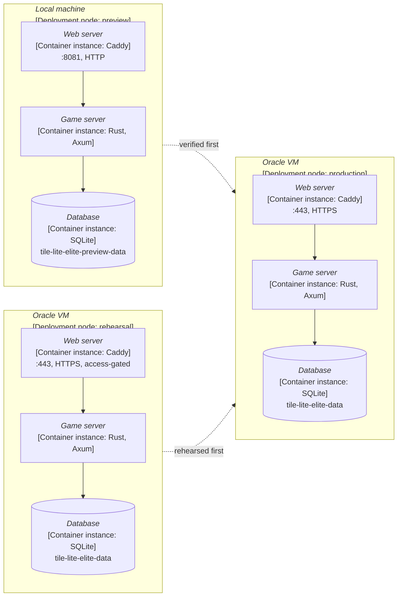

# Architecture

## System overview

A server and two clients, which call its API.

The server is Axum on port 3000. The web client is a Wasm build that runs in
the browser, with a development server on port 8080; the desktop client is a
native window. The server owns all game state, rule enforcement, scoring and
persistence; the clients present it. The components are drawn in
[4.2.0](4.2.0-design-map.md), the main interactions in
[4.1.2](4.1.2-components-and-interactions.md); what runs in each environment is
[4.4.1](4.4.1-configuration.md#environments).

**Deployment view**
([which view a diagram takes](diagrams/README.md#which-view-a-diagram-takes-and-saying-so))
— which container instances run on which deployment node, in each environment.

One Docker image, built from a fresh worktree at the target commit, reaches all
three environments, and they differ only in configuration
(`docker-compose.preview.yml` against `docker-compose.yml`) and where they run.
`scripts/deliver/deploy-preview.sh` loads it into the preview, and
`deploy-rehearsal.sh` and `deploy.sh` copy it to the two VMs. The commands are
[4.3.3](4.3.3-testing-ci-and-release.md) and
[4.3.4](4.3.4-production-environment.md).

## Guiding principles

**The server is authoritative.** Game state, scoring, move validation, turn
order, endgame and word validity are decided by the server. The same rules
code is compiled into the clients so they can preview a move's legality and
score before it is submitted; the server revalidates every move. How the
copies are compiled is in
[4.1.2](4.1.2-components-and-interactions.md#components-and-the-rules-copies).

**Rules and engine are separate.** Board state, racks and word-list lookups are
the *rules layer* (`rules-shared`); move history belongs to the server. Search,
heuristics and move selection are the *engine layer* (`engine-core`), which
depends only on the rules layer
([4.2.1](4.2.1-rules-engine.md#boundary-with-the-engine)).

**Free to host.** Simple deployment, low operational overhead and services that
are free or nearly free: a single server, SQLite and lightweight clients
([4.1.3](4.1.3-technology-decisions.md)).

## Main roles

**The game's creator** ([4.2.7](4.2.7-authentication-and-invitations.md)):

- creates a game and chooses its
  [edition](4.2.1-rules-engine.md#structure) and move time limit;
- fills each seat with a player, an open or emailed invitation, or an engine;
- manages the roster before the start, and starts the game;
- may abort the game or force-resign an unresponsive player.

**A participant**:

- places tiles, passes, exchanges or resigns;
- chats;
- sees the game's current state and history, and can reconnect to a game in
  progress.

## Clients

| Client | State |
| --- | --- |
| web | built: the Wasm build of `crates/ui`, served by Caddy |
| desktop | built: the native build of the same crate |
| mobile | not built; the argument for it is in #423 |

## Engines

Engines run in the server's process. The game's creator gives a seat to an
engine when filling it; the server then asks the engine for each move and
applies it through the same validation as a player's
([4.2.3](4.2.3-engine-interface.md)). The Greedy engine is the one registered.

## Crates

| Crate | Holds |
| --- | --- |
| `rules-shared` | the rules: board, validation, scoring, move generation and the word lists |
| `engine-core` | the engine trait and the Greedy engine |
| `server-game` | the server: game lifecycle, turns, persistence, accounts, the API |
| `api` | the request and response types shared by the server and the clients |
| `ui` | the web and desktop clients (package `tile-lite-elite-ui`) |
| `admin-cli` | the operator's command-line tool |
| `wordlist-tools` | importing and generating word lists |
| `old-crates/first-try` | the command-line prototype, kept in the workspace |

## Persistence

The server keeps canonical game state in one SQLite database per environment,
with `-wal` and `-shm` sidecar files in normal operation. Games, moves,
accounts and ratings are persisted; clients' state and engine search state are
not ([4.2.4](4.2.4-persistence.md)).
