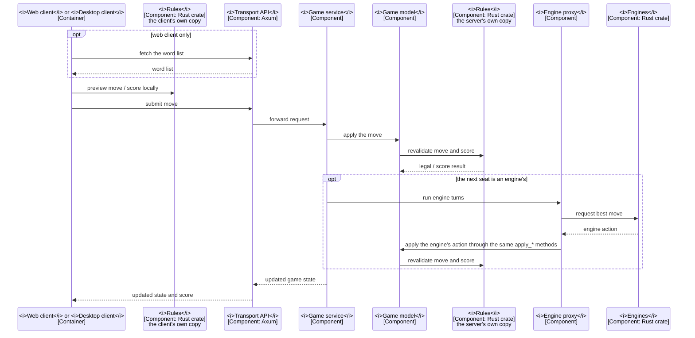

# Components and interactions

The main interaction flow, and where the components and rules copies are drawn.

## Components and the rules copies

The game server's components are drawn in [4.2.0](4.2.0-design-map.md),
generated from the design map's model.

The crate `rules-shared` is compiled separately into each client and into the
server, so each has its own copy and the copies share no running state, and a
rules change reaches every side only when each is rebuilt:

- the client's copy previews legality and score;
- the server's copy decides legality and score, and the engine proxy uses it,
  being part of the same process.

The word lists are embedded in the server and the desktop client, and the web
client fetches its list before it can preview
([4.3.5](4.3.5-word-lists-and-dictionaries.md#stage-6-using-the-lists-at-run-time)).

## Playing a move

**Dynamic view**
([which view a diagram takes](diagrams/README.md#which-view-a-diagram-takes-and-saying-so))
— how a move is submitted and what answers it. The participants carry the
element names of [4.2.0](4.2.0-design-map.md).

`P->>RC` is an in-process call on the player's own device. `P->>S` and
`S-->>P` are network calls; `M->>RS` is an in-process call on the server.

## Interaction notes

- Engines take rules data as input, and engine search state belongs to the
  engine ([4.1.1](4.1.1-architecture.md#guiding-principles)).
- Clients also take the alphabet, letter values and
  [edition](4.2.1-rules-engine.md#structure) names from the rules.
- Engine-vs-engine games take the same proxy path as human-vs-engine games.
- The engine proxy is in-process code within `server-game`. `G->>X` is
  `run_engine_turns`, which calls `maybe_run_engine_turn`: a function call, with
  no OS-process or IPC boundary. The engine's action goes through the same
  `apply_*` methods as a client's HTTP action
  ([4.1.3](4.1.3-technology-decisions.md#the-stack)).
