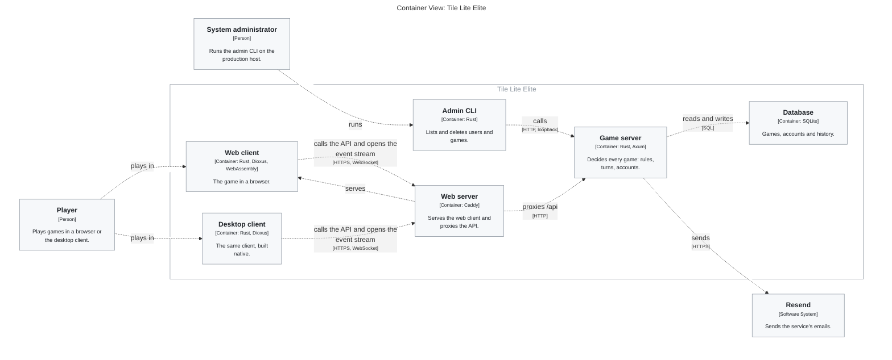
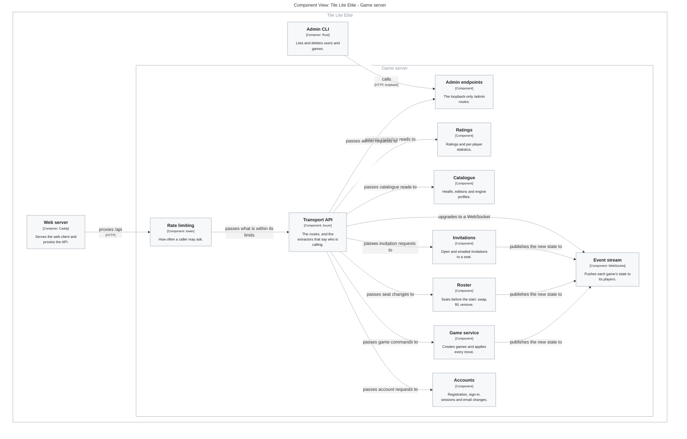
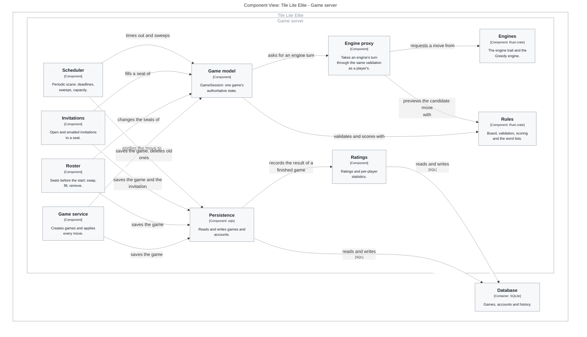
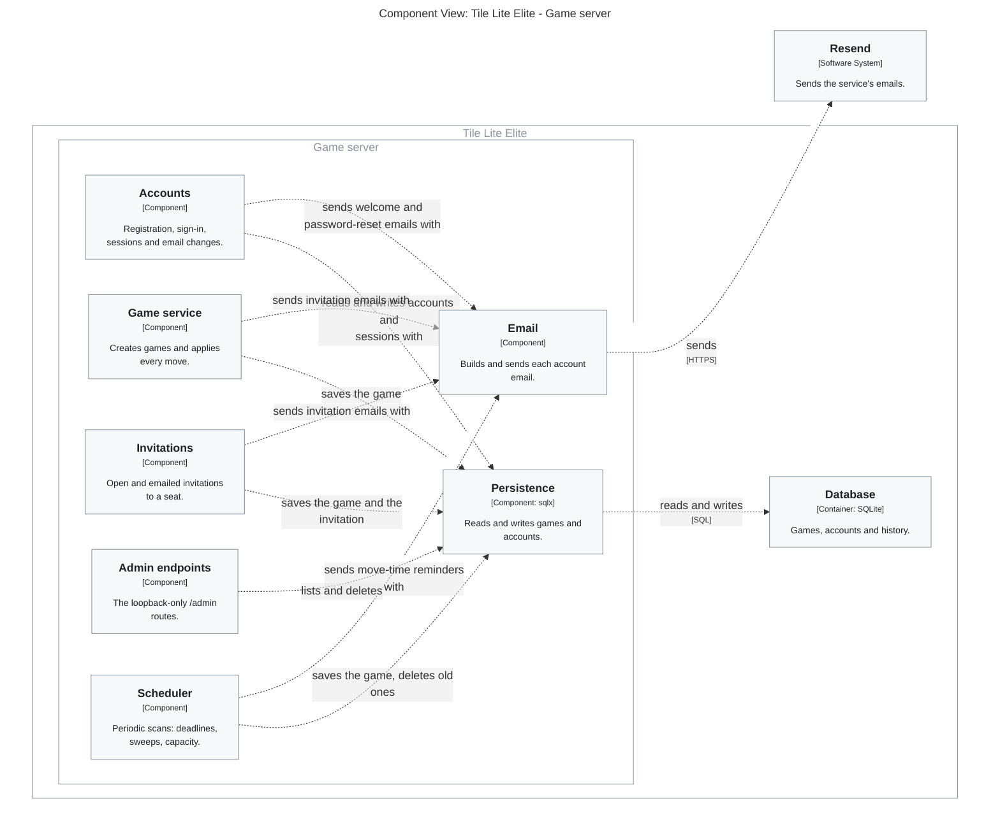

# 4.2.0 Design map

**Generated by `scripts/design-map.py` from [`design-map/`](design-map/). Do not edit.**

The application as it is on `main`, drawn from one model. To change a
diagram, change [`model.dsl`](design-map/model.dsl) and run the script. Each
element's `artefact` property in `model.dsl` names the file or crate that
implements it.

## Container view: the deployable parts and how they talk

## Component view: the game server, taking a request

## Component view: the game server, changing a game

## Component view: the game server, accounts and email

