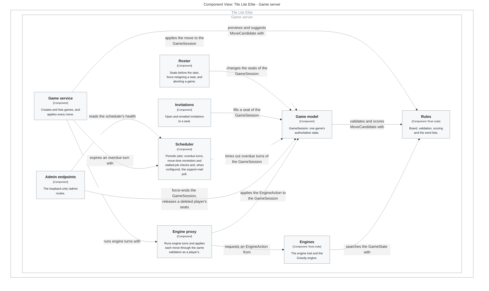
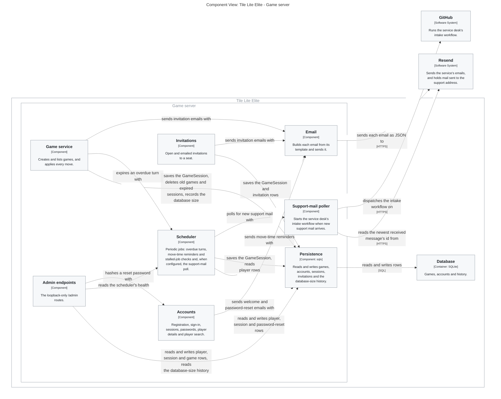

# 4.2.0 Design map

**Generated by the programme's `scripts/docs/design-map/design-map.py` from
[`design-map/`](design-map/). Do not edit.**

The application as it is on `main`, drawn from one model. To change a
diagram, change [`model.dsl`](design-map/model.dsl) and run the script with
`--write`. Each element's `artefact` property in `model.dsl` names the file or
crate that implements it.

Sources hash: `40972ee1dd74ea2a101b794a146682555df8da8fbe18e30aa7091871a357fe4d`.

## Container view: the deployable parts and how they talk

```mermaid
graph TB
  linkStyle default fill:#ffffff

  subgraph diagram ["Container View: Tile Lite Elite"]
    style diagram fill:#ffffff,stroke:#ffffff

    1["<div style='font-weight: bold'>Player</div><div style='font-size: 70%; margin-top: 0px'>[Person]</div><div style='font-size: 80%; margin-top:10px'>Plays games in a browser or<br />the desktop client.</div>"]
    style 1 fill:#f6f8fa,stroke:#8c959f,color:#1f2328
    2["<div style='font-weight: bold'>System administrator</div><div style='font-size: 70%; margin-top: 0px'>[Person]</div><div style='font-size: 80%; margin-top:10px'>Runs the admin CLI on the<br />production host.</div>"]
    style 2 fill:#f6f8fa,stroke:#8c959f,color:#1f2328
    3["<div style='font-weight: bold'>Resend</div><div style='font-size: 70%; margin-top: 0px'>[Software System]</div><div style='font-size: 80%; margin-top:10px'>Sends the service's emails,<br />and holds mail sent to the<br />support address.</div>"]
    style 3 fill:#f6f8fa,stroke:#8c959f,color:#1f2328
    4["<div style='font-weight: bold'>GitHub</div><div style='font-size: 70%; margin-top: 0px'>[Software System]</div><div style='font-size: 80%; margin-top:10px'>Runs the service desk's<br />intake workflow.</div>"]
    style 4 fill:#f6f8fa,stroke:#8c959f,color:#1f2328

    subgraph 5 ["Tile Lite Elite"]
      style 5 fill:#ffffff,stroke:#8c959f,color:#8c959f

      10["<div style='font-weight: bold'>Game server</div><div style='font-size: 70%; margin-top: 0px'>[Container: Rust, Axum]</div><div style='font-size: 80%; margin-top:10px'>Decides every game: rules,<br />turns, accounts.</div>"]
      style 10 fill:#f6f8fa,stroke:#8c959f,color:#1f2328
      29["<div style='font-weight: bold'>Database</div><div style='font-size: 70%; margin-top: 0px'>[Container: SQLite]</div><div style='font-size: 80%; margin-top:10px'>Games, accounts and history.</div>"]
      style 29 fill:#f6f8fa,stroke:#8c959f,color:#1f2328
      6["<div style='font-weight: bold'>Web client</div><div style='font-size: 70%; margin-top: 0px'>[Container: Rust, Dioxus, WebAssembly]</div><div style='font-size: 80%; margin-top:10px'>The game in a browser.</div>"]
      style 6 fill:#f6f8fa,stroke:#8c959f,color:#1f2328
      7["<div style='font-weight: bold'>Desktop client</div><div style='font-size: 70%; margin-top: 0px'>[Container: Rust, Dioxus]</div><div style='font-size: 80%; margin-top:10px'>The same client, built<br />native.</div>"]
      style 7 fill:#f6f8fa,stroke:#8c959f,color:#1f2328
      8["<div style='font-weight: bold'>Web server</div><div style='font-size: 70%; margin-top: 0px'>[Container: Caddy]</div><div style='font-size: 80%; margin-top:10px'>Serves version.txt and the<br />web client files.<br />Reverse-proxies the API paths<br />its Caddyfile lists. On<br />rehearsal, refuses a browser<br />without the access cookie.</div>"]
      style 8 fill:#f6f8fa,stroke:#8c959f,color:#1f2328
      9["<div style='font-weight: bold'>Admin CLI</div><div style='font-size: 70%; margin-top: 0px'>[Container: Rust]</div><div style='font-size: 80%; margin-top:10px'>Administers accounts and<br />games, and reads the database<br />size and scheduler health.</div>"]
      style 9 fill:#f6f8fa,stroke:#8c959f,color:#1f2328
    end

    1-. "<div>plays in</div><div style='font-size: 70%'></div>" .->6
    1-. "<div>plays in</div><div style='font-size: 70%'></div>" .->7
    2-. "<div>runs</div><div style='font-size: 70%'></div>" .->9
    8-. "<div>serves the wasm bundle</div><div style='font-size: 70%'></div>" .->6
    6-. "<div>sends requests, receives<br />GameEventDto, polls<br />version.txt for a new bundle</div><div style='font-size: 70%'>[HTTPS, WebSocket]</div>" .->8
    7-. "<div>sends requests, receives<br />GameEventDto</div><div style='font-size: 70%'>[HTTPS, WebSocket]</div>" .->8
    8-. "<div>reverse-proxies the API paths<br />its Caddyfile lists, but<br />/health</div><div style='font-size: 70%'>[HTTP]</div>" .->10
    9-. "<div>sends admin requests</div><div style='font-size: 70%'>[HTTP, loopback]</div>" .->10
    10-. "<div>sends each email as JSON to,<br />and reads the newest support<br />message's id from</div><div style='font-size: 70%'>[HTTPS]</div>" .->3
    10-. "<div>reads and writes rows</div><div style='font-size: 70%'>[SQL]</div>" .->29
    10-. "<div>dispatches the intake<br />workflow on</div><div style='font-size: 70%'>[HTTPS]</div>" .->4

  end
```

## Component view: the game server, taking a request

```mermaid
graph TB
  linkStyle default fill:#ffffff

  subgraph diagram ["Component View: Tile Lite Elite - Game server"]
    style diagram fill:#ffffff,stroke:#ffffff

    subgraph 5 ["Tile Lite Elite"]
      style 5 fill:#ffffff,stroke:#8c959f,color:#8c959f

      subgraph 10 ["Game server"]
        style 10 fill:#ffffff,stroke:#8c959f,color:#8c959f

        11["<div style='font-weight: bold'>Transport API</div><div style='font-size: 70%; margin-top: 0px'>[Component: Axum]</div><div style='font-size: 80%; margin-top:10px'>The routes, the functions<br />that say who is calling, and<br />the error responses.</div>"]
        style 11 fill:#f6f8fa,stroke:#8c959f,color:#1f2328
        12["<div style='font-weight: bold'>Rate limiting</div><div style='font-size: 70%; margin-top: 0px'>[Component: tower_governor]</div><div style='font-size: 80%; margin-top:10px'>How often a caller may ask,<br />on every public route but<br />/health.</div>"]
        style 12 fill:#f6f8fa,stroke:#8c959f,color:#1f2328
        13["<div style='font-weight: bold'>Accounts</div><div style='font-size: 70%; margin-top: 0px'>[Component]</div><div style='font-size: 80%; margin-top:10px'>Registration, sign-in,<br />sessions, passwords, player<br />details and player search.</div>"]
        style 13 fill:#f6f8fa,stroke:#8c959f,color:#1f2328
        14["<div style='font-weight: bold'>Game service</div><div style='font-size: 70%; margin-top: 0px'>[Component]</div><div style='font-size: 80%; margin-top:10px'>Creates and lists games, and<br />applies every move.</div>"]
        style 14 fill:#f6f8fa,stroke:#8c959f,color:#1f2328
        15["<div style='font-weight: bold'>Roster</div><div style='font-size: 70%; margin-top: 0px'>[Component]</div><div style='font-size: 80%; margin-top:10px'>Seats before the start,<br />force-resigning a seat, and<br />aborting a game.</div>"]
        style 15 fill:#f6f8fa,stroke:#8c959f,color:#1f2328
        16["<div style='font-weight: bold'>Invitations</div><div style='font-size: 70%; margin-top: 0px'>[Component]</div><div style='font-size: 80%; margin-top:10px'>Open and emailed invitations<br />to a seat.</div>"]
        style 16 fill:#f6f8fa,stroke:#8c959f,color:#1f2328
        17["<div style='font-weight: bold'>Event stream</div><div style='font-size: 70%; margin-top: 0px'>[Component: WebSocket]</div><div style='font-size: 80%; margin-top:10px'>Pushes each game's state to<br />its players.</div>"]
        style 17 fill:#f6f8fa,stroke:#8c959f,color:#1f2328
        18["<div style='font-weight: bold'>Catalogue</div><div style='font-size: 70%; margin-top: 0px'>[Component]</div><div style='font-size: 80%; margin-top:10px'>Health, engine profiles and<br />the word lists.</div>"]
        style 18 fill:#f6f8fa,stroke:#8c959f,color:#1f2328
        19["<div style='font-weight: bold'>Ratings</div><div style='font-size: 70%; margin-top: 0px'>[Component]</div><div style='font-size: 80%; margin-top:10px'>Ratings, statistics and<br />rating history, for players<br />and engines.</div>"]
        style 19 fill:#f6f8fa,stroke:#8c959f,color:#1f2328
        20["<div style='font-weight: bold'>Admin endpoints</div><div style='font-size: 70%; margin-top: 0px'>[Component]</div><div style='font-size: 80%; margin-top:10px'>The loopback-only /admin<br />routes.</div>"]
        style 20 fill:#f6f8fa,stroke:#8c959f,color:#1f2328
        21["<div style='font-weight: bold'>Scheduler</div><div style='font-size: 70%; margin-top: 0px'>[Component]</div><div style='font-size: 80%; margin-top:10px'>Periodic jobs: overdue turns,<br />move-time reminders and<br />stalled-job checks and, when<br />configured, the support-mail<br />poll.</div>"]
        style 21 fill:#f6f8fa,stroke:#8c959f,color:#1f2328
      end

      8["<div style='font-weight: bold'>Web server</div><div style='font-size: 70%; margin-top: 0px'>[Container: Caddy]</div><div style='font-size: 80%; margin-top:10px'>Serves version.txt and the<br />web client files.<br />Reverse-proxies the API paths<br />its Caddyfile lists. On<br />rehearsal, refuses a browser<br />without the access cookie.</div>"]
      style 8 fill:#f6f8fa,stroke:#8c959f,color:#1f2328
      9["<div style='font-weight: bold'>Admin CLI</div><div style='font-size: 70%; margin-top: 0px'>[Container: Rust]</div><div style='font-size: 80%; margin-top:10px'>Administers accounts and<br />games, and reads the database<br />size and scheduler health.</div>"]
      style 9 fill:#f6f8fa,stroke:#8c959f,color:#1f2328
    end

    8-. "<div>reverse-proxies the API paths<br />its Caddyfile lists, but<br />/health</div><div style='font-size: 70%'>[HTTP]</div>" .->12
    8-. "<div>reverse-proxies /health</div><div style='font-size: 70%'>[HTTP]</div>" .->18
    9-. "<div>sends admin requests</div><div style='font-size: 70%'>[HTTP, loopback]</div>" .->20
    12-. "<div>passes requests within their<br />limits</div><div style='font-size: 70%'></div>" .->11
    11-. "<div>routes account requests</div><div style='font-size: 70%'></div>" .->13
    11-. "<div>routes GameActionRequest and<br />game requests</div><div style='font-size: 70%'></div>" .->14
    11-. "<div>routes seat requests</div><div style='font-size: 70%'></div>" .->15
    11-. "<div>routes invitation requests</div><div style='font-size: 70%'></div>" .->16
    11-. "<div>upgrades to a WebSocket</div><div style='font-size: 70%'></div>" .->17
    11-. "<div>routes catalogue reads</div><div style='font-size: 70%'></div>" .->18
    11-. "<div>routes statistics reads</div><div style='font-size: 70%'></div>" .->19
    14-. "<div>publishes GameEventDto to</div><div style='font-size: 70%'></div>" .->17
    15-. "<div>publishes GameEventDto to</div><div style='font-size: 70%'></div>" .->17
    16-. "<div>publishes GameEventDto to</div><div style='font-size: 70%'></div>" .->17
    21-. "<div>publishes GameEventDto to</div><div style='font-size: 70%'></div>" .->17
    20-. "<div>publishes GameEventDto to</div><div style='font-size: 70%'></div>" .->17
    20-. "<div>reads the scheduler's health</div><div style='font-size: 70%'></div>" .->21
    14-. "<div>attaches ratings to the<br />GameStateDto</div><div style='font-size: 70%'></div>" .->19
    15-. "<div>attaches ratings to the<br />GameStateDto</div><div style='font-size: 70%'></div>" .->19
    20-. "<div>attaches ratings to the<br />GameStateDto</div><div style='font-size: 70%'></div>" .->19
    16-. "<div>attaches ratings to the<br />GameStateDto</div><div style='font-size: 70%'></div>" .->19
    21-. "<div>attaches ratings to the<br />GameStateDto</div><div style='font-size: 70%'></div>" .->19
    11-. "<div>marks the session verified</div><div style='font-size: 70%'></div>" .->12
    14-. "<div>expires an overdue turn with</div><div style='font-size: 70%'></div>" .->21
    13-. "<div>forgets a signed-out session</div><div style='font-size: 70%'></div>" .->12
    20-. "<div>hashes a reset password with</div><div style='font-size: 70%'></div>" .->13

  end
```

## Component view: the game server, changing a game

## Component view: the game server, storing games and ratings

```mermaid
graph TB
  linkStyle default fill:#ffffff

  subgraph diagram ["Component View: Tile Lite Elite - Game server"]
    style diagram fill:#ffffff,stroke:#ffffff

    subgraph 5 ["Tile Lite Elite"]
      style 5 fill:#ffffff,stroke:#8c959f,color:#8c959f

      subgraph 10 ["Game server"]
        style 10 fill:#ffffff,stroke:#8c959f,color:#8c959f

        11["<div style='font-weight: bold'>Transport API</div><div style='font-size: 70%; margin-top: 0px'>[Component: Axum]</div><div style='font-size: 80%; margin-top:10px'>The routes, the functions<br />that say who is calling, and<br />the error responses.</div>"]
        style 11 fill:#f6f8fa,stroke:#8c959f,color:#1f2328
        14["<div style='font-weight: bold'>Game service</div><div style='font-size: 70%; margin-top: 0px'>[Component]</div><div style='font-size: 80%; margin-top:10px'>Creates and lists games, and<br />applies every move.</div>"]
        style 14 fill:#f6f8fa,stroke:#8c959f,color:#1f2328
        15["<div style='font-weight: bold'>Roster</div><div style='font-size: 70%; margin-top: 0px'>[Component]</div><div style='font-size: 80%; margin-top:10px'>Seats before the start,<br />force-resigning a seat, and<br />aborting a game.</div>"]
        style 15 fill:#f6f8fa,stroke:#8c959f,color:#1f2328
        16["<div style='font-weight: bold'>Invitations</div><div style='font-size: 70%; margin-top: 0px'>[Component]</div><div style='font-size: 80%; margin-top:10px'>Open and emailed invitations<br />to a seat.</div>"]
        style 16 fill:#f6f8fa,stroke:#8c959f,color:#1f2328
        19["<div style='font-weight: bold'>Ratings</div><div style='font-size: 70%; margin-top: 0px'>[Component]</div><div style='font-size: 80%; margin-top:10px'>Ratings, statistics and<br />rating history, for players<br />and engines.</div>"]
        style 19 fill:#f6f8fa,stroke:#8c959f,color:#1f2328
        20["<div style='font-weight: bold'>Admin endpoints</div><div style='font-size: 70%; margin-top: 0px'>[Component]</div><div style='font-size: 80%; margin-top:10px'>The loopback-only /admin<br />routes.</div>"]
        style 20 fill:#f6f8fa,stroke:#8c959f,color:#1f2328
        21["<div style='font-weight: bold'>Scheduler</div><div style='font-size: 70%; margin-top: 0px'>[Component]</div><div style='font-size: 80%; margin-top:10px'>Periodic jobs: overdue turns,<br />move-time reminders and<br />stalled-job checks and, when<br />configured, the support-mail<br />poll.</div>"]
        style 21 fill:#f6f8fa,stroke:#8c959f,color:#1f2328
        26["<div style='font-weight: bold'>Persistence</div><div style='font-size: 70%; margin-top: 0px'>[Component: sqlx]</div><div style='font-size: 80%; margin-top:10px'>Reads and writes games,<br />accounts, sessions,<br />invitations and the<br />database-size history.</div>"]
        style 26 fill:#f6f8fa,stroke:#8c959f,color:#1f2328
      end

      29["<div style='font-weight: bold'>Database</div><div style='font-size: 70%; margin-top: 0px'>[Container: SQLite]</div><div style='font-size: 80%; margin-top:10px'>Games, accounts and history.</div>"]
      style 29 fill:#f6f8fa,stroke:#8c959f,color:#1f2328
    end

    11-. "<div>routes GameActionRequest and<br />game requests</div><div style='font-size: 70%'></div>" .->14
    11-. "<div>routes seat requests</div><div style='font-size: 70%'></div>" .->15
    11-. "<div>routes invitation requests</div><div style='font-size: 70%'></div>" .->16
    11-. "<div>routes statistics reads</div><div style='font-size: 70%'></div>" .->19
    14-. "<div>saves the GameSession,<br />deletes old games and expired<br />sessions, records the<br />database size</div><div style='font-size: 70%'></div>" .->26
    15-. "<div>saves the GameSession,<br />updates invitation rows</div><div style='font-size: 70%'></div>" .->26
    16-. "<div>saves the GameSession and<br />invitation rows</div><div style='font-size: 70%'></div>" .->26
    21-. "<div>saves the GameSession, reads<br />player rows</div><div style='font-size: 70%'></div>" .->26
    20-. "<div>reads and writes player,<br />session and game rows, reads<br />the database-size history</div><div style='font-size: 70%'></div>" .->26
    20-. "<div>reads the scheduler's health</div><div style='font-size: 70%'></div>" .->21
    26-. "<div>settles the ratings of a<br />finished game</div><div style='font-size: 70%'></div>" .->19
    14-. "<div>attaches ratings to the<br />GameStateDto</div><div style='font-size: 70%'></div>" .->19
    15-. "<div>attaches ratings to the<br />GameStateDto</div><div style='font-size: 70%'></div>" .->19
    20-. "<div>attaches ratings to the<br />GameStateDto</div><div style='font-size: 70%'></div>" .->19
    16-. "<div>attaches ratings to the<br />GameStateDto</div><div style='font-size: 70%'></div>" .->19
    21-. "<div>attaches ratings to the<br />GameStateDto</div><div style='font-size: 70%'></div>" .->19
    11-. "<div>reads the session row,<br />updates last-seen</div><div style='font-size: 70%'></div>" .->26
    14-. "<div>expires an overdue turn with</div><div style='font-size: 70%'></div>" .->21
    26-. "<div>reads and writes rows</div><div style='font-size: 70%'>[SQL]</div>" .->29
    19-. "<div>reads and writes rating rows</div><div style='font-size: 70%'>[SQL]</div>" .->29

  end
```

## Component view: the game server, accounts and email

