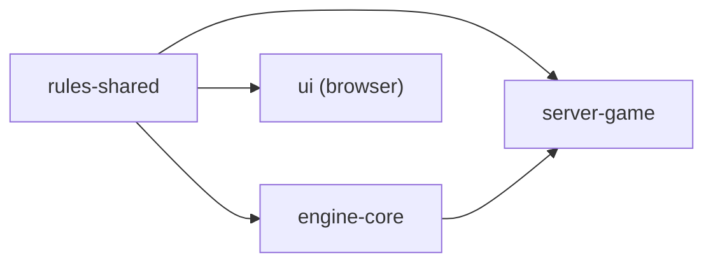

# Rules engine design

The rules engine decides whether a move is legal and what it scores.

It lives in the `rules-shared` crate, which compiles for the server and for
the browser client, so one implementation answers both. Every answer comes from:

- the board and its premiums
- the language's word list, one per edition ([4.1.0](4.1.0-rules.md))
- the variant rules

[4.2.2](4.2.2-rules-engine-implementation.md) has the modules and types.

## Structure

Three layers, each owned by one type:

| Layer | Type | Holds |
| --- | --- | --- |
| rules data | `VariantRules` | premium layout, letter values, tile distribution, blank count, rack size, board size, bingo bonus, alphabet |
| board | `BoardState` | 225 cells, each empty (with its premium) or filled (letter, blank flag) |
| derived cache | `RuleCache` | per cell: a cross-check for each direction and anchor flags; per cell and direction, the two ends of the filled run through it (*line extents*), which the cache maintains and nothing reads |

- `GameState` pairs a `BoardState` with the `RuleCache` derived from it
- `RulesEngine` borrows a `VariantRules` and a `Dictionary` and holds no state
  of its own

An arrow means *is used by*:

| Caller | Uses |
| --- | --- |
| `server-game` | validates, previews and applies a move; its suggest endpoint enumerates moves and plays the highest score for the human seat, or passes if there is none |
| `engine-core` | enumerates legal moves, then validates each to read its score |
| `ui` | validates and scores a move for the live preview |

## Boundary with the engine

**The rules layer decides what is legal and what it scores. The engine layer
chooses.**

| Question | Owner |
| --- | --- |
| is this placement legal | rules |
| what does it score | rules |
| which placements are legal | rules |
| which legal move to play | engine (`engine-core`) |

Ranking, search and greylisted-word avoidance sit in `engine-core`
([4.2.3](4.2.3-engine-interface.md#the-engines)). The exception is the suggest
endpoint in `server-game`: it ranks by score alone, with no greylist.

## Cross-checks

A *cross-check* answers, for an empty cell and a direction of play: which
letters may go here, given the word the tile would form across the line of play?

Each empty cell holds one cross-check per direction: `CachedCell.horizontal`
serves a tile in a horizontal main word and reads the vertical neighbours;
`CachedCell.vertical` serves a vertical main word and reads the horizontal ones.

| Case | Cross-check holds |
| --- | --- |
| no filled cell beside it across the line | `Unconstrained`: no cross word forms, so no restriction and no cross score |
| a filled run beside it | `Constrained`, with the fields below |

| `Constrained` field | Holds |
| --- | --- |
| `allowed_mask` | a bit for each letter that completes a valid cross word, from one dictionary call ([Dictionary structure](#dictionary-structure)) |
| `score_by_letter[l]` | the cross word's score with letter `l` on the cell: surrounding tiles plus `l` times the cell's letter multiplier, all times the cell's word multiplier; blanks in the run count nothing |
| `blank_score` | the same when the placed tile is a blank: surrounding tiles times the word multiplier, one value for every letter |

A full `allowed_mask` still scores a cross word; `Unconstrained` does not.
Scoring relies on the difference.

**A blank is checked as the letter it stands for and scored as zero.** Scoring
it by its letter once gave a real game 37 for a move worth 25, because the
cell's word multiplier tripled points that were never on the board.

## Anchors

An *anchor* is an empty cell next to a filled one (the centre on an empty
board); every move covers at least one.

| Board | Anchor |
| --- | --- |
| empty | the centre square only |
| any tile placed | an empty cell with a filled cell above, below, left or right |

The horizontal and vertical flags are always equal; each is stored so a
direction can be asked separately.

## Move validation

`validate_move` returns a `ValidatedMove`: the candidate, a `MovePreview` and a
`MoveScore`. It runs these checks in order and stops at the first that fails.

| # | Check | Error |
| --- | --- | --- |
| 1 | every letter is in the alphabet; no two tiles sit at the same distance from the start; at least one tile | `InvalidMove` |
| 2 | no more tiles than the rack size | `TilesDoNotFit` |
| 3 | where a rack is supplied, it holds the tiles | `TilesDoNotFit` |
| 4 | every tile lands on an empty square on the board | `InvalidPosition` |
| 5 | at least one tile lies on an anchor | `TilesDoNotConnect` |
| 6 | an opening play places two tiles or more | `OpeningMoveTooShort` |
| 7 | every square between the first and last tile is filled or played | `InvalidMove` |
| 8 | each tile's letter passes its cell's cross-check; the main word is in the dictionary | `InvalidWord`, collecting every failing word; a blank with no letter assigned fails here with `InvalidMove` |

The cross-check cache answers the cross words in check 8; only the main word
goes to `Dictionary::is_word`. `preview_move` runs the same path and returns
`legal: false` and the error.

## Scoring

Scoring runs inside check 8, from the same cache.

| Part | Rule |
| --- | --- |
| main word | filled tiles at face value; new tiles at face value times the cell's letter multiplier; blanks count nothing |
| word multipliers | the product of those on the squares the move covers, applied to the main word |
| cross words | one per placed tile on a constrained cell, taken from the cache by letter, or `blank_score` for a blank |
| bingo | `bingo_bonus` when the tiles placed equal the rack size |
| total | main word + cross words + bingo |

## Move enumeration

`enumerate_legal_moves` returns moves for a rack; the engine ranks them.
**It returns a subset of the legal moves**, so neither the bot nor the suggest
endpoint plays a move with tiles before its anchor.

- generated: a move whose first placed tile is on an anchor; on an empty board
  that is the centre
- not generated: a move with tiles before the anchor. With AT on the board,
  `validate_move` accepts BOAT played from two cells before the A, and
  enumeration returns OAT but not BOAT

1. for each empty cell that is an anchor in a direction, walk a *lane* (the
   cells from there along the direction of play)
2. seed a dictionary [cursor](#dictionary-structure) with the filled cells
   immediately before the anchor, so the cursor tracks the whole word
3. at an empty cell, try each rack letter (and each blank as each letter) that
   the cell's cross-check allows and the cursor can continue with
4. at a filled cell, advance the cursor by its letter
5. at every step with tiles placed, emit the candidate if `validate_move`
   accepts it, once per distinct candidate

The cross-check mask and the cursor prune a branch before it recurses;
`validate_move` makes the final decision. Enumeration reads only whether a cell
allows a letter.

## Cache update

The cache is built whole when a `GameState` is created from a board
(`recompute_all`, which needs the rules and the dictionary) and updated by
`apply_move`. `apply_move` trusts its `ValidatedMove`: the caller validates
first and updates the rack.

| Step | Work | Bound |
| --- | --- | --- |
| 1 | write the tiles to the board | the tiles placed |
| 2 | recompute the extents of every cell | a board walk |
| 3 | recompute the anchor flags of every cell | a board walk |
| 4 | recompute the cross-checks that can have changed, one `allowed_letters` call each | at most 2 + 2*n* for *n* tiles: a placed tile changes only the first empty cell beyond each end of the run through it, along each axis, and only the cross-check that run feeds; at most 16 for a full rack, where a sweep recomputes both directions of every empty cell |

Steps 2 and 3 sweep the whole board because a walk is cheap and has no
dictionary work.

## Dictionary structure

`Dictionary` has three questions:

| Method | Answers |
| --- | --- |
| `is_word` | is this string a word |
| `root_cursor` | a *cursor* that narrows one letter at a time; `advance` returns `None` the moment nothing can continue, the signal to prune |
| `allowed_letters` | which letters fit one square, given the letters fixed either side |

There are two implementations:

| Implementation | Used for |
| --- | --- |
| `TieredDictionary` (`tiered.rs`) | production: the `SOWPODS`, `ENABLE2K`, `GERMAN` and `SPANISH` statics; the browser builds its own from the fetched list |
| `WordListDictionary` | the reference the differential tests check `TieredDictionary` against, at every depth on a sample of about 4,000 words from each of the four lists |

[4.3.5](4.3.5-word-lists-and-dictionaries.md) owns the lists themselves.

`TieredDictionary` has three layers, each answering a different part of a walk:

| Layer | Holds | Search |
| --- | --- | --- |
| arena | every word as a run of `Letter` bytes in one allocation, with an offset table, ordered by letter index (Spanish files Ñ between N and O) | an indexed read for letter *d* of word *i* |
| dense table | one slot per pair of first two letters | arithmetic: first letter × alphabet size + second letter |
| sparse index | only the prefixes that exist, while the words sharing a prefix exceed `MAX_LEAF_WORDS` (64) | a scan of the node's letter bytes |

- the first tier is the two-letter table: words shorter than two characters
  are dropped at construction, so nothing asks about a one-character prefix
- a group of at most `MAX_LEAF_WORDS` words is a leaf, searched in the arena:
  scanned up to `MAX_SCAN_WORDS` (32) words, bisected above
- an edge is one byte of letter and one packed `u32` child, so a leaf needs no
  side arrays ([4.2.2](4.2.2-rules-engine-implementation.md) has the bits)
- a digraph tile (Spanish CH) expands to its characters at construction, so
  both tilings of a word reach the same entry

`allowed_letters(before, after, alphabet)` takes the letters fixed either side
of a square and returns the mask of letters that fit. Every candidate for a
square shares one prefix and one suffix, so a dictionary with a prefix structure
walks the shared prefix once and then, per letter, takes one step and walks the
suffix. The trait default builds each candidate word and calls `is_word`, so it
is correct for every implementation; `TieredDictionary` overrides it and
allocates nothing. One call per square, not per letter: only constrained squares
call it, once each. The measured gain, and the cost and memory of each list, are
in [4.2.8](4.2.8-engine-performance.md#dictionary-and-cross-check-costs).
`crates/rules-shared/examples/sparse_budget.rs`,
`dictionary_variants_bench.rs` and `trace_word.rs` record the layout decisions.

## Design notes on the rules engine

- **A trie, DAWG (directed acyclic word graph) or GADDAG (a trie of reversed
  prefixes) for the dictionary.** Rejected on estimate, not measured: a dense
  26-way trie needs about 800,000 nodes for SOWPODS, about 86 MB, and its
  pointer chasing is expected to lose to contiguous arrays on a memory-bound
  workload.
- **Cross-check data in the board cell.** The board cell holds only its premium
  or its tile; derived legality data lives in the cache, which can be rebuilt
  from the board, the rules and the dictionary.
