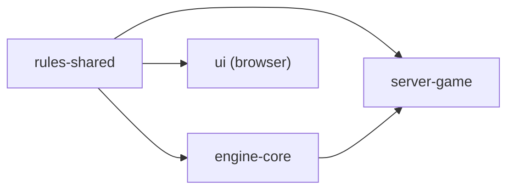

# Rules engine design

The rules engine decides whether a move is legal and what it scores.

It lives in the `rules-shared` crate, which compiles for the server and for
the browser client, so one implementation answers both. Every answer comes from
the board, the premiums, the language's word list and the variant rules.
[4.2.2](4.2.2-rules-engine-implementation.md) has the modules and types; the
game rules are [4.1.0](4.1.0-rules.md).

## Structure

Three layers, each owned by one type:

| Layer | Type | Holds |
| --- | --- | --- |
| rules data | `VariantRules` | premium layout, letter values, tile distribution, blank count, rack size, board size, bingo bonus, alphabet |
| board | `BoardState` | 225 cells, each empty (with its premium) or filled (letter, blank flag) |
| derived cache | `RuleCache` | per cell: a cross-check for each direction, anchor flags and line extents |

- `GameState` pairs a `BoardState` with the `RuleCache` derived from it.
- `RulesEngine` borrows a `VariantRules` and a `Dictionary` and holds no state
  of its own.
- The board cell carries no legality data, so the cache can be rebuilt from the
  board alone.

| Caller | Uses |
| --- | --- |
| `server-game` | validates a move, then applies it to the game's state |
| `engine-core` | enumerates legal moves, then validates each to read its score |
| `ui` | validates and scores a move for the live preview |

## Boundary with the engine

**The rules layer decides what is legal and what it scores. The engine layer
chooses.**

| Question | Owner |
| --- | --- |
| is this placement legal | rules |
| what does it score | rules |
| which placements are legal | rules |
| which legal move to play | engine (`engine-core`) |

Ranking, search and word avoidance sit in `engine-core`
([4.2.3](4.2.3-engine-interface.md#the-engines)).

## Cross-checks

A cross-check answers, for an empty cell and a direction of play: which letters
may go here, given the word the tile would form across the line of play?

`CachedCell.horizontal` serves a tile placed in a horizontal main word and is
read from the vertical neighbours; `vertical` is the mirror.

| Case | Cross-check holds |
| --- | --- |
| no filled cell beside it across the line | `Unconstrained`: no cross word forms, so no restriction and no cross score |
| a filled run beside it | `Constrained`: `allowed_mask`, `score_by_letter` and `blank_score` |

For a constrained cell:

- `allowed_mask` has a bit for each letter that completes a valid cross word.
  The dictionary computes it in one call
  ([below](#cross-checks-as-a-batch-question)).
- `score_by_letter[l]` is the cross word's score with letter `l` placed on the
  cell: surrounding tiles plus `l` times the cell's letter multiplier, all times
  the cell's word multiplier. Blank tiles in the run count nothing.
- `blank_score` is the same score when the placed tile is a blank: the
  surrounding tiles times the word multiplier. One value serves every letter
  because a blank is worth nothing.

`Unconstrained` and a full mask are different answers. A full mask still scores
a cross word; `Unconstrained` scores none. Scoring, the live preview and move
enumeration all need the difference.

**A blank is checked as the letter it stands for and scored as zero.** Scoring
it by its letter once gave a real game 37 for a move worth 25, because the
cell's word multiplier tripled points that were never on the board.

## Anchors

An anchor is an empty cell where a move may place a tile.

| Board | Anchor |
| --- | --- |
| empty | the centre square only |
| any tile placed | an empty cell with a filled cell above, below, left or right |

The horizontal and vertical flags are always equal; each is stored so a
direction can be asked separately.

## Line extents

`LineExtents` holds, for each cell and each of the four directions, the
coordinate where the filled run through that cell ends. The cache maintains
them; validation and enumeration read only the cross-checks and anchor flags.

## Move validation

`validate_move` returns a `ValidatedMove`: the candidate, a `MovePreview` and a
`MoveScore`. It runs these checks in order and stops at the first that fails
(except the last).

| # | Check | Error |
| --- | --- | --- |
| 1 | every letter is in the alphabet; no two tiles share an offset; at least one tile | `InvalidMove` |
| 2 | no more tiles than the rack size | `TilesDoNotFit` |
| 3 | where a rack is supplied, it holds the tiles | `TilesDoNotFit` |
| 4 | every tile lands on an empty square on the board | `InvalidPosition` |
| 5 | one tile lies on an anchor for the move's direction | `TilesDoNotConnect` |
| 6 | an opening play places two tiles or more | `OpeningMoveTooShort` |
| 7 | every square between the first and last tile is filled or played | `InvalidMove` |
| 8 | each tile's letter passes its cell's cross-check; the main word is in the dictionary | `InvalidWord`, naming every failing word |

The cross-check cache answers the cross words in check 8; only the main word
goes to `Dictionary::is_word`. `preview_move` runs the same path and returns
`legal: false` with the error instead of failing.

## Scoring

Scoring runs inside check 8, from the same cache.

| Part | Rule |
| --- | --- |
| main word | filled tiles at face value; new tiles at face value times the cell's letter multiplier; blanks count nothing |
| word multipliers | the product of those on the squares the move covers, applied to the main word |
| cross words | one per placed tile on a constrained cell, taken from the cache by letter, or `blank_score` for a blank |
| bingo | `bingo_bonus` when the tiles placed equal the rack size |
| total | main word + cross words + bingo |

## Move enumeration

`enumerate_legal_moves` returns the legal moves for a rack; the engine ranks
them.

1. For each empty cell that is an anchor in a direction, walk a lane forward
   from it.
2. Seed the dictionary cursor with the filled cells immediately before the
   anchor, so the cursor tracks the whole word.
3. At an empty cell, try each rack letter (and each blank as each letter) that
   the cell's cross-check allows and the cursor can continue with.
4. At a filled cell, advance the cursor by its letter.
5. At every step with tiles placed, emit the candidate if `validate_move`
   accepts it, once per distinct candidate.

The cross-check mask and the cursor prune a branch before it recurses;
`validate_move` makes the final decision. The first tile of every move
generated is on an anchor.

## Cache update

The cache is built whole when a `GameState` is created from a board
(`recompute_all`) and updated by `apply_move`. `apply_move` trusts its
`ValidatedMove`: it does not recheck legality or touch the rack.

1. Write the tiles to the board.
2. Recompute the extents of every cell.
3. Recompute the anchor flags of every cell.
4. Recompute the cross-checks of only the cells that can have changed.

Steps 2 and 3 are board walks with no dictionary work, and the first move
changes every anchor flag. Step 4 is the dictionary work, one question per
alphabet letter per constrained cell, so it is bounded by the tiles placed.

A cross-check depends only on the unbroken run of filled cells across its line
of play. A placed tile therefore changes only the first empty cell beyond each
end of the run through it, along each axis, and only the one cross-check that
the run feeds. A move of *n* tiles recomputes at most 2 + 2*n* cross-checks:
16 for a full rack, where a sweep recomputes both directions of every empty
cell.

## Dictionary structure

`Dictionary` has three questions:

| Method | Answers |
| --- | --- |
| `is_word` | is this string a word |
| `root_cursor` | a cursor that narrows one letter at a time; `advance` returns `None` the moment nothing can continue, the signal to prune |
| `allowed_letters` | which letters fit one square, given the letters fixed either side |

There are two implementations:

| Implementation | Used for |
| --- | --- |
| `TieredDictionary` (`tiered.rs`) | production: the `SOWPODS`, `ENABLE2K`, `GERMAN` and `SPANISH` statics; the browser builds its own from the fetched list |
| `WordListDictionary` | the reference the differential tests check `TieredDictionary` against, at every depth on all four lists |

A dictionary whose cursor is the never-pruning `()` is correct and slow.
[4.3.5](4.3.5-word-lists-and-dictionaries.md) owns the lists themselves.

`TieredDictionary` has three layers, each answering a different part of a walk:

| Layer | Holds | Search |
| --- | --- | --- |
| arena | every word as a run of `Letter` bytes in one allocation, with an offset table, ordered by letter index (Spanish files Ñ between N and O) | an indexed read for letter *d* of word *i* |
| dense table | one slot per pair of first two letters | arithmetic: `l0 × n + l1` |
| sparse index | only the prefixes that exist, while a group exceeds `MAX_LEAF_WORDS` (64) | a scan of the node's letter bytes |

- There is no one-letter tier: every letter starts some word and a one-letter
  word is illegal, so nothing asks about a one-character prefix.
- A group of at most `MAX_LEAF_WORDS` words is a leaf, searched in the arena:
  scanned up to `MAX_SCAN_WORDS` (32) words, bisected above.
- An edge is one byte of letter and one `PackedChild`, a `u32` holding a kind
  bit, an `is_word` bit and a *(length, start)* pair. Packing the leaf range
  into the pointer removes the side arrays a trie needs.
- A digraph tile (Spanish CH) expands to its characters at construction, so
  both tilings of a word reach the same entry.
- Words shorter than two characters are dropped at construction.

Measured on a laptop against `WordListDictionary`, per cursor advance, the
operation move generation repeats:

| List | Before | After | Resident |
| --- | --- | --- | --- |
| sowpods | 130 ns | 22 ns | 20.4 → 3.5 MB |
| enable2k | 93 ns | 20 ns | 12.7 → 2.1 MB |
| german | 230 ns | 45 ns | 48.2 → 8.4 MB |
| spanish | 215 ns | 40 ns | 50.6 → 8.7 MB |

`crates/rules-shared/examples/sparse_budget.rs`,
`dictionary_variants_bench.rs` and `trace_word.rs` record the layout decisions
and the measurements behind them.

## Cross-checks as a batch question

`Dictionary::allowed_letters(before, after, alphabet)` returns the mask of
letters that could occupy one square, given the letters already fixed either
side of it along the crossing line.

Every candidate for a square shares one prefix and one suffix, so a dictionary
with a prefix structure walks the shared part once and then spends one step per
letter. The trait default builds each candidate word and calls `is_word`, so it
is correct for every implementation. `TieredDictionary` overrides it and
allocates nothing.

Moving from one call per letter to one call per square cut the median bot move
from 0.59 ms to 0.35 ms, more than the dictionary layout did. A synthetic
benchmark had hidden it: its boards had far fewer constrained squares than a
real interlocking game, and the cost falls on constrained squares.

## Design notes on the rules engine

- **A trie, DAWG or GADDAG for the dictionary.** Rejected on measurement: a full
  trie costs about 800k nodes and 4–7 MB for SOWPODS even compressed, and its
  pointer chasing loses to contiguous arrays on a memory-bound workload.
- **Cross-check data in the board cell.** The board cell holds only its premium
  or its tile; derived legality data lives in the cache, which can be rebuilt
  from the board alone.
