# Testing, CI and release

What to type to verify a change and ship it: where each step runs, the
commands and what proves it worked.

The rules these steps serve are in
[1.2](https://github.com/delphside/programme/blob/main/docs/1.2-change-lifecycle.md).
Rolling back, an emergency change, the diagnostic commands and a failing step
are [4.3.6](4.3.6-when-a-release-goes-wrong.md); the mechanisms behind the
steps are [4.3.7](4.3.7-how-testing-and-release-work.md).

## 1 What to type

### Where and who

- the development machine has two worktrees
  ([4.3.2](4.3.2-development.md#two-worktrees)): the `main` tree stays on
  `main` and operates, and `projectdev` builds a branch. Each step runs in one
  of them:

  | Steps | Run in | Because |
  | --- | --- | --- |
  | 1.1 and 1.2, straight to `main` | `main` | no branch exists |
  | 1.1 to 1.5, for a branch | `projectdev` | `deploy-preview.sh` and `deploy-rehearsal.sh` build the `HEAD` of the tree they run in |
  | 1.8 and 1.8.1 | `projectdev` | switching the `main` tree to a release branch would take it off `main` |
  | 1.9 | step 1 in `projectdev`, step 3 in `main` | each tree keeps its job |
  | 1.6 | `main` | production is shipped by `main`'s tooling ([4.3.7 §5.6](4.3.7-how-testing-and-release-work.md#56-where-a-gate-meets-a-limit)) |
  | 1.7 | `main` | `verify.sh` judges the current branch's push run |
  | 1.10 | `main`, after `projectdev` has left the branch | git refuses to delete a branch checked out in a worktree |

  A step that runs in the `main` tree starts with:

  ```bash
  cd ~/tile-lite-elite/main
  ```

- the owner runs every step that changes production; Claude may read it. The
  ssh reads are in
  [4.3.4](4.3.4-production-environment.md#journald-not-the-container).
- Claude runs a step that has no **Who** line.

### The pipeline

A step's number is its heading (`1.2`). A third digit is a sub-heading
(`1.2.4`) or, in the diagram, an arrow inside a step (`1.2.3`) with no heading
of its own.



Scripts are in `scripts/deliver/` unless a row says otherwise.

| Step | Does | Type |
| --- | --- | --- |
| **1.1** | records the change | `cargo test --workspace`, `git commit` |
| **1.2** | pushes, and reads CI's verdict | `git push`, `ci-status.sh --run push:<branch> --wait` |
| **1.2.4** | sets the version for a functional release | `Cargo.toml`, `git commit`, `gh api --method PATCH` on the milestone |
| **1.3** | checks a patch carries no functional change, then deploys to preview | `check-release-version.sh`, `deploy-preview.sh` |
| **1.4** | user testing: the one judgement no script makes | a browser at `localhost:8081` |
| **1.5** | rehearses the release, and runs the technical tests | `deploy-rehearsal.sh` |
| **1.5.3** | runs the regression suite on rehearsal, judges it, records the release | `rehearsal-limits.sh`, `npx playwright test` |
| **1.6** | ships it: gates, snapshot, migrate, swap, smoke-test, tag, bump | `deploy.sh` |
| **1.7** | verifies what production runs | `verify.sh` |
| **1.8** | keeps a release branch current | `git merge origin/main` on the branch |
| **1.8.1** | merges a project into a release branch | `merge-to-release.sh <pr>` |
| **1.9** | lands a proven branch on `main` | `git rebase origin/main` (a project branch), then `git merge --ff-only <branch>` |
| **1.10** | deletes a branch once it is merged | `git branch -d <branch>` |
| **[4.3.6](4.3.6-when-a-release-goes-wrong.md)** | rolls back, ships an emergency change, answers a question, diagnoses a failing step | `deploy.sh prod-<version>`, `rollback.sh`, `DEPLOY_EMERGENCY` |

### Which steps each shape runs

The shapes of a delivery, and when each is used, are
[1.2 §1.0](https://github.com/delphside/programme/blob/main/docs/1.2-change-lifecycle.md#10-the-shape-of-a-delivery).
The four that pass through git are in the table; an Other delivery is applied
by hand. Each row lists its steps in the order they run.

| Shape | Steps | Diagram |
| --- | --- | --- |
| straight to `main` | 1.1, 1.2. The push is the delivery. | [flavour-a-pre-approved](diagrams/flavour-a-pre-approved.svg) |
| tooling with a branch | 1.1, 1.2, 1.9 steps 1 and 3, 1.10. Delivered when it lands. | [flavour-b-repository-change](diagrams/flavour-b-repository-change.svg) |
| single-delivery release | 1.1, 1.2, 1.2.4 if functional, 1.9 step 1, 1.3, 1.4, 1.5, 1.5.3, 1.9 step 3, 1.6, 1.7, 1.10 | [flavour-c-single-delivery-release](diagrams/flavour-c-single-delivery-release.svg) |
| release branch | 1.1 and 1.2 per project, 1.2.4 if functional (when the branch is cut), 1.8 then 1.8.1 per project, 1.8 last, 1.9 step 1, 1.3, 1.4, 1.5, 1.5.3, 1.9 step 3, 1.6, 1.7, 1.10 | [flavour-d-multi-delivery-release](diagrams/flavour-d-multi-delivery-release.svg) |

### 1.1 Record the change

One atomic change per commit, with the version stamp first:

```bash
cargo build --workspace
./scripts/develop/services.sh restart   # a rebuilt client against a stale server fails with wire-type errors
cargo test --workspace
git add -A
git commit -m "app <X.Y.Z> api <M.N>: what it does, and why"
./scripts/deliver/check-commit-stamp.sh origin/main..HEAD   # CI refuses a commit without the stamp
curl -s http://127.0.0.1:3000/health                        # dev reports what you just built
```

`restart` is described in
[4.3.2](4.3.2-development.md#quick-start-scripts); the stamp in
[4.3.7 §4.1](4.3.7-how-testing-and-release-work.md#41-check-the-commit-subject-carries-both-versions).
Use `Refs #N` in the body, never `Closes #N`
([1.2 §2.5](https://github.com/delphside/programme/blob/main/docs/1.2-change-lifecycle.md#25-tracking-a-change-to-production)).

**Proved by**: `cargo test --workspace` and `check-commit-stamp.sh` exit 0.

### 1.2 Push, and let CI judge it

```bash
git push origin main                   # or the branch
./scripts/deliver/ci-status.sh --run push:<branch> --wait   # optional: deploy.sh asks anyway
```

**Proved by**: `ci-status.sh` exits 0. Which jobs run on which event is
[4.3.7 §3](4.3.7-how-testing-and-release-work.md#3-continuous-integration).

#### 1.2.4 Set the version for a functional release

**Where**: `projectdev`, on the branch that 1.9 fast-forwards into `main`: the
project branch for a single-delivery release, the release branch for several.
**Who**: the owner. **When**
([4.3.7 §4.2](4.3.7-how-testing-and-release-work.md#42-decide-whether-the-app-version-moves)):
any package in the release's milestone has `Type of change` `functional`. On a
release branch, do it when the branch is cut, before `main`'s next production
deploy.

The examples take the milestone's name now as `old` and the next minor as
`new`; set both first. The `sed` matches any version, because the branch's
`Cargo.toml` can be older than `old`.

1. raise the version to the next minor in a commit of version lines alone:

   ```bash
   old=0.9.2; new=0.10.0
   sed -i "0,/^version = \".*\"/s//version = \"$new\"/" Cargo.toml   # the first version line, under [workspace.package]
   cargo check --workspace          # refreshes Cargo.lock
   git add Cargo.toml Cargo.lock
   git commit -m "app $new api $(./scripts/deliver/read-api-version.sh < crates/api/src/lib.rs): raise the version for a functional release"
   git push -u origin HEAD
   ```

2. rename the milestone to the new version:

   ```bash
   n=$(gh api --paginate "repos/{owner}/{repo}/milestones?state=open" --jq ".[] | select(.title == \"$old\") | .number")
   gh api --method PATCH "repos/{owner}/{repo}/milestones/$n" -f title="$new"
   ```

**Proved by**: `check-commit-stamp.sh origin/main..HEAD` exits 0,
`grep -m1 '^version' Cargo.toml` reads `$new` and
`gh issue list --milestone "$new" --state open` lists the release's packages.

**When the branch is already on `main`**, which takes only proven commits, run
the raise on a new branch, then prove that one commit and land it:

```bash
git fetch origin
git switch -c raise-minor --no-track origin/main   # in projectdev
```

Then, in this order:

1. 1.2.4 steps 1 and 2 on `raise-minor`
2. 1.9 step 1, which rewrites the commit
3. 1.2, 1.3 and 1.5 for the new tip; 1.4 has nothing to judge
4. 1.9 step 3
5. 1.6, 1.7 and 1.10 from `main`

### 1.3 Deploy to the preview environment

**Before each preview deploy of `HEAD`**, whoever deploys checks that a patch
version's milestone carries no functional change, so preview and rehearsal run
on a version `deploy.sh` accepts:

```bash
v="$(grep -m1 '^version' Cargo.toml | cut -d'"' -f2)"   # the version deploy.sh checks
./scripts/deliver/check-release-version.sh "$v"
gh issue list --milestone "$v" --state all                # what the check read
```

| Exit | Then |
| --- | --- |
| 0 | A minor or major: go on. A patch: go on once `gh issue list` shows the release's packages, as the check also passes when it cannot read the milestone. |
| 1 | It lists the functional issues: take [1.2.4](#124-set-the-version-for-a-functional-release), then 1.2 again, then 1.3; or correct the `Type of change` of each listed issue that is wrong ([4.3.6 §5](4.3.6-when-a-release-goes-wrong.md#5-when-a-release-step-fails)). A listed line that is not an issue is a `gh` error: fix `gh` (`gh auth status`) and run the check again. |
| 2 | `Cargo.toml`'s version is missing or is not X.Y.Z: set an X.Y.Z version, then run the check again. |

Then deploy:

| Command | Does |
| --- | --- |
| `deploy-preview.sh` | builds and deploys `HEAD`, keeping the database |
| `deploy-preview.sh at <ref>` | wipes the database, then deploys any ref |
| `deploy-preview.sh at prod` | the same, for the commit production reports |
| `deploy-preview.sh verify` | compares preview's version with production's |
| `deploy-preview.sh down` | stops it, keeping the data |
| `deploy-preview.sh reset` | wipes the database |

`at` wipes the database, or a ref from before a migration would meet a
database from after it. To test a migration, seed preview from
production's commit first, so it meets production's schema:

```bash
./scripts/deliver/deploy-preview.sh at prod    # wipe, then build production's commit
./scripts/deliver/deploy-preview.sh            # then build HEAD on top of it
```

**Proved by**: `deploy-preview.sh` exits 0, and `curl -s localhost:8081/health`
reports `app_version` equal to `HEAD`. The deploy gate curls that same endpoint,
so a browser tab showing an old version is a stale tab, not a failed gate.

### 1.4 User testing

**Where**: a browser, at `http://localhost:8081`. **Who**: the owner.

Use the change and decide whether it does what was wanted. If something is
wrong, Claude fixes it on the branch and starts again from 1.1: the new commit
invalidates preview and rehearsal, and the deploy refuses until both are
redeployed. A merge or a version bump after the preview deploy is a new commit
too, and runs 1.3 to 1.5 again.

**Proved by**: nothing mechanical. `deploy.sh` checks only that the commit was
deployed to preview.

### 1.5 Rehearse the release, and run the technical tests

A release is rehearsed and shipped at one tip, whatever it carries. What
rehearsal deploys, and so what the technical tests cover, depends on the shape:

| Shape | Rehearsal deploys | Technical tests cover |
| --- | --- | --- |
| single-delivery release | the project branch tip, after 1.9 step 1 | that delivery |
| release branch | the release branch tip, after the last 1.8 and 1.9 step 1 | every package in the release |

#### 1.5.1 Test deployment on rehearsal

Once, at the tip the shape's row names:

```bash
./scripts/deliver/deploy-rehearsal.sh
```

It runs the script and steps production gets, and is the only test of them.

**Proved by**: exit 0, and `deploy.sh`'s `rehearsal` gate
([1.6](#16-ship-it)).

#### 1.5.2 Technical tests on rehearsal

**Who**: Claude, against rehearsal, at the same tip, before the branch merges
to `main`. A script asserts what no person can judge by using the site:

```bash
./scripts/measure/check-rate-limits.sh          # a caller who asks too often is refused; /health still answers
cargo run --release --example rate_limit_load   # where the limits trip, against rehearsal
./scripts/measure/bench-rehearsal.sh            # engine timings, beside the last run on the same host
```

- for a change whose correctness depends on conditions preview cannot
  reproduce (limits, timing, memory, headers), Claude writes the equivalent
  script
- `bench-rehearsal.sh` exits 0 whatever it finds, so Claude judges its
  figures against the last run's ([4.3.10](4.3.10-benchmarking.md))
- Claude runs the project's `Technical tests` task list
  ([1.9 *The test strategy*](https://github.com/delphside/programme/blob/main/docs/1.9-testing-standards.md#the-test-strategy))
  here; for one run elsewhere, Claude records under its box what narrower
  question it answered and why that was enough

**Proved by**: each script exiting 0 against rehearsal, and Claude's judgement
of the bench figures.

#### 1.5.3 Regression on rehearsal, then judge it

**Who**: Claude runs the end-to-end suite at the same tip, with rehearsal's
rate limits relaxed for it and restored after, always
([4.4.1 *Rate Limits*](4.4.1-configuration.md#rate-limits)):

```bash
./scripts/deliver/rehearsal-limits.sh regression
(cd e2e && PLAYWRIGHT_BASE_URL=<rehearsal URL> npx playwright test --workers=1)
./scripts/deliver/rehearsal-limits.sh production   # after, even when the suite fails
```

The rehearsal URL, its access key and a failed cleanup are as
[e2e/README.md](../e2e/README.md) says. The test manager reports the
results on each work package the release carries
([1.7 *Test manager*](https://github.com/delphside/programme/blob/main/docs/1.7-roles-and-responsibilities.md#test-manager)),
and the owner judges whether rehearsal passed
([1.9 *The test policy*](https://github.com/delphside/programme/blob/main/docs/1.9-testing-standards.md#the-test-policy)).
Claude then writes the release's row in
[3.1.1](https://github.com/delphside/programme/blob/main/applications/tile-lite-elite/3.1.1-delivery-log.md),
saying *released, not deployed*.

**Proved by**: the suite exiting 0, the test manager's report, the owner's
judgement and the row in 3.1.1.

### 1.6 Ship it

**Where**: the `main` tree, on `main`. **Who**: the owner. Run it bare: piping
into `tail` reports the pipe's exit status, not the script's.

```bash
DEPLOY_GATES_ONLY=1 ./scripts/deliver/deploy.sh   # the gates alone, changing nothing
./scripts/deliver/deploy.sh                       # HEAD
./scripts/deliver/deploy.sh <commit-ish>          # a specific commit: see 4.3.6 §1
```

The owner reads the milestone first, and decides on any issue in it that is
not a project
([4.3.7 §5.6](4.3.7-how-testing-and-release-work.md#56-where-a-gate-meets-a-limit)).
The deploy settles every open issue, shipped or not
([4.3.7 §5.5](4.3.7-how-testing-and-release-work.md#55-what-a-release-settles)):

```bash
gh issue list --milestone X.Y.Z --state open --json number,title,issueType
```

**A release runs eight gates; an emergency skips two and adds one.**

| Gate | Passes when | In an emergency |
| --- | --- | --- |
| `on-remote` | the commit is on a remote branch, after a fetch | the same |
| `ci` | `ci-status.sh` finds the push-to-`main` run for this commit green, `e2e` included ([4.3.7 §5.3](4.3.7-how-testing-and-release-work.md#53-gating-on-a-particular-run)) | the pull request's run, `e2e` included |
| `pull-request` | a pull request's run, where one exists, is green | the same |
| `schema` | the live database is not ahead of this build's migrations | the same |
| `version` | the commit's `Cargo.toml` has a readable version, and `check-release-version.sh` agrees ([4.3.7 §4.2](4.3.7-how-testing-and-release-work.md#42-decide-whether-the-app-version-moves)) | the same |
| `milestone` | the milestone's open issues are listed, and the owner confirms any with no commit claiming it and any shipping issue filed under a placeholder milestone (`patch`, `minor`, `major`, `no-release`) | the same |
| `preview` | preview's `/health` reports this commit | skipped |
| `rehearsal` | rehearsal's `/health` reports this commit | skipped |
| `emergency-scope` | not applicable | asks the owner when an image change already on `main` rides along |

What a gate does at a limit, and the deploy from tooling not on `main`, are
[4.3.7 §5.6](4.3.7-how-testing-and-release-work.md#56-where-a-gate-meets-a-limit).

**Proved by**: exit 0.

| Exit | Then |
| --- | --- |
| 0 | Go on to 1.7. |
| 3 | Production runs the new version and a step after the swap failed: run each remedy the output names. |
| any other | The deploy refused, or failed and undid what [4.3.7 §5](4.3.7-how-testing-and-release-work.md#5-how-deploysh-ships-an-image) says. When the reason is not on the terminal, the owner reads the server's log ([4.3.4](4.3.4-production-environment.md#journald-not-the-container)). |

### 1.7 Verify what is live

**Where**: the `main` tree. **Who**: Claude or the owner: `verify.sh` is one of
the scripted checks that read production. Straight after 1.6, wait for CI to
judge `deploy.sh`'s version bump commit, or `verify.sh` fails on CI:

```bash
./scripts/deliver/ci-status.sh --run push:main --wait
./scripts/deliver/verify.sh                  # exits 0 only when every check passes
./scripts/deliver/verify.sh --quick          # skips the tooling tests and the deploy gates
./scripts/deliver/deploy-preview.sh verify   # preview and production report the same version
```

What `verify.sh` fails on, and what it only notes, is
[4.3.7 §7](4.3.7-how-testing-and-release-work.md#7-what-verifysh-checks).

**Proved by**: `verify.sh` exits 0.

### 1.8 Keep a release branch current

**Where**: `projectdev`. **When**: merge `main` in at each of these:

- after every release
- before each 1.8.1
- once more after the last project is merged in

```bash
git fetch origin
git switch release/X.Y.Z
git merge --ff-only origin/release/X.Y.Z   # takes 1.8.1's merges made on GitHub
git merge origin/main                      # exits 1 on a conflict
```

When `git merge origin/main` exits 0, only `git push` remains, except where
the branch did not run 1.2.4 and `main` deployed since the cut: then stop for
the owner. On a conflict, keep the branch's version lines
([4.3.7 §4.2](4.3.7-how-testing-and-release-work.md#42-decide-whether-the-app-version-moves)
has both cases):

```bash
git diff HEAD...origin/main -- Cargo.toml Cargo.lock   # main's changes: expect version lines alone
git checkout --ours Cargo.toml Cargo.lock              # ours is the release branch
git add Cargo.toml Cargo.lock
./programme/scripts/docs/document-map.py --write       # only on a 4.1.6 conflict
git add docs/4.1.6-document-map.md                     # only on a 4.1.6 conflict
git commit --no-edit
git push
```

When `main` changed those files beyond the version lines, leave out the
`--ours` line and edit the conflict markers by hand, keeping the branch's side
of each version line.

**Proved by**: `git push` exiting 0, and `grep -m1 '^version' Cargo.toml`
reading the version the release's milestone is named for.

#### 1.8.1 Merge a project into a release branch

**Where**: `projectdev`. Project pull requests target the release branch:
`gh pr edit <pr-number> --base release/X.Y.Z`.

```bash
./scripts/deliver/merge-to-release.sh <pr-number>                     # --check-only judges without merging
./scripts/deliver/merge-to-release.sh <pr-number> --allow-missing-run
```

The script merges only when two runs are green with `e2e`:

- the pull request's own run
- the **release branch's current tip**, so a good change is not merged onto a
  broken one

It refuses when:

- a run does not exist; `--allow-missing-run` overrides that, and says so, for
  a run that will never exist
- a run has not finished, and the script does not wait. Wait for each run,
  then run the script again:

  ```bash
  git fetch origin
  sha=$(gh pr view <pr-number> --json headRefOid -q .headRefOid)
  ./scripts/deliver/ci-status.sh --run pull_request --wait "$sha"
  ./scripts/deliver/ci-status.sh --run push:release/X.Y.Z --wait origin/release/X.Y.Z
  ```

Only rehearsal at 1.5.1 deploys the combined projects.

The merge is `--merge --delete-branch`, never a rebase
([4.3.7 §6](4.3.7-how-testing-and-release-work.md#6-how-a-change-is-merged)).

**Proved by**: exit 0, and a new tip on the release branch with its own CI run.

### 1.9 Merge a branch into `main`

`main` receives a commit already proven.

1. bring the branch level with `main`, in `projectdev`:

   - a project branch rebases, and the `--exec` re-stamps each commit to its
     own tree's versions as it replays it
     ([4.3.7 §6](4.3.7-how-testing-and-release-work.md#6-how-a-change-is-merged)).
     `--force-rebase` replays, and so re-stamps, a branch already level:

     ```bash
     git fetch origin
     restamp='v=$(grep -m1 "^version" Cargo.toml | cut -d\" -f2); '
     restamp+='a=$(./scripts/deliver/read-api-version.sh < crates/api/src/lib.rs); '
     restamp+='git log -1 --format=%B | sed "1s/^app [0-9.]* api [0-9.]*:/app $v api $a:/" | '
     restamp+='git commit --amend --no-verify -q -F -'
     git rebase --force-rebase origin/main --exec "$restamp"
     ```

     The version lines conflict only when the branch ran 1.2.4 and production
     deployed since the cut. During a rebase:

     - `--ours` is `origin/main` with the branch's commits replayed so far
     - `--theirs` is the commit being replayed

     On a conflict, keep the branch's `Cargo.toml` and `main`'s `Cargo.lock`
     with the branch's version, regenerate a conflicted 4.1.6, and continue;
     the `--exec` re-stamps as it goes:

     ```bash
     git diff REBASE_HEAD...origin/main -- Cargo.toml   # main's changes since the cut: expect version lines alone
     git checkout --theirs Cargo.toml
     git checkout --ours Cargo.lock
     cargo check --workspace                            # writes the branch's version into Cargo.lock
     git add Cargo.toml Cargo.lock
     ./programme/scripts/docs/document-map.py --write   # only on a 4.1.6 conflict
     git add docs/4.1.6-document-map.md                 # only on a 4.1.6 conflict
     git rebase --continue
     ```

     When `main` changed `Cargo.toml` beyond the version lines, leave out the
     `--theirs` line and edit its conflict markers by hand, keeping the
     branch's side of each version line.

   - a release branch stays as it is: the last 1.8 left it level, and a rebase
     would flatten 1.8.1's merges

   Then, for either:

   ```bash
   ./programme/scripts/docs/document-map.py --write   # this branch's headings; commit it, stamped, if it changed
   ./scripts/deliver/check-commit-stamp.sh origin/main..HEAD
   ```

   and push:

   - a project branch: `git push --force-with-lease`, because it now carries
     the commit that lands
   - a release branch: `git push`

2. a release runs 1.3 (preview), 1.4 (user testing) and 1.5 (rehearsal)
   against that commit. A tooling branch skips this step.
3. fast-forward `main` in the `main` tree:

   ```bash
   cd ~/tile-lite-elite/main
   git pull --ff-only
   git merge --ff-only <branch>
   git push origin main
   ```

Nothing else goes onto `main` between step 1 and step 3. If `main` moved,
`--ff-only` refuses, or `git push` does; after a refused push, run
`git reset --keep origin/main` in the `main` tree first. Then:

- a project branch repeats step 1
- a release branch repeats 1.8, then step 1
- either repeats 1.2's CI check, and a release repeats step 2

Step 3 is never the merge button or `gh pr merge`: each method adds an untested
commit or rewrites the SHA. Pushing the branch's head to `main` marks the pull
request merged.

A release then follows with 1.6 and 1.7 from `main`, now or with a later
release.

**Proved by**: `git merge --ff-only` exiting 0. The `post-merge` hook
updates the board
([1.1](https://github.com/delphside/programme/blob/main/docs/1.1-programme-tooling.md#the-board)).

### 1.10 Delete a branch once it is merged

**Where**: the `main` tree. A branch can go once it is merged into the branch
it ships from. First switch `projectdev` off the branch (`git switch --detach`,
or to the next branch), then:

```bash
git branch --merged main                       # the candidates
git branch -d 79-last-move-highlight           # -d, not -D: refuses if unmerged
```

- a project branch: the repository deletes its remote when the pull request is
  merged; if `git branch -r` still lists it after 1.9, the owner runs
  `git push origin --delete <branch>`
- a release branch: it has no pull request into `main`, so the owner deletes
  both halves by hand:

  ```bash
  git push origin --delete release/X.Y.Z
  git branch -d release/X.Y.Z
  ```

**Proved by**: `verify.sh` noting no merged branches left behind, and
the branch gone from `git branch -r`.
