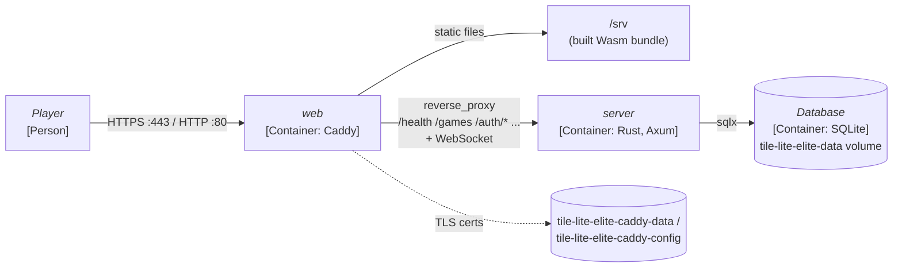

# Production environment and operations

What runs on the live system and how it is operated. Building and patching a
host is [4.3.8](4.3.8-building-and-maintaining-a-host.md), and backups and
restores are [4.3.9](4.3.9-backups-and-restores.md).

Every host step here is the owner's to run ([CLAUDE.md](../CLAUDE.md)).

Host commands name the host by its `ssh` alias:

| Host | Alias |
| --- | --- |
| production | `tile-lite-elite` |
| rehearsal | `tile-lite-elite-rehearsal` |

Where each task is:

| Task | Section |
| --- | --- |
| ship a release | [4.3.3](4.3.3-testing-ci-and-release.md#1-what-to-type) |
| find an artefact outside git | [3.1.2](https://github.com/delphside/programme/blob/main/applications/tile-lite-elite/3.1.2-artefacts.md) |
| build a host | [Building a host](4.3.8-building-and-maintaining-a-host.md#building-a-host) |
| change `.env` | [Changing production configuration](#changing-production-configuration), then [Host configuration](#host-configuration-env) |
| run an admin command | [Admin CLI](#admin-cli) |
| read the database | [Inspecting the database](#inspecting-the-database) |
| read the logs | [Logging](#logging) |
| change console or DNS configuration | [Changing production configuration](#changing-production-configuration) |
| respond to an alarm | [Responding to an alarm](#responding-to-an-alarm) |
| patch or reboot a host | [Keeping the hosts current](4.3.8-building-and-maintaining-a-host.md#keeping-the-hosts-current) |
| take a manual backup | [Taking and restoring a manual backup](4.3.9-backups-and-restores.md#taking-and-restoring-a-manual-backup) |
| check that backups are running | [Checking the backups](4.3.9-backups-and-restores.md#checking-the-backups) |
| renew the write pre-authenticated request (PAR) | [Renewing the write PAR](4.3.9-backups-and-restores.md#renewing-the-write-par) |
| drill a restore | [Drilling a restore](4.3.9-backups-and-restores.md#drilling-a-restore) |
| restore a backup into production | [Restoring production](4.3.9-backups-and-restores.md#restoring-production) |
| start over | [Wiping production](4.3.9-backups-and-restores.md#wiping-production) |

## Container topology

`Dockerfile`, `docker-compose.yml` and `Caddyfile` at the repository root run
the app as two containers:

| Container | Runs | Reachable |
| --- | --- | --- |
| `server` | the Axum backend (`server-game`), release-built | from `web` over the compose network, and by `docker compose exec`. No published port. |
| `web` | Caddy: the release web build as static files, a reverse proxy for the API and WebSocket paths, and HTTPS | published on `:80`, `:443` and `:443/udp` |

**Container view**
([which view a diagram takes](diagrams/README.md#which-view-a-diagram-takes-and-saying-so))
— the containers, the volumes and how they talk.



The `@api` matcher in the `Caddyfile` lists the proxied paths
([4.4.1](4.4.1-configuration.md#caddy)).

**One origin serves everything.** The web build is compiled with
`TILE_LITE_ELITE_API_BASE_URL=""` (explicitly empty, not unset;
[4.4.1](4.4.1-configuration.md#environment-variables)), so the client takes its
API and WebSocket target from the origin that served the page. The same bundle
works on any host without a rebuild, and the browser makes no cross-origin
request. The server's CORS layer is permissive regardless.

| Volume | Mounted in | Holds |
| --- | --- | --- |
| `tile-lite-elite-data` | `server`, `/data` | the SQLite database |
| `tile-lite-elite-caddy-data` | `web`, `/data` | TLS certificates |
| `tile-lite-elite-caddy-config` | `web`, `/config` | Caddy's runtime state |

`docker compose down` and rebuilds keep them; `down -v` deletes them.

**Pinned builds**:

- the three base images by digest in the `Dockerfile`; Dependabot's `docker`
  ecosystem opens a weekly pull request when one moves;
- `dioxus-cli` and `wasm-bindgen-cli` by `cargo install --version` in the
  `Dockerfile`;
- the compiler by `rust-toolchain.toml`, on a developer machine, in CI and in
  the `Dockerfile`'s `builder` stage, which copies it in before its first
  `rustup` or `cargo` command.

The `apt-get install` in the `runtime-server` stage resolves at build time, so
an image is reproducible only as far as the base layer.

## Host configuration (`.env`)

`.env` beside `docker-compose.yml` holds each host's secrets and settings
([4.4.1](4.4.1-configuration.md#environment-variables) lists them).
`deploy.sh` copies the images and the compose file and leaves `.env` as it is.
The owner edits it on the host.

| Host | Keys |
| --- | --- |
| production | `RESEND_API_KEY`, `SUPPORT_POLL_RESEND_API_KEY`, `SUPPORT_POLL_GITHUB_TOKEN` |
| rehearsal | `RESEND_API_KEY`, `SITE_ADDRESS`, `REHEARSAL_ACCESS_KEY` (written by `rehearsal-access.sh grant`, not by hand) |
| any other | `RESEND_API_KEY`, `SITE_ADDRESS` |

A host other than production needs `SITE_ADDRESS`: without it Caddy requests
production's certificates, which Let's Encrypt cannot validate for it.

**A new host** gets the file once, before its first deploy. Run this only where
no `.env` exists, adding the host's keys from the table:

```bash
ssh <alias>
mkdir -p ~/tile-lite-elite
cd ~/tile-lite-elite
cat > .env <<'EOF'
RESEND_API_KEY=re_your_real_key_here
EOF
chmod 600 .env
```

**A change** is an `Other` delivery (one applied by hand): follow
[Changing production configuration](#changing-production-configuration). It
edits the file in place, keeping a copy, then recreates the containers:

```bash
ssh <alias>
cd ~/tile-lite-elite
cp .env ".env.bak-$(date +%Y%m%d-%H%M%S)"
$EDITOR .env
docker compose up -d
```

## Admin CLI

`tile-lite-elite-admin` (crate `crates/admin-cli`) is a thin HTTP client for
`server-game`'s `/admin/*` endpoints, so it cannot drift from what the server
does. The release image carries the binary; nothing is installed on the VM.

Access control:

- `/admin/*` accepts only requests whose peer address is loopback, whatever
  `TILE_LITE_ELITE_BIND` is, so the CLI runs inside the server's container or
  on the server's own machine;
- the `Caddyfile` proxies only the `@api` paths, which exclude `/admin`, and a
  request from any other peer gets a 403.

| Environment | Run | Written to `~/.bashrc` by | Notes |
| --- | --- | --- | --- |
| dev | `sadev`, or `./scripts/develop/admin.sh` | `setup-dev-environment.sh` | the server is native on `:3000`, the CLI's default. `admin.sh` builds the CLI in release mode first. |
| preview | `sapre` | `setup-dev-environment.sh` | the server is in a container, whose loopback is not the host's. |
| production | `sa`, in an SSH session on the VM | `deploy.sh`, on the VM | runs the CLI inside the `server` container |
| rehearsal | `sa`, in an SSH session on the rehearsal VM | `deploy.sh`, on the VM | the same |

Each script replaces its earlier alias line in `~/.bashrc`.

| Command | Does |
| --- | --- |
| `users list` | every account, newest first |
| `users reset-password <user> [--password '…']` | sets a password, printing a generated one when none is given |
| `users sign-out <user>` | ends every session the account has, and nothing else |
| `users delete <user>` | deletes the account, under the refusals in [Before acting](#before-acting) |
| `games list [--status S] [--older-than-days N]` | `S` is `waiting`, `active`, `finished` or `aborted`; `N` counts days since the game was created |
| `games delete <game_id>` | deletes the game with its moves, chat, participants and invitations |
| `games force-end <game_id>` | marks a stuck game finished without touching scores |
| `size` | the daily database size record, one row per day, the latest 90 at most |
| `scheduler-health` | each scheduled job's last pass, UTC to the second, and its error count |

`<user>` is a display name or an account ID. `--json` prints:

- for the listings and `games force-end`, the server's own records, timestamps
  as epoch seconds;
- for `users delete`, `users sign-out`, `users reset-password` and
  `games delete`, the CLI's own confirmation.

For example:

```bash
sadev --json games list | jq '.[] | select(.status == "waiting")'
```

### Reading the output

Timestamps are UTC.

- `users list`: `RATING` `-` means no rated game has finished, distinct from an
  account at the starting 1500. `GAMES` counts rated games. `LAST SEEN` is real
  activity, or `never` ([4.4.2](4.4.2-database-schema.md#players)).
- `games list` marks a seat `[bot]`, `[invited]`, `[declined]`, `[unclaimed]`
  (a human seat nobody has taken or been asked to take) or `[out]` (resigned,
  force-resigned or timed out). Scores appear once a game has started.

### Before acting

- `games delete` and `users delete` ask for no confirmation and cannot be
  undone.
- `games force-end` is refused on a game already finished or aborted, but it
  ends any game not yet over, waiting or active. Check the ID against
  `games list` first.
- `users delete` is refused while:
  - a game, invitation or chat message still refers to the account; the
    refusal lists the games ([4.1.0](4.1.0-rules.md#deleting-an-account));
  - the account has a live session.
- To clear a `users delete` refusal:
  - run `users sign-out <user>`, which ends the sessions and succeeds quietly
    on an account with none;
  - delete the games, or wait for retention
    ([4.1.0](4.1.0-rules.md#retention), RET-1 and RET-4), whose sweep runs
    when any player next loads their games list (`GET /games`);
    `sa games list` does not run it.

## Inspecting the database

For anything the admin CLI does not cover, read the SQLite file through a
read-only shortcut that `scripts/develop/setup-dev-environment.sh` writes into
`~/.bashrc`:

| Shortcut | Reads | How |
| --- | --- | --- |
| `dbdev` | `data/tile-lite-elite.sqlite3` in the checkout | `sqlite3 -readonly` |
| `dbpre` | preview | `sqlite3 -readonly` in the running `server` container (`docker-compose.preview.yml`) |
| `dbprod` | production | the same, over `ssh -t tile-lite-elite` (the owner). Interactive only. |

`dbpre` also takes a query (`dbpre "select count(*) from games;"`), which works
in a pipeline. The database is in write-ahead log (WAL) mode, so reading never
blocks the server. The shell sees its own pragma defaults, not the server's
([4.4.1](4.4.1-configuration.md#sqlite)).

```sql
.tables                                          -- list tables
.schema games                                    -- one table's DDL
.headers on
select id, status, turn_number from games order by created_at desc limit 10;
select version, description from _sqlx_migrations order by version;  -- migrations applied
```

The authoritative game state is the `snapshot_json` text column; the other
columns are projections of it ([4.4.4](4.4.4-snapshot-json-schema.md),
[4.4.5](4.4.5-data-dictionary.md)). To avoid touching production, restore a
backup locally
([Restoring the offsite backup](4.3.9-backups-and-restores.md#restoring-the-offsite-backup))
and query the copy.

**If the stack is stopped**, `exec` has nothing to reach. Use a throwaway
container and exit it, since one left running holds the volume. The volumes
are:

| Stack | Volume |
| --- | --- |
| preview | `tile-lite-elite-preview-data` |
| production (the owner) | `tile-lite-elite-data` |

The command is for preview; for production the owner substitutes its volume:

```bash
docker run --rm -it -v tile-lite-elite-preview-data:/data alpine sh -c \
  'apk add --no-cache sqlite >/dev/null 2>&1 && exec sqlite3 -readonly /data/tile-lite-elite.sqlite3'
```

Do not read the volume's host path. It needs `sudo`, and a copy of the
`.sqlite3` file without its `-wal` and `-shm` files is stale.

## Logging

`server-game` logs JSON, one object per line, through `tracing`. The default
`RUST_LOG` filter
([4.4.1](4.4.1-configuration.md#environment-variables)) logs `info` and above;
`debug` needs it lowered:

| Level | Events, for example |
| --- | --- |
| `error` | persistence failures, such as a timeout retirement or a user deletion not saved; "job appears stalled" |
| `warn` | admin actions (the audit trail), rejected logins and password resets, email not sent, "database unavailable", support mail check or dispatch failures |
| `info` | registration, login, games, invitations, move-time retirement, email sent |
| `debug` (off by default) | `tower-http`'s per-request spans; the server's sweep events, such as examining a game for retirement |

To log `tower-http`'s per-request spans in a local run, set `RUST_LOG`:

```bash
RUST_LOG=server_game=info,tower_http=debug cargo run -p server-game
```

### Identifiers only

**No display name, email address, token or password reaches the log**, except
in preview's unsent-email event, which also carries the recipient and body
([Reading an email out of preview's log](#reading-an-email-out-of-previews-log)).
`player_id` and `game_id` are enough to diagnose, and the admin CLI resolves an
ID. A failed login carries its reason only. `player_id` is pseudonymous, not
anonymous: the `players` table resolves it.

[4.4.7](4.4.7-log-events.md) declares every field each declared event may
carry. `scripts/operate/check-log-hygiene.py` validates log lines against it:

- no email address in any field of any event, except that the CI stream skips
  this rule for `debugOnly` events;
- no undeclared field on a declared event, and no declared field missing;
- `additionalProperties: false` on every event in the schema;
- no `debugOnly` event in a production stream.

| Stream | Source |
| --- | --- |
| CI | the regression suite's own output, which reaches events production rarely logs |
| the host, nightly | `check-log-hygiene-nightly.sh` reads the `tle-server` journal from the start of the previous day |

### journald, not the container

Both services log through the **journald** driver. The owner reads production
logs on the VM:

```bash
journalctl CONTAINER_TAG=tle-server -o cat            # the server, one JSON object per line
journalctl CONTAINER_TAG=tle-server -o cat | jq -r 'select(.level=="WARN")'  # warnings: admin actions, rejected logins and resets, unsent email
journalctl CONTAINER_TAG=tle-web --since today        # the web container
```

Ubuntu's `/usr/lib/systemd/journald.conf.d/syslog.conf` sets
`ForwardToSyslog=yes`, so every journal line is also in `/var/log/syslog`. Both
copies stay on the instance:

| Copy | Kept by | Survives |
| --- | --- | --- |
| the journal | two drop-ins in `/etc/systemd/journald.conf.d/` (size and age caps: [3.1.2](https://github.com/delphside/programme/blob/main/applications/tile-lite-elite/3.1.2-artefacts.md#the-production-host)) | container recreation and deploys, but not the VM |
| `/var/log/syslog` | logrotate, which keeps four weekly gzipped copies | the same |

### Reading an email out of preview's log

`docker-compose.preview.yml` sets `TILE_LITE_ELITE_LOG_EMAIL_BODIES=1`. With no
email provider, preview then logs the whole message, recipient included, which
is how a link is read while testing:

```bash
journalctl CONTAINER_TAG=tle-preview-server -o cat \
  | jq -r 'select(.message | startswith("email not sent")) | .text_body' | tail -1

# just the link
journalctl CONTAINER_TAG=tle-preview-server -o cat \
  | jq -r 'select(.text_body) | .text_body' | grep -oE 'https?://[^ ]+' | tail -1
```

Production sets nothing and logs the message kind and `player_id` alone;
[the hygiene check](#identifiers-only) fails a body in a production stream.

## Monitoring and alerting

Four alarms, built only in the Oracle Cloud Infrastructure (OCI) console,
watch production and publish to the OCI Notifications topic
`tile-lite-elite-alerts`, which emails the owner.

| Alarm | Fires when |
| --- | --- |
| `tile-lite-elite-production-health-success-rate` | two of three external probes cannot get `/health`, for 3 minutes |
| `CPU 90%` | mean CPU above 90% for 5 minutes |
| `Memory 90%` | mean memory above 90% for 5 minutes. Every game is held in RAM until deleted, so this is the alarm with a trajectory. |
| `Stopped` | the instance's status changes to stopped |

**The external probe** is the OCI Health Check
`tile-lite-elite-production-health`:

| Setting | Value |
| --- | --- |
| request | HTTPS `GET https://tileliteelite.com/health` every 60 s, 10 s timeout |
| vantage points | AWS West EU 3, São Paulo and Tokyo |
| alarm query | `oci_healthchecks` / `HTTP.isHealthy`, `mean()` with `grouping()`, filtered to that monitor's `resourceId` |
| alarm fires | below 0.5, which means at least two of three probes agree |

The host alarms read `oci_computeagent`, published by the Oracle Cloud Agent
on the VM, so a lost VM is silent to them: the probe is the alarm that
matters.

**Two settings fail silently if wrong**:

- the Health Check targets the hostname, not the instance. Over HTTPS a bare IP
  fails the TLS handshake, and the monitor reports down forever;
- the alarm's `resourceId` filter is required. Without it `grouping()` averages
  every stream in the namespace, and a second monitor could hold the mean at
  exactly 0.5, which does not fire.

| Not monitored | Why |
| --- | --- |
| filesystem free space | no built-in OCI metric |
| error rates, latency and volume | no baseline |
| rehearsal | closed, test-only |
| the [backups](4.3.9-backups-and-restores.md#checking-the-backups) | OCI publishes no object-age metric, so nothing alarms on the markers |

### Responding to an alarm

The owner responds, and checks production after any fix with the health
`curl` in the first row. `verify.sh` also fails on checks unrelated to
production
([4.3.7 §7](4.3.7-how-testing-and-release-work.md#7-what-verifysh-checks)),
so its exit status alone does not show an outage.

| Alarm | Case | Do |
| --- | --- | --- |
| health probe | first check | `curl -fsS --max-time 10 https://tileliteelite.com/health` |
| health probe | diagnose | on the VM, `cd ~/tile-lite-elite && docker compose ps` and `journalctl CONTAINER_TAG=tle-server -o cat` ([Logging](#journald-not-the-container)) |
| health probe | a container is down | on the VM, `cd ~/tile-lite-elite && docker compose up -d` |
| health probe | after a bad release | [roll back](4.3.6-when-a-release-goes-wrong.md#1-roll-back-production) |
| `CPU 90%` | first check | `docker stats --no-stream` on the VM, then the server's log for a loop |
| `CPU 90%` | fix | none scripted: the owner decides from the cause |
| `Memory 90%` | first check | `sa games list --older-than-days 7` on the VM |
| `Memory 90%` | fix | `sa games delete <game_id>` for the games no longer wanted ([Admin CLI](#admin-cli)) |
| `Stopped` | first check | the instance's status in the console |
| `Stopped` | fix | start the instance in the console; the containers restart with it; then the health `curl` |

## Changing production configuration

| Change | Whose delivery | Recorded by |
| --- | --- | --- |
| the `.env` on the VM, the OCI console, DNS ([3.1.2](https://github.com/delphside/programme/blob/main/applications/tile-lite-elite/3.1.2-artefacts.md)) | this application's, an `Other` delivery | a work package, a dated milestone (`YYYY.MM.DD-n`, made the day it lands) and a row in this application's delivery log |
| a host package upgrade, the container runtime, a kernel, a reboot | the infrastructure application's `Other` delivery, as host maintenance ([1.2 §2.15](https://github.com/delphside/programme/blob/main/docs/1.2-change-lifecycle.md#host-maintenance-is-the-infrastructure-applications)) | a work package, a dated milestone and a row in the infrastructure application's delivery log |
| what the application installs on its host: `/opt/tile-lite-elite/`, its systemd units and the packages it needs | this application's, a Production Release ([3.1.2](https://github.com/delphside/programme/blob/main/applications/tile-lite-elite/3.1.2-artefacts.md#artefacts-by-route)) | its release |

**An `Other` delivery has no CI, gate, smoke test or scripted rollback, so the
owner reviews and tests it by hand.** The owner makes a change in either of
the first two rows in this order:

1. **Raise the work package** (for host maintenance, in the infrastructure
   application's repository).
2. **Try it on rehearsal first** where the same setting, package or host
   exists. Rehearsal has its own `.env` and instance
   (`ssh tile-lite-elite-rehearsal`). Then check rehearsal answers, on the one
   path its access gate leaves open:

   ```bash
   curl -fsS --max-time 10 https://rehearsal.tileliteelite.com/health
   ```

3. **Keep what is replaced.** For `.env`, the copy made in
   [Host configuration](#host-configuration-env) is the only rollback. For the
   console or DNS, note the current value in the work package. For a package,
   note in the work package what
   `sudo apt-get update && apt list --upgradable` lists on production.
4. **Check the order** of a new hostname and its DNS record, as in the
   [HTTPS cases](4.3.8-building-and-maintaining-a-host.md#https).
5. **Make the change on production** (`ssh tile-lite-elite`), check it
   answers, and test the changed setting by hand:

   ```bash
   curl -fsS --max-time 10 https://tileliteelite.com/health
   ```

6. **Record it** in the section it belongs to in this document,
   [4.3.8](4.3.8-building-and-maintaining-a-host.md) or
   [4.3.9](4.3.9-backups-and-restores.md), and in
   [3.1.2](https://github.com/delphside/programme/blob/main/applications/tile-lite-elite/3.1.2-artefacts.md).
   Host maintenance is recorded in its work package and its row in the
   infrastructure application's delivery log.
7. **Close the dated milestone by hand**: no deploy settles an `Other`
   delivery's milestone
   ([1.2](https://github.com/delphside/programme/blob/main/docs/1.2-change-lifecycle.md#a-delivery-that-ships-no-application-code)).
