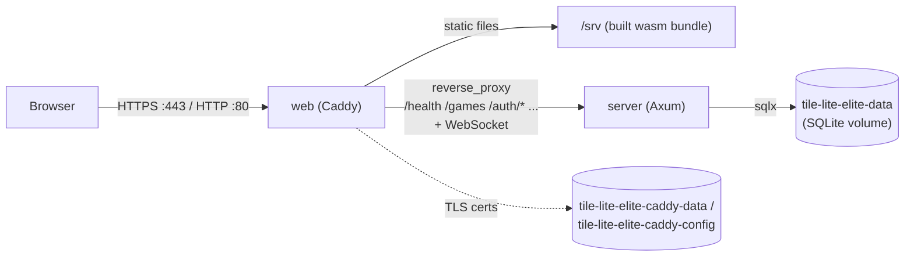

# Production environment and operations

How the live system is built, what runs on it and how it is operated.

Shipping a release is [4.3.3](4.3.3-testing-ci-and-release.md#1-what-to-type).
The artefacts outside git are in
[3.1.2](https://github.com/delphside/programme/blob/main/applications/tile-lite-elite/3.1.2-artefacts.md).
Every host step here is the owner's to run ([CLAUDE.md](../CLAUDE.md)).

Host commands name the host by its `ssh` alias:

| Host | Alias |
| --- | --- |
| production | `tile-lite-elite` |
| rehearsal | `tile-lite-elite-rehearsal` |

| Task | Section |
| --- | --- |
| build a host | [Building a host](#building-a-host) |
| change `.env` | [Changing production configuration](#changing-production-configuration), then [Host configuration](#host-configuration-env) |
| run an admin command | [Admin CLI](#admin-cli) |
| read the database | [Inspecting the database](#inspecting-the-database) |
| read the logs | [Logging](#logging) |
| change console or DNS configuration | [Changing production configuration](#changing-production-configuration) |
| respond to an alarm | [Responding to an alarm](#responding-to-an-alarm) |
| patch or reboot a host | [Keeping the hosts current](#keeping-the-hosts-current) |
| take a manual backup | [Backups](#backups) |
| check that backups are running | [Checking the backups](#checking-the-backups) |
| renew the write PAR | [Renewing the write PAR](#renewing-the-write-par) |
| restore a backup into production, or drill a restore | [Restoring production](#restoring-production), [Restoring](#restoring) |
| start over | [Wiping production](#wiping-production) |

## Building a host

Production and rehearsal are Oracle Cloud VMs on the Always Free tier. The
owner builds one in the Oracle Cloud Infrastructure (OCI) console:

1. **Sign up** at `cloud.oracle.com`. Phone and card verification is an
   identity check, not a charge.
2. **Upgrade to Pay-As-You-Go before creating the instance.** Oracle reclaims
   idle Free-tier instances (95th-percentile CPU under 20% over seven days),
   which a quiet game server is. Staying within the Always Free limits costs
   nothing. The owner rechecks Oracle's policy at each build.
3. **Create the instance**:
   - image: Ubuntu 24.04 LTS;
   - shape: `VM.Standard.E2.1.Micro` (1 GB of memory; x86_64, so images
     built on an x86_64 machine run unchanged);
   - a public IPv4 address;
   - the public half of the host's deploy key, pasted in at creation:
     `oracle_tile_lite_elite` for production,
     `oracle_tile_lite_elite_rehearsal` for rehearsal. The private halves stay
     in `~/.ssh` ([4.3.1](4.3.1-setup.md)).
4. **Open the network.** Failures show only as timeouts:
   - the subnet needs a route to an internet gateway;
   - the rules go in the security list attached to the subnet, found under
     *Subnet → Security*; a VCN (virtual cloud network) can hold several
     security lists. The security group the *Networking* tab creates has no inbound rules;
   - ingress: TCP 22, 80 and 443, and UDP 443;
   - egress: all. A TCP-only rule blocks DNS, and with it `apt-get` and image
     pulls.
5. **Install Docker and add a swapfile**, over `ssh <alias>`:
   - Docker Engine and the Compose plugin from Docker's apt repository, as
     [Docker's Ubuntu guide](https://docs.docker.com/engine/install/ubuntu/)
     gives it;
   - `sudo usermod -aG docker ubuntu`, because the deploy scripts run `docker`
     without `sudo`;
   - a swapfile for headroom on 1 GB, persisted in `/etc/fstab` (the hosts' size is not recorded here; read it with `swapon --show`):

     ```bash
     sudo fallocate -l <size> /swapfile && sudo chmod 600 /swapfile
     sudo mkswap /swapfile && sudo swapon /swapfile
     echo '/swapfile none swap sw 0 0' | sudo tee -a /etc/fstab
     ```

6. **Install the rest of what the host needs**:
   - `sudo apt-get install -y sqlite3 python3 jq`: the nightly jobs run
     `sqlite3` and `python3`, and the log commands in
     [Logging](#journald-not-the-container) use `jq`;
   - `sudo usermod -aG systemd-journal ubuntu`, so the log check can read the
     journal;
   - the journald drop-ins ([Logging](#journald-not-the-container));
   - `/opt/tile-lite-elite/` and the systemd units, copied from the repository
     by hand, with the timers enabled. The four files and the unit names are in
     [3.1.2](https://github.com/delphside/programme/blob/main/applications/tile-lite-elite/3.1.2-artefacts.md#the-production-host).
     From the repository root:

     ```bash
     scp scripts/operate/backup-to-oci.sh \
         scripts/operate/check-log-hygiene-nightly.sh \
         scripts/operate/check-log-hygiene.py \
         docs/4.4.7-log-events.md <alias>:/tmp/
     scp scripts/operate/systemd/* <alias>:/tmp/
     ssh <alias> 'sudo mkdir -p /opt/tile-lite-elite \
       && sudo install -m 755 -t /opt/tile-lite-elite \
            /tmp/backup-to-oci.sh /tmp/check-log-hygiene-nightly.sh \
            /tmp/check-log-hygiene.py \
       && sudo install -m 644 -t /opt/tile-lite-elite /tmp/4.4.7-log-events.md \
       && sudo install -m 644 -t /etc/systemd/system /tmp/tile-lite-elite-*.service \
            /tmp/tile-lite-elite-*.timer \
       && sudo systemctl daemon-reload \
       && sudo systemctl enable --now tile-lite-elite-backup.timer \
            tile-lite-elite-log-check.timer'
     ```

   - the write PAR (pre-authenticated request) in
     `~/.tile-lite-elite-backup-par`, mode `0600`
     ([Renewing the write PAR](#renewing-the-write-par));
   - `sudo apt-get install -y unattended-upgrades`, which Ubuntu may already
     carry ([Keeping the hosts current](#keeping-the-hosts-current));
   - the `.env` ([Host configuration](#host-configuration-env)).
7. **Deploy once**, which creates `~/tile-lite-elite` with the compose file and
   starts the stack: `deploy-rehearsal.sh` for rehearsal, `deploy.sh` for
   production ([4.3.3](4.3.3-testing-ci-and-release.md#16-ship-it)).

**HTTPS** is Caddy's. Given a hostname, it obtains and renews a Let's Encrypt
certificate and redirects `http://` itself. It serves `SITE_ADDRESS` from
`.env`, or the default in `docker-compose.yml`
([4.4.1](4.4.1-configuration.md#environment-variables)). A host with no DNS
name sets `SITE_ADDRESS=<ip>.sslip.io` in `.env`, because Let's Encrypt will
not certify a bare IP address and sslip.io resolves to the IP with nothing to
register.

## Container topology

`Dockerfile`, `docker-compose.yml` and `Caddyfile` at the repository root run
the app as two containers:

| container | runs | reachable |
| --- | --- | --- |
| `server` | the Axum backend (`server-game`), release-built | from `web` over the compose network, and by `docker compose exec`. No published port |
| `web` | Caddy: the release web build as static files, a reverse proxy for the API and WebSocket paths, and HTTPS | published on `:80`, `:443` and `:443/udp` |



The `@api` matcher in the `Caddyfile` lists the proxied paths
([4.4.1](4.4.1-configuration.md#caddy)).

**One origin serves everything.** The web build is compiled with
`TILE_LITE_ELITE_API_BASE_URL=""` (explicitly empty, not unset;
[4.4.1](4.4.1-configuration.md#environment-variables)), so the client takes its
API and WebSocket target from the origin that served the page. The same bundle
works on any host without a rebuild, and the browser makes no cross-origin
request. The server's CORS layer is permissive regardless.

| volume | mounted in | holds |
| --- | --- | --- |
| `tile-lite-elite-data` | `server`, `/data` | the SQLite database |
| `tile-lite-elite-caddy-data` | `web`, `/data` | TLS certificates |
| `tile-lite-elite-caddy-config` | `web`, `/config` | Caddy's runtime state |

`docker compose down` and rebuilds keep them; `down -v` deletes them. Losing
the certificates means a fresh request against Let's Encrypt's rate limits.

**Pinned builds:**

- the three base images by digest in the `Dockerfile`; Dependabot's `docker`
  ecosystem opens a weekly pull request when one moves;
- `dioxus-cli` and `wasm-bindgen-cli` by `cargo install --version` in the
  `Dockerfile`;
- the compiler on a developer machine and in CI by `rust-toolchain.toml`. The
  release image uses the toolchain in its `rust:1-bookworm` digest, because
  the `Dockerfile` does not copy that file in.

The `apt-get install` in the `runtime-server` stage resolves at build time, so
an image is reproducible to the base layer, not byte for byte.

### Host configuration (`.env`)

`.env` beside `docker-compose.yml` holds each host's secrets and settings
([4.4.1](4.4.1-configuration.md#environment-variables) lists them).
`deploy.sh` copies the images and the compose file and never touches `.env`.
The owner edits it on the host.

Each host needs `RESEND_API_KEY` and its own extra keys. A host other than
production needs `SITE_ADDRESS`: without it Caddy requests production's
certificates, which risks Let's Encrypt's rate limit.

| Host | Extra keys |
| --- | --- |
| production | `SUPPORT_POLL_RESEND_API_KEY`, `SUPPORT_POLL_GITHUB_TOKEN` |
| rehearsal | `SITE_ADDRESS`, `REHEARSAL_ACCESS_KEY` |
| any other | `SITE_ADDRESS` |

**A new host** gets the file once, before its first deploy, which creates the
compose file and starts the stack. The block creates the directory and the
file, so run it only where no `.env` exists, adding the host's extra keys from
the table:

```bash
ssh <alias>
mkdir -p ~/tile-lite-elite
cd ~/tile-lite-elite
cat > .env <<'EOF'
RESEND_API_KEY=re_your_real_key_here
EOF
chmod 600 .env
```

**A change** is an `Other` delivery: follow
[Changing production configuration](#changing-production-configuration). It
edits the file in place, keeping a copy, then recreates the containers:

```bash
ssh <alias>
cd ~/tile-lite-elite
cp .env ".env.bak-$(date +%Y%m%d-%H%M%S)"
$EDITOR .env
docker compose up -d
```

## Admin CLI

`tile-lite-elite-admin` (crate `crates/admin-cli`) is a thin HTTP client for
`server-game`'s `/admin/*` endpoints, so it cannot drift from what the server
does. The release image carries the binary; nothing is installed on the VM.

`/admin/*` accepts only requests whose peer address is loopback, whatever
`TILE_LITE_ELITE_BIND` is. Running the CLI inside the server's container, or
on the server's own machine, is the access control. `Caddyfile` does not proxy
`/admin`, and a request from any other peer gets a 403.

| environment | run | why |
| --- | --- | --- |
| dev | `sadev`, or `./scripts/develop/admin.sh` | the server is native on `:3000`, the CLI's default. `admin.sh` builds the CLI in release mode first |
| preview | `sapre` | the server is in a container, whose loopback is not the host's |
| production | `sa`, in an ssh session on the VM (the owner) | runs the CLI inside the `server` container |
| rehearsal | `sa`, in an ssh session on the rehearsal VM (the owner) | the same |

`scripts/develop/setup-dev-environment.sh` writes `sadev` and `sapre` into
`~/.bashrc`, replacing any earlier line. `deploy.sh` writes `sa` into the
target VM's `~/.bashrc`, production or rehearsal.

| command | does |
| --- | --- |
| `users list` | every account, newest first |
| `users reset-password <user> [--password '…']` | sets a password, printing a generated one when none is given |
| `users sign-out <user>` | ends every session the account has, and nothing else |
| `users delete <user>` | deletes the account, under the refusals in [Before acting](#before-acting) |
| `games list [--status S] [--older-than-days N]` | `S` is `waiting`, `active`, `finished` or `aborted` |
| `games delete <game_id>` | deletes the game with its moves, chat, participants and invitations |
| `games force-end <game_id>` | marks a stuck game finished without touching scores |
| `size` | the daily database size record, one row per day, the latest 90 at most |
| `scheduler-health` | each scheduled job's last pass, UTC to the second, and its error count |

`<user>` is a display name or an account id. `--json` prints the server's own
records, timestamps as epoch seconds, for every command:

```bash
sadev --json games list | jq '.[] | select(.status == "waiting")'
```

### Reading the output

Timestamps are UTC.

- `users list`: `RATING` `-` means no rated game has finished, distinct from an
  account at the starting 1500. `GAMES` counts rated games. `LAST SEEN` is real
  activity, or `never` ([4.4.2](4.4.2-database-schema.md#players)).
- `games list` marks a seat `[bot]`, `[invited]`, `[declined]`, `[unclaimed]`
  (a human seat nobody has taken or been asked to take) or `[out]` (resigned,
  force-resigned or timed out). Scores appear once a game has started.

### Before acting

- `games delete` and `users delete` ask for no confirmation and cannot be
  undone.
- `games force-end` is refused on a game already finished or aborted, but it
  ends any game not yet over, waiting or active. Check the id against
  `games list` first.
- `users delete` is refused while:
  - a game, invitation or chat message still refers to the account; the
    refusal lists the games ([4.1.0](4.1.0-rules.md#deleting-an-account));
  - the account has a live session.
- To clear a `users delete` refusal:
  - `users sign-out <user>` ends the sessions, and succeeds quietly on an
    account with none;
  - delete the games, or wait: the server deletes a finished game at least
    7 days after it ends, when the games list is next loaded
    ([4.1.0](4.1.0-rules.md#retention)).

## Inspecting the database

For anything the admin CLI does not cover, read the SQLite file through a
read-only shortcut that `scripts/develop/setup-dev-environment.sh` writes into
`~/.bashrc`. `dbprod` is production access and so the owner's; `dbdev` and
`dbpre` are not:

| Shortcut | Reads | How |
| --- | --- | --- |
| `dbdev` | `data/tile-lite-elite.sqlite3` in the checkout | `sqlite3 -readonly` |
| `dbpre` | preview | `sqlite3 -readonly` in the running `server` container (`docker-compose.preview.yml`) |
| `dbprod` | production | the same, over `ssh -t tile-lite-elite` (the owner). Interactive only |

`dbpre` also takes a query (`dbpre "select count(*) from games;"`), which works
in a pipeline. The database is in WAL (write-ahead log) mode, so reading never
blocks the server. The shell sees its own pragma defaults, not the server's
([4.4.1](4.4.1-configuration.md#sqlite)).

```sql
.tables                                          -- list tables
.schema games                                    -- one table's DDL
.headers on
select id, status, turn_number from games order by created_at desc limit 10;
select version, description from _sqlx_migrations order by version;  -- migrations applied
```

The authoritative game state is the `snapshot_json` text column; the other
columns are projections of it ([4.4.4](4.4.4-snapshot-json-schema.md),
[4.4.5](4.4.5-data-dictionary.md)). To avoid touching production, restore a
[backup](#restoring) locally and query the copy.

**If the stack is stopped**, `exec` has nothing to reach. Use a throwaway
container and exit it, since one left running holds the volume. The volume is
`tile-lite-elite-preview-data` for preview, `tile-lite-elite-data` for
production:

```bash
docker run --rm -it -v tile-lite-elite-preview-data:/data alpine sh -c \
  'apk add --no-cache sqlite >/dev/null 2>&1 && exec sqlite3 -readonly /data/tile-lite-elite.sqlite3'
```

Do not read the volume's host path. It needs `sudo`, and a copy of the
`.sqlite3` file without its `-wal` and `-shm` files is stale.

## Logging

`server-game` logs JSON, one object per line, through `tracing`. The default
filter is `server_game=info,tower_http=info,warn`:

| Level | Events, for example |
| --- | --- |
| `info` | registration, login, games, invitations, move-time retirement, email sent |
| `error` | persistence failures, such as a timeout retirement or a user deletion not saved; "job appears stalled" |
| `warn` | admin actions (the audit trail), rejected logins and password resets, email not sent, "database unavailable", support mail check or dispatch failures |
| `debug` | `tower-http`'s per-request spans; the server's sweep events, such as examining a game for retirement |

```bash
RUST_LOG=server_game=info,tower_http=debug cargo run -p server-game
```

### Identifiers only

**No display name, email address, token or password reaches the log**, except
in preview's unsent-email event, which also carries the recipient and body
([Reading an email out of preview's log](#reading-an-email-out-of-previews-log)).
`player_id` and `game_id` are enough to diagnose, and the admin CLI resolves an
id. A failed login carries its reason only. `player_id` is pseudonymous, not
anonymous: the `players` table resolves it.

[4.4.7](4.4.7-log-events.md) declares every field each declared event may
carry. `scripts/operate/check-log-hygiene.py` validates log lines against it:

- no email address in any field of any event;
- no undeclared field on a declared event, and no declared field missing;
- `additionalProperties: false` on every event in the schema;
- no `debugOnly` event in a production stream.

| Stream | Source |
| --- | --- |
| CI | the regression suite's own output, which reaches events production rarely logs |
| the host, nightly | `check-log-hygiene-nightly.sh` reads the `tle-server` journal from the start of the previous day |

### journald, not the container

Both services log through the **journald** driver, so logs survive container
recreation and deploys. They do not survive the VM: the journal is on the
instance only and nothing copies it off.

The owner reads production logs on the VM:

```bash
journalctl CONTAINER_TAG=tle-server -o cat            # the server, one JSON object per line
journalctl CONTAINER_TAG=tle-server -o cat | jq -r 'select(.level=="WARN")'  # warnings: admin actions, rejected logins and resets, unsent email
journalctl CONTAINER_TAG=tle-web --since today        # the web container
```

Two drop-ins in `/etc/systemd/journald.conf.d/` cap the journal at 100 MB
(16 MB in memory) and 7 days. Their values, and why the later file wins, are in
[3.1.2](https://github.com/delphside/programme/blob/main/applications/tile-lite-elite/3.1.2-artefacts.md#the-production-host).

Ubuntu's `/usr/lib/systemd/journald.conf.d/syslog.conf` sets
`ForwardToSyslog=yes`, so every journal line is also in `/var/log/syslog`,
which logrotate keeps for four weekly gzipped copies. The nightly check reads
the journal; the syslog copy holds the same lines and is not checked
separately.

### Reading an email out of preview's log

`docker-compose.preview.yml` sets `TILE_LITE_ELITE_LOG_EMAIL_BODIES=1`. With no
email provider, preview then logs the whole message, recipient included, which
is how a link is read while testing:

```bash
journalctl CONTAINER_TAG=tle-preview-server -o cat \
  | jq -r 'select(.message | startswith("email not sent")) | .text_body' | tail -1

# just the link
journalctl CONTAINER_TAG=tle-preview-server -o cat \
  | jq -r 'select(.text_body) | .text_body' | grep -oE 'https?://[^ ]+' | tail -1
```

Production sets nothing and logs the message kind and `player_id` alone;
[the hygiene check](#identifiers-only) fails a body in a production stream.

## Monitoring and alerting

Four alarms watch production and publish to the OCI Notifications topic
`tile-lite-elite-alerts`, which emails the owner. They exist only in the OCI
console; nothing in the repository builds them.

| Alarm | Fires when |
| --- | --- |
| `tile-lite-elite-production-health-success-rate` | two of three external probes cannot get `/health`, for 3 minutes |
| `CPU 90%` | mean CPU above 90% for 5 minutes |
| `Memory 90%` | mean memory above 90% for 5 minutes |
| `Stopped` | the instance's status changes to stopped |

Memory is the alarm with a trajectory: every game is held in RAM until
deleted.

**The external probe** is the OCI Health Check
`tile-lite-elite-production-health`:

- request: HTTPS `GET https://tileliteelite.com/health` every 60 s, 10 s
  timeout;
- vantage points: AWS West EU 3, São Paulo and Tokyo;
- alarm: reads `oci_healthchecks` / `HTTP.isHealthy`, `mean()` with
  `grouping()`, filtered to that monitor's `resourceId`, and fires below 0.5,
  which means at least two of three probes agree.

The host alarms read `oci_computeagent`, published by the Oracle Cloud Agent
on the VM, so a lost VM is silent to them: the probe is the alarm that
matters.

**Two settings fail silently if wrong:**

- the Health Check targets the hostname, not the instance. Over HTTPS a bare IP
  fails the TLS handshake, and the monitor reports down forever;
- the alarm's `resourceId` filter is required. Without it `grouping()` averages
  every stream in the namespace, and a second monitor could hold the mean at
  exactly 0.5, which does not fire.

| Not monitored | Why |
| --- | --- |
| filesystem free space | no built-in OCI metric |
| error rates, latency and volume | no baseline |
| rehearsal | closed, test-only |
| the [backups](#checking-the-backups) | OCI publishes no object-age metric, so nothing alarms on the markers |

### Responding to an alarm

The owner responds; each fix is a command or console action that exists.

| Alarm | First check | Fix |
| --- | --- | --- |
| health probe | `./scripts/deliver/verify.sh`, which reads production's `/health` | on the VM, `docker compose ps` and `journalctl CONTAINER_TAG=tle-server -o cat` ([Logging](#journald-not-the-container)); `docker compose up -d` if a container is down; after a bad release, [roll back](4.3.3-testing-ci-and-release.md#111-roll-back-production) |
| `CPU 90%` | `docker stats --no-stream` on the VM, then the server's log for a loop | none scripted: the cause decides, and the owner decides |
| `Memory 90%` | `sa games list --older-than-days 7` on the VM, since games are held in RAM until deleted | `sa games delete <game_id>` for the games no longer wanted ([Admin CLI](#admin-cli)) |
| `Stopped` | the instance's status in the console | start the instance in the console; the containers restart with it, then run `verify.sh` |

## Changing production configuration

A change outside the image (the `.env` on the VM, the OCI console, DNS) is an
`Other` delivery: a work package, a letter milestone and a delivery-log row
([1.2 §2.15](https://github.com/delphside/programme/blob/main/docs/1.2-change-lifecycle.md#215-classifying-a-change)).
It reaches users as code does, with nothing automatic: no CI, gate, smoke test
or scripted rollback, so the owner reviews and tests it by hand. A wrong `SITE_ADDRESS` in `.env` takes
the site down as surely as a bad commit. The owner makes it, in this order:

1. **Raise the work package.**
2. **Try it on rehearsal first** where the same setting exists. Rehearsal has
   its own `.env` and instance (`ssh tile-lite-elite-rehearsal`).
3. **Keep what is replaced.** For `.env`, the copy made in
   [Host configuration](#host-configuration-env) is the only rollback. For the
   console or DNS, note the current value in the work package.
4. **Check the order.** Adding a hostname to `SITE_ADDRESS` before its DNS
   record resolves fails certificate issuance, and repeated failures risk a
   Let's Encrypt rate limit.
5. **Record it** in the section it belongs to here and in
   [3.1.2](https://github.com/delphside/programme/blob/main/applications/tile-lite-elite/3.1.2-artefacts.md).
6. **Close the letter milestone by hand**: no deploy settles an `Other`
   delivery's milestone
   ([1.2 §2.2.1](https://github.com/delphside/programme/blob/main/docs/1.2-change-lifecycle.md#221-business-as-usual-updates)).

## Keeping the hosts current

| Layer | Updated by | Who acts | Cadence |
| --- | --- | --- | --- |
| security updates to OS packages | `unattended-upgrades` | nobody (automatic) | daily (`apt-daily-upgrade.timer`) |
| other OS packages, Docker included | `apt`, an `Other` delivery ([1.2 §2.2.1](https://github.com/delphside/programme/blob/main/docs/1.2-change-lifecycle.md#221-business-as-usual-updates)) | the owner | when needed |
| the running kernel and libc | a reboot | the owner | when `/var/run/reboot-required` appears |
| GitHub Actions, Docker base images | Dependabot | Claude, on Dependabot's pull request | weekly |
| Rust crates | `cargo audit` | Claude | advisories daily, bumps as needed |
| the application | a release | Claude | per release |

**`unattended-upgrades` installs and never reboots**, so a kernel or libc fix
is not live until a reboot. `scripts/operate/check-hosts.sh`:

- reads the reboot flag, the kernel and the Docker version on both hosts, and
  reports where they differ;
- runs inside `verify.sh` as a note, never a failure;
- does not read phased packages such as `netplan.io`, which Ubuntu releases
  gradually.

A package upgrade and a reboot are separate deliveries. Each is made on each
host, rehearsal first, by the owner. A reboot costs about 90 seconds of outage;
the containers restart with the host (`restart: unless-stopped`). On each host:

```bash
ssh <alias>
sudo apt-get update && sudo apt-get upgrade   # the upgrade
sudo reboot                                   # the reboot, when reboot-required appears
```

Then run `./scripts/deliver/verify.sh`.

## Backups

Three kinds exist:

- a manual tarball;
- a [pre-deploy snapshot](#automatic-pre-deploy-snapshots) on the VM;
- [the nightly copy](#the-nightly-copy-that-leaves-the-vm) off it.

The owner takes a manual backup with the server stopped, because in WAL mode a
copy taken while it runs can miss the WAL entry that completes the file:

```bash
ssh tile-lite-elite
cd ~/tile-lite-elite
docker compose stop server
docker run --rm -v tile-lite-elite-data:/data -v "$PWD":/backup debian \
  tar czf /backup/tile-lite-elite-data-$(date +%Y%m%d).tgz -C /data .
docker compose up -d
```

To restore a manual backup, on the VM:

```bash
ssh tile-lite-elite
cd ~/tile-lite-elite
```

1. Stop the stack: `docker compose down`.
2. Clear the database files, as step 3 of
   [Wiping production](#wiping-production) does.
3. Extract the tarball into the volume:

   ```bash
   docker run --rm -v tile-lite-elite-data:/data -v "$PWD":/backup debian \
     tar xzf /backup/tile-lite-elite-data-YYYYMMDD.tgz -C /data
   ```

4. Start the stack: `docker compose up -d`.

### Automatic pre-deploy snapshots

`deploy.sh` stops the server, then writes a tarball of the volume to
`~/tile-lite-elite/snapshots/`, keeps the newest five
([4.4.1](4.4.1-configuration.md#environment-variables)) and starts the new
version:

```text
snapshots/pre-0.4.13-fb36f50-20260731T164500Z.tgz
```

The name is the version and commit being deployed, then the UTC time.
`rollback.sh` restores a snapshot together with the `:previous` images
([4.3.3](4.3.3-testing-ci-and-release.md#112-roll-back-across-a-migration)),
and the owner runs it.

### The nightly copy that leaves the VM

`tile-lite-elite-backup.timer` runs `backup-to-oci.sh` on the VM at 03:10 UTC,
with up to 5 minutes of delay. The script:

1. takes a consistent copy with `VACUUM INTO` while the server runs;
2. checks the copy with `PRAGMA integrity_check`;
3. gzips it and uploads `db-<UTC time>.sqlite3.gz` to the bucket;
4. uploads `marker-backup-ok`, after a successful upload only.

`tile-lite-elite-log-check.timer` runs the nightly log check at 03:40 UTC,
which uploads `marker-logcheck-ok` after a clean run.

**The VM can write backups and cannot read, list or delete them**, so neither
an attacker on the host nor a bug in the script can destroy them.

| Setting | Value |
| --- | --- |
| bucket | `tile-lite-elite-backups` |
| credential | a bucket-scoped pre-authenticated request (PAR): object writes only, listing off. The VM reads it from `~/.tile-lite-elite-backup-par`, mode `0600` |
| on the bucket | object versioning on, since a write PAR can overwrite an existing name |
| PAR expiry | **2028-08-23**. Nothing announces it |

Deleting the PAR in the console revokes it on the next attempt.

### Checking the backups

Nothing alarms when backups stop, so the owner checks them after each
production deploy and whenever an alarm fires. Make a read PAR and save it as
in [Restoring](#restoring), then, from the development machine:

1. List the objects:

   ```bash
   curl -sS "$(< ~/.tle-restore-par)" | jq -r '.objects[].name'
   ```

2. Read each marker, which holds a UTC time:

   ```bash
   curl -sS "$(< ~/.tle-restore-par)marker-backup-ok"
   ```

   Likewise `marker-logcheck-ok` and `marker-restore-ok`.
3. Compare the newest backup's age and each marker's with now:

   | Object | Healthy when under |
   | --- | --- |
   | newest `db-<UTC time>.sqlite3.gz` | 26 hours |
   | `marker-backup-ok` | 26 hours |
   | `marker-logcheck-ok` | 36 hours |
   | `marker-restore-ok` | 100 days |

4. Remove the credential and delete the PAR, as in [Restoring](#restoring).

The owner diagnoses a stale marker on the VM:
`systemctl status tile-lite-elite-backup.service` or
`systemctl status tile-lite-elite-log-check.service`.

### Renewing the write PAR

Before the expiry, the owner creates a bucket PAR in the console with access
*Permit object writes* and listing off, then saves its URL on the VM. The
URL ends in `/o/`, because the script appends the object name:

```bash
read -rs PAR && umask 077 && printf '%s\n' "$PAR" > ~/.tile-lite-elite-backup-par
unset PAR
```

Delete the old PAR in the console, and update the expiry in
[the table](#the-nightly-copy-that-leaves-the-vm).

### Restoring

The owner restores from the development machine, with a read PAR created in the
console for the occasion. No standing read credential exists, so **a restore
cannot begin without console access**, and whatever protects the Oracle account
protects the backups. The read PAR never goes on the production host: while it
is there, anyone on the host can read every backup.

1. In the console, open bucket `tile-lite-elite-backups` → *Pre-Authenticated
   Requests* → *Create*:
   - target: Bucket;
   - access: Permit object reads;
   - listing: on, because `restore-backup.sh` lists to find the newest object;
   - expiry: a day or two.
2. On the development machine, save the PAR:

   ```bash
   read -rs PAR && umask 077 && printf '%s\n' "$PAR" > ~/.tle-restore-par
   unset PAR
   ```

3. Check what is there. This downloads the newest backup, checks its integrity
   and player count, and writes `./restored-*.sqlite3`, loading nothing.
   `--object <name>` restores a named backup instead of the newest:

   ```bash
   ./scripts/operate/restore-backup.sh "$(< ~/.tle-restore-par)"
   ```

4. Optionally load it into a volume of the Docker on this machine, replacing
   its contents. `--into` names that local volume: preview's is
   `tile-lite-elite-preview-data` (`docker-compose.preview.yml`). The script
   refuses while a container uses the volume, so stop the stack first. This
   does not touch production; for that, use
   [Restoring production](#restoring-production):

   ```bash
   ./scripts/operate/restore-backup.sh "$(< ~/.tle-restore-par)" --into tile-lite-elite-preview-data
   ```

5. Remove the credential from this machine, then delete the PAR in the console:

   ```bash
   shred -u ~/.tle-restore-par
   ```

**Drill it every 100 days.** The owner runs steps 1 to 3 and 5, then uploads
the marker from the host, so the write PAR never leaves the host. A drill
refreshes `marker-restore-ok`:

```bash
ssh tile-lite-elite 'PAR="$(< ~/.tile-lite-elite-backup-par)"
  printf "%s\n" "$(date -u +%Y%m%dT%H%M%SZ)" > /tmp/m
  curl --fail -sS -T /tmp/m "${PAR}marker-restore-ok"; rm -f /tmp/m'
```

Do not use `restore-backup.sh --mark`: it puts the write PAR on the
development machine.

### Restoring production

The owner loads a restored database into production's volume from the
development machine. The read PAR stays there: only the restored file goes to
the VM.

1. Run steps 1 to 3 of [Restoring](#restoring), which write
   `./restored-*.sqlite3`.
2. Copy the file to the VM:

   ```bash
   scp restored-<name>.sqlite3 tile-lite-elite:~/tile-lite-elite/
   ```

3. On the VM, back up what is there, stop the stack and clear the database
   files, which are steps 1 to 3 of [Wiping production](#wiping-production):

   ```bash
   ssh tile-lite-elite
   cd ~/tile-lite-elite
   ```

4. Load the file into the volume, then start the stack and delete the copy,
   which holds every player's data:

   ```bash
   docker run --rm -v tile-lite-elite-data:/data -v "$PWD":/in:ro debian \
     cp /in/restored-<name>.sqlite3 /data/tile-lite-elite.sqlite3
   docker compose up -d
   rm restored-<name>.sqlite3
   ```

5. Run `./scripts/deliver/verify.sh` from the development machine, then
   remove the credential and delete the PAR as in
   [Restoring](#restoring) step 5.

## Wiping production

Migrations apply when `deploy.sh` runs them before the swap, and again on
startup, so a schema change never needs a wipe. Wiping is only for a
deliberate start-over. The owner runs it:

```bash
ssh tile-lite-elite
cd ~/tile-lite-elite

# 1. Stop services; the named volumes are untouched.
docker compose down

# 2. Back up the volume.
docker run --rm -v tile-lite-elite-data:/data -v "$PWD":/backup debian \
  tar czf /backup/tile-lite-elite-data-$(date +%Y%m%d).tgz -C /data .

# 3. Clear the database.
docker run --rm -v tile-lite-elite-data:/data debian \
  sh -c 'rm -f /data/tile-lite-elite.sqlite3 /data/tile-lite-elite.sqlite3-wal /data/tile-lite-elite.sqlite3-shm'

# 4. Start the stack. The server recreates the database, migrations included.
docker compose up -d
```
