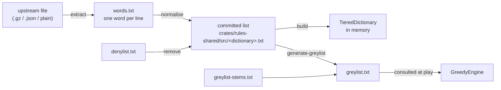

# Word lists and dictionaries

How a word list becomes the dictionary the engine searches, and how to redo it.

Four dictionaries ship (`sowpods`, `enable2k`, `german` and `spanish`), each
built from its own committed list. What the denylist and the greylist are for,
and why the denylist is narrow, is in
[`wordlists/README.md`](../crates/rules-shared/src/wordlists/README.md). The
four lists (`sowpods.txt`, `enable2k.txt`, `german.txt` and `spanish.txt`, or
`<dictionary>.txt`) are in `crates/rules-shared/src/`. `denylist.txt`,
`greylist.txt` and `greylist-stems.txt` are in
`crates/rules-shared/src/wordlists/`. `ATTRIBUTIONS.md` is at the repository
root.

| To | Change | Runbook |
| --- | --- | --- |
| load a new upstream version of a dictionary | `<dictionary>.txt` | [re-sourcing](#runbook-re-sourcing-a-list) |
| stop an engine choosing a word | `greylist-stems.txt`; `generate-greylist` writes `greylist.txt` | [greylist](#runbook-changing-the-greylist) |
| change the rustrict version | `crates/wordlist-tools/Cargo.toml`, `Cargo.lock` and `generate-greylist.rs`, then `greylist.txt` | [rustrict version](#changing-the-rustrict-version) |
| stop anybody playing a word | `denylist.txt` (empty), then all four lists | [denylist](#runbook-changing-the-denylist) |
| let a denied word be played again | `denylist.txt`, then each list that held the word | [removing a denied word](#removing-a-denied-word) |

The lists are in the image, so each runbook is a Production Release: run it on
a project branch
([4.3.3](4.3.3-testing-ci-and-release.md#which-steps-each-shape-runs)).

## From upstream to dictionary



## Stage 1: recording where a list came from

[`ATTRIBUTIONS.md`](../ATTRIBUTIONS.md) holds one entry per list:

- the upstream;
- the SHA-256 of the upstream file as fetched;
- the licence;
- the counts read in and written out.

CI checks only a list's properties ([stage 5](#stage-5-verifying-a-list)), so
provenance rests on the checksum that
[re-sourcing](#runbook-re-sourcing-a-list) step 2 compares.

## Stage 2: extracting plain text

Each upstream has its own container, and the importer reads plain text. The
output is `words.txt`, one word per line, in any letter case. `upstream` and
`words.txt` are scratch files: keep them in a temporary directory outside the
repository (`work=$(mktemp -d)` in the shell that runs the steps) and never
commit them.

| Dictionary | Fetch | Extract |
| --- | --- | --- |
| `enable2k` | `https://raw.githubusercontent.com/BartMassey/wordlists/master/enable2k.txt.gz` | `gunzip -c "$work/upstream" > "$work/words.txt"` |
| `german` | `https://raw.githubusercontent.com/enz/german-wordlist/master/words` | `cp "$work/upstream" "$work/words.txt"` |
| `spanish` | `https://raw.githubusercontent.com/words/an-array-of-spanish-words/master/index.json` | `jq -r '.[]' "$work/upstream" > "$work/words.txt"` |
| `sowpods` | `https://raw.githubusercontent.com/jesstess/Scrabble/master/scrabble/sowpods.txt` (a mirror) | `(cat "$work/upstream"; echo FRACKS) > "$work/words.txt"` |

`sowpods` appends `FRACKS` because the committed list carries that one word
beyond its upstream (the `sowpods.txt` entry in
[`ATTRIBUTIONS.md`](../ATTRIBUTIONS.md)).

## Stage 3: normalising a list

`normalise(text, &alphabet)` in `crates/rules-shared/src/wordlists.rs`, run by
`import-wordlist`. A list that `normalise` leaves unchanged is *normalised*;
the [fixed-point test](#the-fixed-point-test) checks that every committed list
is. The steps, in order:

| Step | Rule | Why |
| --- | --- | --- |
| 1 | trim and uppercase each line | the board holds uppercase graphemes; Unicode uppercases `ß` to `SS`, which is how German sets play it (no `ß` tile) |
| 2 | drop a word with a character outside the alphabet (`VariantRules::alphabet`) | Spanish has `Ñ` and no `K` or `W`; German adds `Ä Ö Ü`; the test is per character, so Spanish `CH`, `LL` and `RR` need no handling |
| 3 | drop a word shorter than 2 or longer than 15 characters | 15 is the board width and 2 the shortest play |
| 4 | sort and dedupe in byte (code-point) order | a locale-aware sort files German `Ä` beside `A` and fails the fixed-point test |
| 5 | end the output with one newline | the fixed-point test compares bytes |

`--remove-denied` (`remove_denied`) is a separate step
([why](#design-notes-on-the-word-lists)); the runbooks show when to run it.

### The fixed-point test

A committed list must equal `normalise` of itself. The test is
`every_word_list_is_a_fixed_point_of_the_normaliser` in
`crates/rules-shared/src/dictionary.rs`. It fails on:

- a changed alphabet;
- a changed length bound;
- a list edited, or imported without normalising, including a missing final
  newline.

`TieredDictionary` construction filters, sorts and dedupes again, so file order
affects no lookup ([4.2.1](4.2.1-rules-engine.md#dictionary-structure)).

## Stage 4: the greylist and the denylist

The greylist is generated; the denylist is curated by hand
([curating the denylist](#curating-the-denylist)).

### Generating the greylist

`generate-greylist` writes `greylist.txt` from the committed `sowpods.txt` and
`enable2k.txt` together:

```text
greylist = rustrict is(Type::ANY) on the lowercased word
         ∪ words matching an entry in greylist-stems.txt
         − exclusions in greylist-stems.txt
         − denylist
```

The generator lowercases each word because an all-caps string can raise
rustrict's `SPAM` type on its own. The count is in the header of
`greylist.txt`.

Stem syntax, one entry per line of `greylist-stems.txt`:

| Entry | Kind | Meaning |
| --- | --- | --- |
| `WORD` | *exact stem* | grey this word, exactly |
| `PREFIX*` | *prefix stem* | grey every dictionary word starting with `PREFIX` |
| `!WORD` | *exclusion* | never grey this word; `!NEGRONI` keeps `NEGRONI` out of `NEGRO*` |

- **Why stems:** they cover rustrict's arbitrary recall gaps. It flags
  `NEGROES` and not `NEGRO`, `POOFTER` and not `POOF`, and misses `MONG`.
- **Plurals:** a greylisted base can have a plural that is not greylisted,
  whether rustrict or a stem caught the base. The plurals section of
  `greylist-stems.txt` holds the plurals found missing, and its header says how
  they were found.
- **The report** on stderr lists exact stems in no dictionary and exclusions
  under no prefix stem.

### Curating the denylist

`denylist.txt` is empty. The owner curates it, because what a person may play
is a game rule.

- **Candidates:** the 185 `sowpods` words rustrict rates both `OFFENSIVE` and
  `SEVERE`, which the README measured, plus the slurs the
  [LDNOOBW list](https://github.com/LDNOOBW/List-of-Dirty-Naughty-Obscene-and-Otherwise-Bad-Words)
  catches and rustrict misses (`NEGRO`, `MONG`, `POOF`, `POON`). No script
  computes them; Claude recomputes either set by hand when the owner asks.
- **Who:** rustrict and LDNOOBW propose, the owner strikes the false positives.
- **Scope:** candidates are English
  ([why](../crates/rules-shared/src/wordlists/README.md#not-english)); a denied
  word is removed from all four lists.

## Stage 5: verifying a list

`cargo test -p rules-shared` and `cargo test -p engine-core` run these, and CI
runs them ([4.3.3](4.3.3-testing-ci-and-release.md#23-continuous-integration)):

| Test | Proves |
| --- | --- |
| `every_word_list_is_a_fixed_point_of_the_normaliser` | each list is in normalised form |
| `no_committed_word_list_holds_a_denied_word` | the lists were re-imported after a denylist change |
| `matching_is_whole_word_never_substring` | `SCUNTHORPE`, `ASSASSIN` and `KNITTING` survive a denylist of their substrings |
| `the_greylist_ships_populated_and_the_denylist_empty` | the shipped state; an empty denylist removes nothing |
| `stem_expansion_does_not_catch_ordinary_words` | the listed ordinary words stay ungreyed |
| `the_base_words_rustrict_misses_are_greylisted` | the stems close rustrict's gaps |
| `crates/rules-shared/tests/greylist_plurals.rs` | a fixed sample of plurals stays greylisted and five ordinary words stay playable |
| `the_bot_declines_a_greylisted_word_that_would_have_won` | the engine avoids the real greylist |

## Stage 6: using the lists at run time

Every dictionary is built by `TieredDictionary::from_word_list(text,
&alphabet)`; the structure is in
[4.2.1](4.2.1-rules-engine.md#dictionary-structure). What differs is who builds
it, and when:

| Where | Built by | When |
| --- | --- | --- |
| server | `build_all_dictionaries()` (`crates/server-game/src/main.rs`) forces each `LazyLock` | at start, all four |
| other native code | `dictionary_by_name` through a `LazyLock` | first use |
| web client | `load_client_dictionary` (`crates/ui/src/app.rs`), fetching `/dictionaries/{name}` | when the client needs the language |

- **Greylist:** separate from the dictionary. `GreedyEngine` declines a move
  that forms a word for which `is_avoided_by_engines` is true, which is a word
  on either list. [4.2.3](4.2.3-engine-interface.md#the-engines) says which
  words it checks.
- **Denied words:** gone from the committed lists, so a player gets the
  [ordinary not-in-the-dictionary message](../crates/rules-shared/src/wordlists/README.md#say-not-a-word-never-that-word-is-offensive).

## Shared steps

Runbooks link to these. They change files but commit nothing: the commit is
always the calling runbook's own.

### Importing a list

1. Extract `words.txt` from `upstream` with the stage 2 command.
2. Import it. Counts go to stderr and the list to stdout, which overwrites
   `<dictionary>.txt`:

   ```bash
   cargo run --release -p wordlist-tools --bin import-wordlist -- <dictionary> \
     < "$work/words.txt" > crates/rules-shared/src/<dictionary>.txt
   ```

3. Run `cargo test -p rules-shared every_word_list_is_a_fixed_point`. It is the
   acceptance check; the calling runbook runs the full suite later.

### Removing the denied words from a list

Run it for one dictionary, and only while `denylist.txt` holds words: with an
empty denylist `remove_denied` returns its input unchanged, newline included,
so `echo` would add a second newline and fail the fixed-point test.

```bash
list=crates/rules-shared/src/<dictionary>.txt
tmp=$(mktemp)
cargo run --release -p wordlist-tools --bin import-wordlist -- \
  <dictionary> --remove-denied < "$list" > "$tmp" \
  && echo >> "$tmp" && mv "$tmp" "$list"
```

- Redirecting into the file being read would empty it, hence the temporary
  file.
- `remove_denied` drops the final newline, so `echo` adds it back.

### Regenerating greylist.txt

`generate-greylist` reads the list files and the stems as they are on disk, so
run it after any change to them.

1. Generate:

   ```bash
   cargo run --release -p wordlist-tools --bin generate-greylist \
     > crates/rules-shared/src/wordlists/greylist.txt
   ```

2. Read the report on stderr:
   - an exact stem in no dictionary is a typo or a word the lists dropped: fix
     the stem;
   - an exclusion listed under no prefix stem: remove it and regenerate; if the
     word is then in `greylist.txt`, rustrict flags it, so restore the
     exclusion; if not, leave it removed.

## Runbook: re-sourcing a list

1. **Owner:** fetch the upstream file ([stage 2](#stage-2-extracting-plain-text)
   has the URL) into a temporary directory and take its checksum:

   ```bash
   work=$(mktemp -d)
   curl -sLo "$work/upstream" <fetch URL>
   sha256sum "$work/upstream"
   ```

   If the fetch fails because the upstream moved, Claude corrects the URL in
   the stage 2 table and the `ATTRIBUTIONS.md` entry.
2. **Owner:** compare the checksum with the `ATTRIBUTIONS.md` entry and read
   the upstream licence:
   - same checksum: upstream has not moved, so stop;
   - new checksum and a licence that still allows the list to ship: continue;
   - a licence that no longer allows it: stop, and the owner decides the
     dictionary's future.
3. **Claude:** import the list ([importing a list](#importing-a-list)).
4. **Claude:** update the dictionary's `ATTRIBUTIONS.md` entry: URL, licence,
   checksum, counts.
5. **Claude:** commit `<dictionary>.txt` and `ATTRIBUTIONS.md` together.
6. **Claude:** if the denylist holds words, remove them from this dictionary
   alone ([removing the denied words](#removing-the-denied-words-from-a-list)),
   update the counts in the `ATTRIBUTIONS.md` entry, and commit
   `<dictionary>.txt` and `ATTRIBUTIONS.md` as a second commit. After commit 5
   alone, `no_committed_word_list_holds_a_denied_word` fails: read CI at the
   branch tip after both commits.
7. **Claude:** for `sowpods` or `enable2k`, regenerate the greylist
   ([regenerating greylist.txt](#regenerating-greylisttxt)), because the
   generator reads those two lists.
8. **Claude:** for `sowpods` or `enable2k`, record the greylist count (in the
   header of `greylist.txt`) in the greylist section of `ATTRIBUTIONS.md`.
9. **Claude:** run `cargo test -p rules-shared -p engine-core`.
10. **Claude:** for `sowpods` or `enable2k`, commit `greylist.txt` and
    `ATTRIBUTIONS.md` together.

## Runbook: changing the greylist

1. **Owner:** decide the stem change. Adding a stem is cheap; removing one lets
   the bot play those words, so the owner reviews each removal as closely as the
   full review that the header of `greylist-stems.txt` records.
2. **Claude:** edit `greylist-stems.txt`, never `greylist.txt`. For an exact
   stem, add its plurals in the plurals section.
3. **Claude:** regenerate and read the report
   ([regenerating greylist.txt](#regenerating-greylisttxt)).
4. **Claude:** run `cargo test -p rules-shared -p engine-core`.
5. **Claude:** record the count (in the header of `greylist.txt`) and the
   rustrict version in the greylist section of `ATTRIBUTIONS.md`.
6. **Owner:** review the diff of `greylist-stems.txt`.
7. **Claude:** commit `greylist-stems.txt`, `greylist.txt` and
   `ATTRIBUTIONS.md` together.

### Changing the rustrict version

1. **Owner:** decide the bump.
2. **Claude:** edit the pin in `crates/wordlist-tools/Cargo.toml`, and
   `RUSTRICT_VERSION` in `crates/wordlist-tools/src/bin/generate-greylist.rs`,
   which sets only the header's text of `greylist.txt`.
3. **Claude:** regenerate
   ([regenerating greylist.txt](#regenerating-greylisttxt)). The build updates
   `Cargo.lock`.
4. **Claude:** check by hand the plural of each entry that the diff of
   `greylist.txt` adds, because `crates/rules-shared/tests/greylist_plurals.rs`
   asserts a fixed sample, not the new entries. Add a missing plural to the
   plurals section of `greylist-stems.txt` and regenerate.
5. **Claude:** run `cargo test -p rules-shared -p engine-core`.
6. **Claude:** record the new version and the count in the greylist section of
   `ATTRIBUTIONS.md`.
7. **Owner:** review the diff of `greylist.txt`.
8. **Claude:** commit `crates/wordlist-tools/Cargo.toml`, `Cargo.lock`,
   `generate-greylist.rs`, `greylist.txt` and `ATTRIBUTIONS.md` together, with
   `greylist-stems.txt` if step 4 changed it.

## Runbook: changing the denylist

This runbook adds words; [removing a denied word](#removing-a-denied-word) is
its inverse.

1. **Owner:** decide the words, from the candidates
   ([curating the denylist](#curating-the-denylist)), and edit `denylist.txt`.
2. **Claude:** update `the_greylist_ships_populated_and_the_denylist_empty` in
   `crates/rules-shared/src/wordlists.rs` to the new shipped state: its first
   assertion is that the denylist is empty, and its last that `remove_denied`
   changes nothing.
3. **Claude:** for each of the four dictionaries, remove the denied words
   ([removing the denied words](#removing-the-denied-words-from-a-list)).
   German and Spanish are included because the denylist applies to every
   dictionary and `no_committed_word_list_holds_a_denied_word` checks all four.
4. **Claude:** regenerate the greylist
   ([regenerating greylist.txt](#regenerating-greylisttxt)).
5. **Claude:** update the counts of the four lists in `ATTRIBUTIONS.md`, and the
   greylist count in its greylist section.
6. **Claude:** run `cargo test -p rules-shared -p engine-core`.
7. **Claude:** commit `denylist.txt`, `crates/rules-shared/src/wordlists.rs`,
   the four lists, `greylist.txt` and `ATTRIBUTIONS.md` together. The diff over
   the lists is the record of what was removed.

### Removing a denied word

A committed list no longer holds the word, so it comes back only from upstream.
Re-sourcing stops on an unchanged checksum, so this runbook has its own steps.

1. **Owner:** take the word out of `denylist.txt`.
2. **Claude:** update `the_greylist_ships_populated_and_the_denylist_empty` in
   `crates/rules-shared/src/wordlists.rs`. If the denylist is now empty, restore
   its assertion that the denylist is empty. If words remain, check that each
   assertion still holds.
3. **Owner:** for each list that held the word (the diff of the commit that
   denied it shows which), fetch its upstream file and take the checksum, as
   [re-sourcing](#runbook-re-sourcing-a-list) step 1 does. A checksum that
   differs from the `ATTRIBUTIONS.md` entry means upstream moved: stop, and the
   owner decides whether to run re-sourcing instead.
4. **Claude:** import each of those lists
   ([importing a list](#importing-a-list)).
5. **Claude:** if the denylist still holds words, remove them from each of those
   lists ([removing the denied words](#removing-the-denied-words-from-a-list)).
6. **Claude:** if `sowpods` or `enable2k` was imported, regenerate the greylist
   ([regenerating greylist.txt](#regenerating-greylisttxt)).
7. **Claude:** update the counts of each imported list in `ATTRIBUTIONS.md`, and
   the greylist count in its greylist section if step 6 ran.
8. **Claude:** run `cargo test -p rules-shared -p engine-core`.
9. **Claude:** commit `denylist.txt`, `crates/rules-shared/src/wordlists.rs`,
   each imported list, `greylist.txt` if step 6 ran, and `ATTRIBUTIONS.md`
   together.

## Design notes on the word lists

- **Why the extraction stays outside the importer:** teaching it to un-gzip and
  parse JSON would add a decompressor and a JSON parser to `wordlist-tools`, to
  save one line of shell per source.
- **Why re-sourcing removes the denied words in a second commit:** the history
  then shows where a list first departs from its upstream.
- **Why the fixed-point test compares against `normalise`:** it proves a list is
  normalised with no second copy of the rules to drift.
- **Why rustrict only generates the greylist:** it is a chat moderator built to
  defeat evasion, so on isolated words it fires on stems and topics. At no
  threshold is its output a denylist: `OFFENSIVE | SEVERE` flags `HOLOCAUST`,
  `JEW`, `QUEER` and `SCUNTHORPE` (the README's
  [measurements](../crates/rules-shared/src/wordlists/README.md#filling-these-in)).
  It is the right tool where a false positive only costs the engine vocabulary,
  and the wrong one where it takes a word from a person.
- **Why stems are not a substring pass:** short stems match ordinary words
  (`MONG` in `MONGOOSE`, `SCAT` in `SCATTER`, `GYP` in `GYPSUM`), so each stem
  is reviewed and exclusions name the accidents. `MONG*` would also catch
  `MONGER`, so `MONG` is exact.
- **Why the greylist errs long:** a wrongly greyed word is one the engine
  declines, which nobody notices, and a missed one is a bot playing it in front
  of a person.
