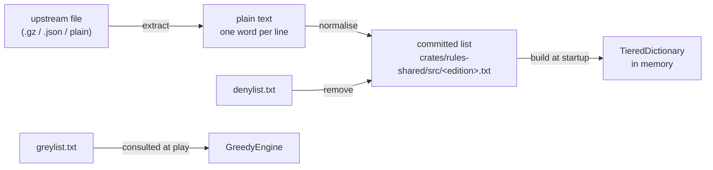

# Word lists and dictionaries

How a word list becomes the trie the engine searches, and how to redo it.

Four editions ship a dictionary: `sowpods`, `enable2k`, `german` and `spanish`.
Each is built from its own committed list in `crates/rules-shared/src/`, and
two shared lists in `crates/rules-shared/src/wordlists/` decide what nobody may
play and what no engine will choose. What each shared list is for, and why the
denylist is narrow, is in
[`wordlists/README.md`](../crates/rules-shared/src/wordlists/README.md).

| List | Applies to | Effect | Today |
| --- | --- | --- | --- |
| `denylist.txt` | everyone | removed from the committed lists | empty, awaiting curation |
| `greylist.txt` | engines | stays in the dictionaries; `GreedyEngine` never plays it | generated and shipped |
| `greylist-stems.txt` | `generate-greylist` | input that makes the greylist reproducible | curated by hand |

An engine avoids the union of the denylist and the greylist
(`is_avoided_by_engines`), so the greylist alone already stops a bot playing
a listed word. The denylist decides only what a person may play.

## From upstream to dictionary



Extraction and the review of generated lists are one-off human work. The
rest is mechanical and stays so.

## Stage 1: recording where a list came from

[`ATTRIBUTIONS.md`](../ATTRIBUTIONS.md) holds one entry per list:

- upstream URL;
- SHA-256 of the upstream file as fetched;
- licence;
- counts read in and written out.

CI checks a committed list's properties (stage 5). It cannot check that the
list came from the stated upstream, so a green build is no proof of
provenance. A person holding the upstream file compares it with the recorded
checksum.

## Stage 2: extracting plain text

Extraction is the only per-source step and stays in shell. A Rust binary that
un-gzips and parses JSON would add dependencies to `rules-shared`, which
compiles to wasm. The output is plain text, one word per line, in any case.
Take the URL from `ATTRIBUTIONS.md`; upstream layouts move.

| Edition | Upstream shape | Extraction |
| --- | --- | --- |
| `enable2k` | gzipped text | `curl -sL <url>/enable2k.txt.gz \| gunzip` |
| `german` | plain `words` file | `curl -sL <url>/words` |
| `spanish` | JSON array | `curl -sL <url>/index.json \| jq -r '.[]'` |
| `sowpods` | plain text, from a mirror | `curl -sL <url>/sowpods.txt` |

## Stage 3: normalising a list so construction can trust it

`normalise(text, &alphabet)` in `crates/rules-shared/src/wordlists.rs`, run by
`import-wordlist`. In order:

1. trim and uppercase each line; the board holds uppercase graphemes, and
   Unicode uppercases `ß` to `SS`, which is how German sets play it (no `ß`
   tile), so there is no special case;
2. drop a word with a character outside the edition's alphabet
   (`VariantRules::alphabet`; Spanish has `Ñ` and no `K` or `W`, German adds
   `Ä Ö Ü`); the test is per character, so Spanish `C`, `H`, `L` and `R` all
   pass and the `CH`, `LL` and `RR` tiles need no handling;
3. drop a word shorter than 2 or longer than 15 characters, the board width
   and the shortest play;
4. sort and dedupe in byte order, the code-point order the prefix cursor's
   binary search assumes; a locale-aware sort files German `Ä` beside `A` and
   breaks lookups on the two non-ASCII lists only;
5. end the output with one newline.

`remove_denied` (`--remove-denied`) is a separate step, committed separately.
The history then shows where a list first departs from its upstream.
`remove_denied` joins lines without a final newline, so its output fails the
fixed-point test below; the denylist is empty today, so it is not yet hit.

### Why normalising happens at import

A list is normalised once and committed, so no process re-sorts or re-filters
it at startup. The same holds for denylist removal.

### The fixed-point invariant

A committed list must equal `normalise` of itself. The test is
`every_word_list_is_a_fixed_point_of_the_normaliser` in
`crates/rules-shared/src/dictionary.rs`. It fails on a changed alphabet or
length bound, or on a list or denylist changed without re-importing, with no
second copy of the rules to drift.

## Stage 4: generating the greylist

The denylist is curated by a person; the greylist is generated. A wrongly
denied word is taken from a human, who notices. A wrongly greyed word is one
the bot declines, which nobody notices.

[`rustrict`](https://crates.io/crates/rustrict) cannot generate the denylist
at any threshold. It is a chat moderator built to defeat evasion, so on
isolated words it fires on stems and topics: `OFFENSIVE | SEVERE` flags
`HOLOCAUST`, `JEW`, `QUEER` and `SCUNTHORPE`. The README linked above has the
measurements.

### Generating the greylist

`generate-greylist` writes `greylist.txt` for sowpods and enable2k together:

```text
greylist = rustrict is(Type::ANY) on the lowercased word
         ∪ words matching an entry in greylist-stems.txt
         − exclusions in greylist-stems.txt
         − denylist
```

- **rustrict** is a dependency of `wordlist-tools` only, pinned exactly in its
  `Cargo.toml` and recorded in `ATTRIBUTIONS.md`; it is not in `rules-shared`,
  the server or the wasm client. The lowercase is because an all-caps string
  raises `SPAM` on its own.
- **The count** is in the header of `greylist.txt`. Check it against
  `ATTRIBUTIONS.md` after regenerating.
- **Stems** cover rustrict's arbitrary recall gaps: it flags `NEGROES` and not
  `NEGRO`, `POOFTER` and not `POOF`, and misses `MONG`.
- **Plurals** of every greylisted base are greylisted too, so a base never
  has a playable plural. The stems file's plurals sections hold them.
- **Erring long** costs nothing: lookups do not allocate, and `GreedyEngine`
  tests a move only when it would become the best so far.

Stem file syntax (the file's header is the reference):

| Line | Meaning |
| --- | --- |
| `WORD` | grey this word exactly |
| `PREFIX*` | grey every dictionary word starting with `PREFIX` |
| `!WORD` | never grey this word |

Expanding a prefix is reviewed per stem, not applied as a blanket substring
pass. `NEGRO*` is safe except `NEGRONI`; `MONG*` catches `MONGER` and
`MONGOOSE`, so `MONG` is exact. The generator also reports on stderr any
exact entry in no dictionary and any exclusion matching no prefix.

### Curating the denylist

Not yet done. The candidate set is rustrict's `OFFENSIVE & SEVERE`
intersection plus the slurs LDNOOBW catches and rustrict misses (`NEGRO`,
`MONG`, `POOF`, `POON`), with the false positives struck. A struck word falls
into the greylist, so over-striking is safe. German and Spanish are out of
scope for both lists: nobody on the project can review them.

## Stage 5: verifying a list

`cargo test -p rules-shared` and `cargo test -p engine-core` run these, and CI
runs them ([4.3.3](4.3.3-testing-ci-and-release.md)):

| Test | Proves |
| --- | --- |
| `every_word_list_is_a_fixed_point_of_the_normaliser` | each list is in normalised form |
| `no_committed_word_list_holds_a_denied_word` | the lists were regenerated after a denylist change |
| `matching_is_whole_word_never_substring` | `SCUNTHORPE`, `ASSASSIN` and `BASEMENT` survive a denylist of their substrings |
| `the_greylist_ships_populated_and_the_denylist_empty` | the shipped state; an empty denylist removes nothing |
| `stem_expansion_does_not_catch_ordinary_words` | no stem has widened onto an ordinary word |
| `the_base_words_rustrict_misses_are_greylisted` | the stems close rustrict's gaps |
| `crates/rules-shared/tests/greylist_plurals.rs` | plurals stay greylisted and ordinary words stay playable |
| `the_bot_declines_a_greylisted_word_that_would_have_won` | the engine avoids the real greylist |

## Stage 6: using the lists at run time

- **Dictionary:** `TieredDictionary::from_word_list(text, &alphabet)` builds
  each edition once, behind a `LazyLock`; `build_all_dictionaries()` warms
  them off the request path. The arena is ordered by letter index, not code
  point, so construction needs the alphabet (Spanish files `Ñ` between `N` and
  `O`).
- **Greylist:** not part of the dictionary. `GreedyEngine` asks
  `is_avoided_by_engines` of the main word and every cross word of a move,
  only for a move that beats the best so far.
- **Denied words:** gone from the committed lists, so a player gets the
  ordinary not-in-the-dictionary message.

## Runbook: re-sourcing an edition's list

1. Extract to plain text (stage 2) and note the SHA-256 of the upstream file.
2. Import; counts go to stderr and the list to stdout. Add `--remove-denied`
   as a separate commit if the denylist is non-empty.

   ```bash
   cargo run --release -p wordlist-tools --bin import-wordlist -- <name> \
     < words.txt > crates/rules-shared/src/<name>.txt
   ```

3. `cargo test -p rules-shared`; the fixed-point test is the acceptance check.
4. Update the edition's `ATTRIBUTIONS.md` entry: URL, licence, checksum,
   counts.
5. Commit the list and the attribution together.

## Runbook: changing the greylist or the denylist

- **Greylist:** edit `greylist-stems.txt`, never `greylist.txt`, then
  regenerate and commit both:

  ```bash
  cargo run --release -p wordlist-tools --bin generate-greylist \
    > crates/rules-shared/src/wordlists/greylist.txt
  ```

- **Denylist:** re-import all four editions with `--remove-denied` in the
  same commit as the denylist change. The diff over four files is the record
  of what was removed.

## Not automated

| What | Why |
| --- | --- |
| extraction | one line of shell per source, against gzip and JSON dependencies in a wasm crate |
| denylist curation | a judgement no classifier makes |
| provenance check | needs the network and an upstream file that may have moved |
