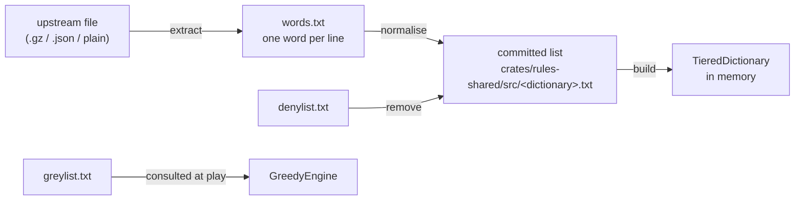

# Word lists and dictionaries

How a word list becomes the dictionary the engine searches, and how to redo it.

Four dictionaries ship: `sowpods`, `enable2k`, `german` and `spanish`. Each is
built from its own committed list. Three more files decide what nobody may play
and what no engine will choose. What each is for, and why the denylist is
narrow, is in
[`wordlists/README.md`](../crates/rules-shared/src/wordlists/README.md). This
page covers how the lists are produced, verified and changed.

| File (in `crates/rules-shared/src/`) | Holds | Changed by |
| --- | --- | --- |
| `<dictionary>.txt` | the words of one dictionary | the [re-sourcing runbook](#runbook-re-sourcing-a-list) |
| `wordlists/denylist.txt` | words nobody may play (empty) | the [denylist runbook](#runbook-changing-the-denylist) |
| `wordlists/greylist-stems.txt` | the judgement behind the greylist | the [greylist runbook](#runbook-changing-the-greylist) |
| `wordlists/greylist.txt` | words no engine will choose | `generate-greylist`, never by hand |

To change a list, go to:

| To | Go to |
| --- | --- |
| load a new upstream version of a dictionary | [re-sourcing runbook](#runbook-re-sourcing-a-list) |
| stop an engine choosing a word | [greylist runbook](#runbook-changing-the-greylist) |
| stop anybody playing a word | [denylist runbook](#runbook-changing-the-denylist) |

## From upstream to dictionary



## Stage 1: recording where a list came from

[`ATTRIBUTIONS.md`](../ATTRIBUTIONS.md) holds one entry per list: upstream,
SHA-256 of the upstream file as fetched, licence, and counts read in and
written out. CI checks a committed list's properties
([stage 5](#stage-5-verifying-a-list)); it cannot check that the list came
from the stated upstream, so a green build is no proof of provenance. The
[re-sourcing runbook](#runbook-re-sourcing-a-list) compares the checksum.

## Stage 2: extracting plain text

Extraction is the only per-source step: each upstream has its own container,
and the importer reads plain text. The output is `words.txt`, one word per
line, in any letter case. Upstream layouts move; when the fetch fails, correct
the URL here and in the `ATTRIBUTIONS.md` entry.

| Dictionary | Fetch | Extract |
| --- | --- | --- |
| `enable2k` | `https://raw.githubusercontent.com/BartMassey/wordlists/master/enable2k.txt.gz` | `gunzip -c upstream > words.txt` |
| `german` | `https://raw.githubusercontent.com/enz/german-wordlist/master/words` | `cp upstream words.txt` |
| `spanish` | `https://raw.githubusercontent.com/words/an-array-of-spanish-words/master/index.json` | `jq -r '.[]' upstream > words.txt` |
| `sowpods` | `https://raw.githubusercontent.com/jesstess/Scrabble/master/scrabble/sowpods.txt` (a mirror) | `cp upstream words.txt` |

## Stage 3: normalising a list

`normalise(text, &alphabet)` in `crates/rules-shared/src/wordlists.rs`, run by
`import-wordlist`. In order:

| Step | Rule | Why |
| --- | --- | --- |
| 1 | trim and uppercase each line | the board holds uppercase graphemes; Unicode uppercases `ß` to `SS`, which is how German sets play it (no `ß` tile) |
| 2 | drop a word with a character outside the alphabet (`VariantRules::alphabet`) | Spanish has `Ñ` and no `K` or `W`; German adds `Ä Ö Ü`; the test is per character, so Spanish `CH`, `LL` and `RR` need no handling |
| 3 | drop a word shorter than 2 or longer than 15 characters | 15 is the board width and 2 the shortest play |
| 4 | sort and dedupe in byte (code-point) order | a locale-aware sort files German `Ä` beside `A` and fails the fixed-point test |
| 5 | end the output with one newline | the fixed-point test compares bytes |

`--remove-denied` (`remove_denied`) is a separate step, committed separately,
so that the history shows where a list first departs from its upstream. With a
non-empty denylist it returns the lines joined without a final newline.

### The fixed-point test

A committed list must equal `normalise` of itself. The test is
`every_word_list_is_a_fixed_point_of_the_normaliser` in
`crates/rules-shared/src/dictionary.rs`. It fails on:

- a changed alphabet;
- a changed length bound;
- a list edited, or imported without normalising, including a missing final
  newline.

It proves a list is normalised, with no second copy of the rules to drift.
Startup re-filters and re-sorts regardless: `TieredDictionary::from_word_list`
drops words with a character outside the alphabet, and `from_encoded` drops
words under 2 characters, sorts by letter index and dedupes, so file order
affects no lookup.

## Stage 4: the greylist and the denylist

The owner curates the denylist, because what a person may play is a game rule.
The greylist is generated. A wrongly denied word is taken from a person, who
notices. A wrongly greyed word is one the engine declines, which nobody
notices.

[`rustrict`](https://crates.io/crates/rustrict) cannot generate the denylist
at any threshold. It is a chat moderator built to defeat evasion, so on
isolated words it fires on stems and topics: `OFFENSIVE | SEVERE` (either
flag) flags `HOLOCAUST`, `JEW`, `QUEER` and `SCUNTHORPE`. The
[README](../crates/rules-shared/src/wordlists/README.md) has the
measurements.

### Generating the greylist

`generate-greylist` writes `greylist.txt` from the committed `sowpods.txt` and
`enable2k.txt` together:

```text
greylist = rustrict is(Type::ANY) on the lowercased word
         ∪ words matching an entry in greylist-stems.txt
         − exclusions in greylist-stems.txt
         − denylist
```

The generator lowercases each word because an all-caps string can raise `SPAM`
on its own. The count is in the header of `greylist.txt`.

Stem syntax, one entry per line of `greylist-stems.txt`:

| Entry | Meaning |
| --- | --- |
| `WORD` | grey this word, exactly |
| `PREFIX*` | grey every dictionary word starting with `PREFIX` |
| `!WORD` | never grey this word; `!NEGRONI` keeps `NEGRONI` out of `NEGRO*` |

- **Stems** cover rustrict's arbitrary recall gaps: it flags `NEGROES` and not
  `NEGRO`, `POOFTER` and not `POOF`, and misses `MONG`.
- **Prefix stems** are reviewed per stem, not applied as a blanket substring
  pass. `MONG*` would catch `MONGER` and `MONGOOSE`, so `MONG` is exact.
- **Plurals:** the plurals section of `greylist-stems.txt` holds the plurals
  of greylisted bases. A plural of an exact stem is not greylisted until it is
  added there.
- **The report** on stderr lists exact stems in no dictionary and exclusions
  that never fire.

### Curating the denylist

`denylist.txt` is empty.

- **Candidates:** rustrict's `OFFENSIVE & SEVERE` (both flags) plus the slurs
  the
  [LDNOOBW list](https://github.com/LDNOOBW/List-of-Dirty-Naughty-Obscene-and-Otherwise-Bad-Words)
  catches and rustrict misses (`NEGRO`, `MONG`, `POOF`, `POON`).
- **Who:** rustrict proposes, the owner strikes the false positives.
- **Struck words:** one that rustrict or a stem flags still reaches the
  greylist.
- **Scope:** English only, because nobody on the project can review German or
  Spanish.

## Stage 5: verifying a list

`cargo test -p rules-shared` and `cargo test -p engine-core` run these, and CI
runs them ([4.3.3](4.3.3-testing-ci-and-release.md#23-continuous-integration)):

| Test | Proves |
| --- | --- |
| `every_word_list_is_a_fixed_point_of_the_normaliser` | each list is in normalised form |
| `no_committed_word_list_holds_a_denied_word` | the lists were re-imported after a denylist change |
| `matching_is_whole_word_never_substring` | `SCUNTHORPE`, `ASSASSIN` and `BASEMENT` survive a denylist of their substrings |
| `the_greylist_ships_populated_and_the_denylist_empty` | the shipped state; an empty denylist removes nothing |
| `stem_expansion_does_not_catch_ordinary_words` | the listed ordinary words stay ungreyed |
| `the_base_words_rustrict_misses_are_greylisted` | the stems close rustrict's gaps |
| `crates/rules-shared/tests/greylist_plurals.rs` | sampled plurals stay greylisted and ordinary words stay playable |
| `the_bot_declines_a_greylisted_word_that_would_have_won` | the engine avoids the real greylist |

## Stage 6: using the lists at run time

- **Dictionary:** `TieredDictionary::from_word_list(text, &alphabet)` builds
  each dictionary once. Natively, a `LazyLock` builds it on first use and the
  server pre-builds all four at start (`build_all_dictionaries()`,
  `crates/server-game/src/main.rs`). The web client fetches
  `/dictionaries/{name}` and builds the same structure
  (`load_client_dictionary` in `crates/ui/src/app.rs`). The structure is in
  [4.2.1](4.2.1-rules-engine.md#dictionary-structure).
- **Greylist:** not part of the dictionary. `GreedyEngine` asks
  `is_avoided_by_engines` of the main word and every cross word of a move,
  and the function is true for a word on either the greylist or the denylist.
  When it asks is in [4.2.3](4.2.3-engine-interface.md#the-engines).
- **Denied words:** gone from the committed lists, so a player gets the
  ordinary not-in-the-dictionary message.

## Runbook: re-sourcing a list

1. **Owner:** fetch the upstream file ([stage 2](#stage-2-extracting-plain-text)
   has the URL) and take its checksum:

   ```bash
   curl -sLo upstream <fetch URL>
   sha256sum upstream
   ```

2. **Owner:** compare the checksum with the `ATTRIBUTIONS.md` entry and read
   the upstream licence. A new checksum means upstream moved.
3. Extract `words.txt` (stage 2), then import. Counts go to stderr and the list
   to stdout:

   ```bash
   cargo run --release -p wordlist-tools --bin import-wordlist -- <name> \
     < words.txt > crates/rules-shared/src/<name>.txt
   ```

4. Run `cargo test -p rules-shared every_word_list_is_a_fixed_point`. It is the
   acceptance check; the other tests wait for step 7.
5. Update the dictionary's `ATTRIBUTIONS.md` entry: URL, licence, checksum,
   counts.
6. Commit the list and the attribution together.
7. If the denylist is not empty, run
   [step 2 of the denylist runbook](#runbook-changing-the-denylist) for this
   dictionary alone and commit that on its own. Until then
   `no_committed_word_list_holds_a_denied_word` fails, so commits 6 and 7 are
   not both green.
8. For `sowpods` and `enable2k`, run steps 2 and 3 of the
   [greylist runbook](#runbook-changing-the-greylist), because the generator
   reads the committed lists. Then run
   `cargo test -p rules-shared -p engine-core` and commit the greylist.

## Runbook: changing the greylist

1. Edit `greylist-stems.txt`, never `greylist.txt`. For an exact stem, add its
   plurals in the plurals section.
2. Generate:

   ```bash
   cargo run --release -p wordlist-tools --bin generate-greylist \
     > crates/rules-shared/src/wordlists/greylist.txt
   ```

3. Read the report on stderr. For each exact stem in no dictionary, fix the
   typo. For each exclusion that never fires, fix it or drop it.
4. Run `cargo test -p rules-shared -p engine-core`.
5. Record the count (in the header of `greylist.txt`) and the rustrict version
   in the greylist section of `ATTRIBUTIONS.md`.
6. Commit the stems, the greylist and `ATTRIBUTIONS.md` together.

To change the rustrict version, edit both places that hold it, then
regenerate from step 2: the pin in `crates/wordlist-tools/Cargo.toml` and
`RUSTRICT_VERSION` in `generate-greylist.rs`, which is only the header's text.

## Runbook: changing the denylist

1. **Owner:** decide the words, from the candidates
   ([curating the denylist](#curating-the-denylist)). Edit `denylist.txt`.
2. Re-import all four lists from their committed text, through a temporary file
   (redirecting into the file being read empties it). The denylist applies to
   every dictionary and `no_committed_word_list_holds_a_denied_word` checks all
   four, so German and Spanish are included: a denied word may also be a
   German or Spanish word. `remove_denied` drops the final newline, so the loop
   adds it back:

   ```bash
   for name in sowpods enable2k german spanish; do
     list=crates/rules-shared/src/$name.txt
     tmp=$(mktemp)
     cargo run --release -p wordlist-tools --bin import-wordlist -- \
       "$name" --remove-denied < "$list" > "$tmp" \
       && echo >> "$tmp" && mv "$tmp" "$list"
   done
   ```

3. Regenerate the greylist: steps 2 and 3 of the
   [greylist runbook](#runbook-changing-the-greylist).
4. Update `the_greylist_ships_populated_and_the_denylist_empty` to the new
   shipped state, then run `cargo test -p rules-shared -p engine-core`.
5. Commit the denylist, the four lists and the greylist together. The diff over
   the lists is the record of what was removed.

## Steps done by hand

| What | Who | Why |
| --- | --- | --- |
| fetching the upstream file and the provenance check | owner | needs the network and an upstream file that may have moved |
| extraction | Claude | one line of shell per source |
| denylist curation | owner | a judgement no classifier makes |
| greylist stem review | owner | a stem that widens onto an ordinary word costs the engine vocabulary |

## Design notes on the word lists

- **Why the extraction stays outside the importer:** teaching it to un-gzip and
  parse JSON would add both dependencies to a crate that compiles to wasm, to
  save one line run once a year.
- **Why rustrict only generates the greylist:** it is the right tool where a
  miss costs vocabulary and the wrong one where a miss takes a word from a
  person ([stage 4](#stage-4-the-greylist-and-the-denylist)).
- **Why stems are not a substring pass:** short stems match ordinary words
  (`MONG` in `MONGOOSE`, `SCAT` in `SCATTER`, `GYP` in `GYPSUM`), so each stem
  is reviewed and exclusions name the accidents.
- **Why the greylist errs long:** the stems err towards greying because a
  wrongly greyed word is unobserved and a missed one is not.
