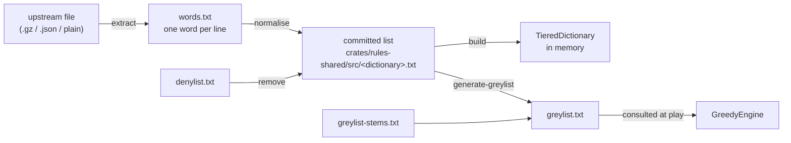

# Word lists and dictionaries

How a word list becomes the dictionary the engine searches, and how to redo it.

Four dictionaries ship (`sowpods`, `enable2k`, `german` and `spanish`), each
built from its own committed list. What the denylist and the greylist are for,
and why the denylist is narrow, is in
[`wordlists/README.md`](../crates/rules-shared/src/wordlists/README.md). This
page covers how the lists are produced, verified and changed. Paths are under
`crates/rules-shared/src/`.

| To | Change | Runbook |
| --- | --- | --- |
| load a new upstream version of a dictionary | `<dictionary>.txt` | [re-sourcing](#runbook-re-sourcing-a-list) |
| stop an engine choosing a word | `wordlists/greylist-stems.txt`; `generate-greylist` writes `wordlists/greylist.txt`, which is never edited by hand | [greylist](#runbook-changing-the-greylist) |
| stop anybody playing a word | `wordlists/denylist.txt` (empty), then all four lists | [denylist](#runbook-changing-the-denylist) |

## From upstream to dictionary



## Stage 1: recording where a list came from

[`ATTRIBUTIONS.md`](../ATTRIBUTIONS.md) holds one entry per list:

- the upstream;
- the SHA-256 of the upstream file as fetched;
- the licence;
- the counts read in and written out.

CI checks a committed list's properties ([stage 5](#stage-5-verifying-a-list))
but not that it came from the stated upstream, so provenance rests on the
checksum, which the [re-sourcing runbook](#runbook-re-sourcing-a-list) compares
in step 2.

## Stage 2: extracting plain text

Extraction is the only per-source step: each upstream has its own container,
and the importer reads plain text. The output is `words.txt`, one word per
line, in any letter case. Upstream layouts move; when the fetch fails, correct
the URL here and in the `ATTRIBUTIONS.md` entry.

| Dictionary | Fetch | Extract |
| --- | --- | --- |
| `enable2k` | `https://raw.githubusercontent.com/BartMassey/wordlists/master/enable2k.txt.gz` | `gunzip -c upstream > words.txt` |
| `german` | `https://raw.githubusercontent.com/enz/german-wordlist/master/words` | `cp upstream words.txt` |
| `spanish` | `https://raw.githubusercontent.com/words/an-array-of-spanish-words/master/index.json` | `jq -r '.[]' upstream > words.txt` |
| `sowpods` | `https://raw.githubusercontent.com/jesstess/Scrabble/master/scrabble/sowpods.txt` (a mirror) | `cp upstream words.txt` |

## Stage 3: normalising a list

`normalise(text, &alphabet)` in `crates/rules-shared/src/wordlists.rs`, run by
`import-wordlist`. A list that `normalise` leaves unchanged is *normalised*;
the [fixed-point test](#the-fixed-point-test) checks that every committed list
is. The steps, in order:

| Step | Rule | Why |
| --- | --- | --- |
| 1 | trim and uppercase each line | the board holds uppercase graphemes; Unicode uppercases `ß` to `SS`, which is how German sets play it (no `ß` tile) |
| 2 | drop a word with a character outside the alphabet (`VariantRules::alphabet`) | Spanish has `Ñ` and no `K` or `W`; German adds `Ä Ö Ü`; the test is per character, so Spanish `CH`, `LL` and `RR` need no handling |
| 3 | drop a word shorter than 2 or longer than 15 characters | 15 is the board width and 2 the shortest play |
| 4 | sort and dedupe in byte (code-point) order | a locale-aware sort files German `Ä` beside `A` and fails the fixed-point test |
| 5 | end the output with one newline | the fixed-point test compares bytes |

`--remove-denied` (`remove_denied`) is a separate step, committed separately,
so that the history shows where a list first departs from its upstream.

### The fixed-point test

A committed list must equal `normalise` of itself. The test is
`every_word_list_is_a_fixed_point_of_the_normaliser` in
`crates/rules-shared/src/dictionary.rs`. It fails on:

- a changed alphabet;
- a changed length bound;
- a list edited, or imported without normalising, including a missing final
  newline.

It proves a list is normalised, with no second copy of the rules to drift.
`TieredDictionary` construction filters, sorts and dedupes again, so file order
affects no lookup ([4.2.1](4.2.1-rules-engine.md#dictionary-structure)).

## Stage 4: the greylist and the denylist

The greylist is generated; the denylist is curated by hand
([curating the denylist](#curating-the-denylist)).

### Generating the greylist

`generate-greylist` writes `greylist.txt` from the committed `sowpods.txt` and
`enable2k.txt` together:

```text
greylist = rustrict is(Type::ANY) on the lowercased word
         ∪ words matching an entry in greylist-stems.txt
         − exclusions in greylist-stems.txt
         − denylist
```

The generator lowercases each word because an all-caps string can raise `SPAM`
on its own. The count is in the header of `greylist.txt`.

Stem syntax, one entry per line of `greylist-stems.txt`:

| Entry | Kind | Meaning |
| --- | --- | --- |
| `WORD` | *exact stem* | grey this word, exactly |
| `PREFIX*` | *prefix stem* | grey every dictionary word starting with `PREFIX` |
| `!WORD` | *exclusion* | never grey this word; `!NEGRONI` keeps `NEGRONI` out of `NEGRO*` |

- **Why stems:** they cover rustrict's arbitrary recall gaps. It flags
  `NEGROES` and not `NEGRO`, `POOFTER` and not `POOF`, and misses `MONG`.
- **Prefix stems** are reviewed per stem, not applied as a blanket substring
  pass. `MONG` is an exact stem (see
  [why stems are not a substring pass](#design-notes-on-the-word-lists)).
- **Plurals:** a greylisted base can have a plural that is not greylisted,
  whether rustrict or a stem caught the base. The plurals section of
  `greylist-stems.txt` holds the plurals found missing, and its header says how
  they were found. After a rustrict version change, check the plurals of the
  new greylist entries by hand; `tests/greylist_plurals.rs` samples them.
- **The report** on stderr lists exact stems in no dictionary and exclusions
  that never fire.

### Curating the denylist

`denylist.txt` is empty. The owner curates it, because what a person may play
is a game rule.

- **Candidates:** the 185-word `OFFENSIVE & SEVERE` intersection of rustrict
  that the README measured against `sowpods`, plus the slurs the
  [LDNOOBW list](https://github.com/LDNOOBW/List-of-Dirty-Naughty-Obscene-and-Otherwise-Bad-Words)
  catches and rustrict misses (`NEGRO`, `MONG`, `POOF`, `POON`). No script
  computes them; recomputing either set is by hand.
- **Who:** rustrict and LDNOOBW propose, the owner strikes the false positives.
- **Struck words:** one that rustrict or a stem flags still reaches the
  greylist.
- **Scope:** candidates are English, because nobody on the project can review
  German or Spanish; removal applies to all four lists.

## Stage 5: verifying a list

`cargo test -p rules-shared` and `cargo test -p engine-core` run these, and CI
runs them ([4.3.3](4.3.3-testing-ci-and-release.md#23-continuous-integration)):

| Test | Proves |
| --- | --- |
| `every_word_list_is_a_fixed_point_of_the_normaliser` | each list is in normalised form |
| `no_committed_word_list_holds_a_denied_word` | the lists were re-imported after a denylist change |
| `matching_is_whole_word_never_substring` | `SCUNTHORPE`, `ASSASSIN` and `KNITTING` survive a denylist of their substrings |
| `the_greylist_ships_populated_and_the_denylist_empty` | the shipped state; an empty denylist removes nothing |
| `stem_expansion_does_not_catch_ordinary_words` | the listed ordinary words stay ungreyed |
| `the_base_words_rustrict_misses_are_greylisted` | the stems close rustrict's gaps |
| `crates/rules-shared/tests/greylist_plurals.rs` | sampled plurals stay greylisted and ordinary words stay playable |
| `the_bot_declines_a_greylisted_word_that_would_have_won` | the engine avoids the real greylist |

## Stage 6: using the lists at run time

Every dictionary is built by `TieredDictionary::from_word_list(text,
&alphabet)`; the structure is in
[4.2.1](4.2.1-rules-engine.md#dictionary-structure). What differs is who builds
it, and when:

| Where | Built by | When |
| --- | --- | --- |
| server | `build_all_dictionaries()` (`crates/server-game/src/main.rs`) forces each `LazyLock` | at start, all four |
| other native code | `dictionary_by_name` through a `LazyLock` | first use |
| web client | `load_client_dictionary` (`crates/ui/src/app.rs`), fetching `/dictionaries/{name}` | when the client needs the language |

- **Greylist:** separate from the dictionary. `GreedyEngine` declines a move
  that forms a word for which `is_avoided_by_engines` is true, which is a word
  on either list. [4.2.3](4.2.3-engine-interface.md#the-engines) says which
  words it checks.
- **Denied words:** gone from the committed lists, so a player gets the
  ordinary not-in-the-dictionary message.

## Runbook: re-sourcing a list

1. **Owner:** fetch the upstream file ([stage 2](#stage-2-extracting-plain-text)
   has the URL) and take its checksum:

   ```bash
   curl -sLo upstream <fetch URL>
   sha256sum upstream
   ```

2. **Owner:** compare the checksum with the `ATTRIBUTIONS.md` entry and read
   the upstream licence. The same checksum means upstream has not moved: stop.
   A new checksum or a changed licence means continue, recording the licence
   in step 5.
3. **Claude:** extract `words.txt` ([stage 2](#stage-2-extracting-plain-text)),
   then import. Counts go to stderr and the list to stdout:

   ```bash
   cargo run --release -p wordlist-tools --bin import-wordlist -- <dictionary> \
     < words.txt > crates/rules-shared/src/<dictionary>.txt
   ```

   For `sowpods`, first append the line `FRACKS` to `words.txt`: the committed
   list carries that one word beyond its upstream (the `sowpods.txt` entry in
   [`ATTRIBUTIONS.md`](../ATTRIBUTIONS.md)), and the import does not keep it.
4. **Claude:** run
   `cargo test -p rules-shared every_word_list_is_a_fixed_point`. It is the
   acceptance check; the full suite runs in step 8.
5. **Claude:** update the dictionary's `ATTRIBUTIONS.md` entry: URL, licence,
   checksum, counts.
6. **Claude:** commit the list and the attribution together.
7. **Claude:** if the denylist holds words, remove them from this dictionary
   alone and commit that on its own, with the new counts in `ATTRIBUTIONS.md`:

   ```bash
   list=crates/rules-shared/src/<dictionary>.txt
   tmp=$(mktemp)
   cargo run --release -p wordlist-tools --bin import-wordlist -- \
     <dictionary> --remove-denied < "$list" > "$tmp" \
     && echo >> "$tmp" && mv "$tmp" "$list"
   ```

   Until then `no_committed_word_list_holds_a_denied_word` fails, so commit 6
   fails CI until commit 7.
8. **Claude:** run `cargo test -p rules-shared -p engine-core`. For `sowpods`
   and `enable2k`, first run steps 3, 4 and 6 of the
   [greylist runbook](#runbook-changing-the-greylist), because the generator
   reads the committed lists, and commit the greylist with `ATTRIBUTIONS.md`.

## Runbook: changing the greylist

1. **Owner:** decide the stem change. Adding a stem is cheap; removing one lets
   the bot play those words, so it needs the same review the stems file's
   header records.
2. **Claude:** edit `greylist-stems.txt`, never `greylist.txt`. For an exact
   stem, add its plurals in the plurals section.
3. **Claude:** generate:

   ```bash
   cargo run --release -p wordlist-tools --bin generate-greylist \
     > crates/rules-shared/src/wordlists/greylist.txt
   ```

4. **Claude:** read the report on stderr. For each exact stem in no dictionary,
   fix the typo. For each exclusion that never fires, fix it or drop it.
5. **Claude:** run `cargo test -p rules-shared -p engine-core`.
6. **Claude:** record the count (in the header of `greylist.txt`) and the
   rustrict version in the greylist section of `ATTRIBUTIONS.md`.
7. **Owner:** review the diff of the stems. **Claude:** commit the stems, the
   greylist and `ATTRIBUTIONS.md` together.

To change the rustrict version:

1. **Claude:** edit the pin in `crates/wordlist-tools/Cargo.toml`.
2. **Claude:** edit `RUSTRICT_VERSION` in `generate-greylist.rs`, which sets
   only the header's text.
3. **Claude:** regenerate from step 3 above, then check the plurals by hand
   ([stage 4](#generating-the-greylist)).

## Runbook: changing the denylist

This runbook adds words. A removed word cannot be restored from the committed
lists, which no longer hold it: to remove a word, take it out of
`denylist.txt` and re-source every list that held it from upstream
([re-sourcing runbook](#runbook-re-sourcing-a-list)), whose step 7 applies the
words that remain. If none remain, that step is skipped: with an empty
denylist `remove_denied` returns its input unchanged, newline included, so the
loop below would add a second newline and the fixed-point test would fail.

1. **Owner:** decide the words, from the candidates
   ([curating the denylist](#curating-the-denylist)), and edit `denylist.txt`.
2. **Claude:** re-import all four lists from their committed text, through a
   temporary file:

   ```bash
   for name in sowpods enable2k german spanish; do
     list=crates/rules-shared/src/$name.txt
     tmp=$(mktemp)
     cargo run --release -p wordlist-tools --bin import-wordlist -- \
       "$name" --remove-denied < "$list" > "$tmp" \
       && echo >> "$tmp" && mv "$tmp" "$list"
   done
   ```

   Redirecting into the file being read would empty it. German and Spanish are
   included because the denylist applies to every dictionary and
   `no_committed_word_list_holds_a_denied_word` checks all four. With a
   non-empty denylist `remove_denied` drops the final newline, so the loop adds
   it back.
3. **Claude:** regenerate the greylist: steps 3, 4 and 6 of the
   [greylist runbook](#runbook-changing-the-greylist).
4. **Claude:** update the counts of the four lists in `ATTRIBUTIONS.md`.
5. **Claude:** update `the_greylist_ships_populated_and_the_denylist_empty` to
   the new shipped state, then run `cargo test -p rules-shared -p engine-core`.
6. **Claude:** commit the denylist, the four lists, the greylist and
   `ATTRIBUTIONS.md` together. The diff over the lists is the record of what
   was removed.

## Design notes on the word lists

- **Why the extraction stays outside the importer:** teaching it to un-gzip and
  parse JSON would add a decompressor and a JSON parser to `wordlist-tools`, to
  save one line of shell per source.
- **Why rustrict only generates the greylist:** it is a chat moderator built to
  defeat evasion, so on isolated words it fires on stems and topics. At no
  threshold is its output a denylist: `OFFENSIVE | SEVERE` flags `HOLOCAUST`,
  `JEW`, `QUEER` and `SCUNTHORPE` (the
  [README](../crates/rules-shared/src/wordlists/README.md) has the
  measurements). It is the right tool where a false positive only costs the
  engine vocabulary, and the wrong one where it takes a word from a person.
- **Why stems are not a substring pass:** short stems match ordinary words
  (`MONG` in `MONGOOSE`, `SCAT` in `SCATTER`, `GYP` in `GYPSUM`), so each stem
  is reviewed and exclusions name the accidents. `MONG*` would also catch
  `MONGER`, so `MONG` is exact.
- **Why the greylist errs long:** a wrongly greyed word is one the engine
  declines, which nobody notices, and a missed one is a bot playing it in front
  of a person.
