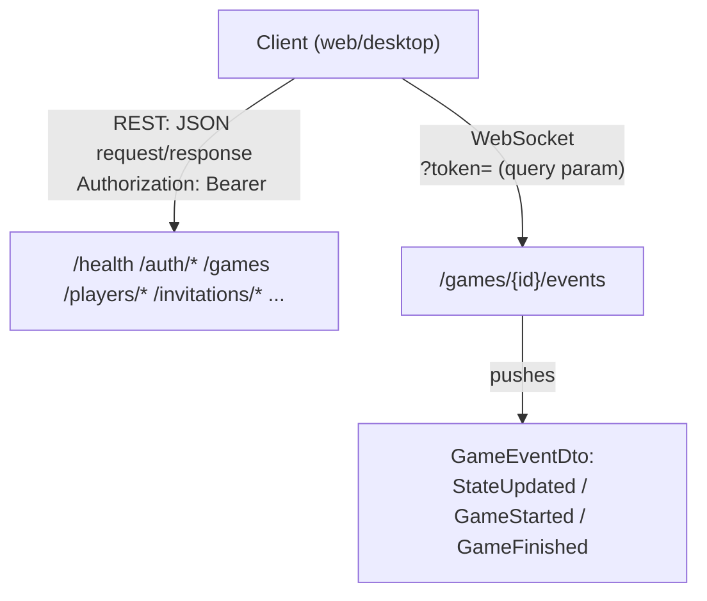
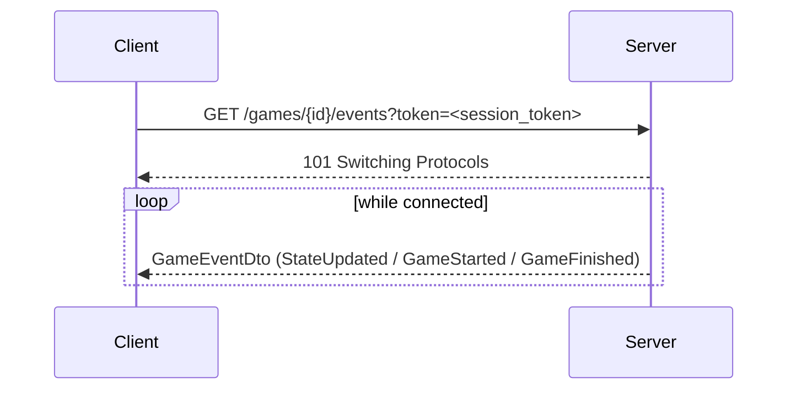
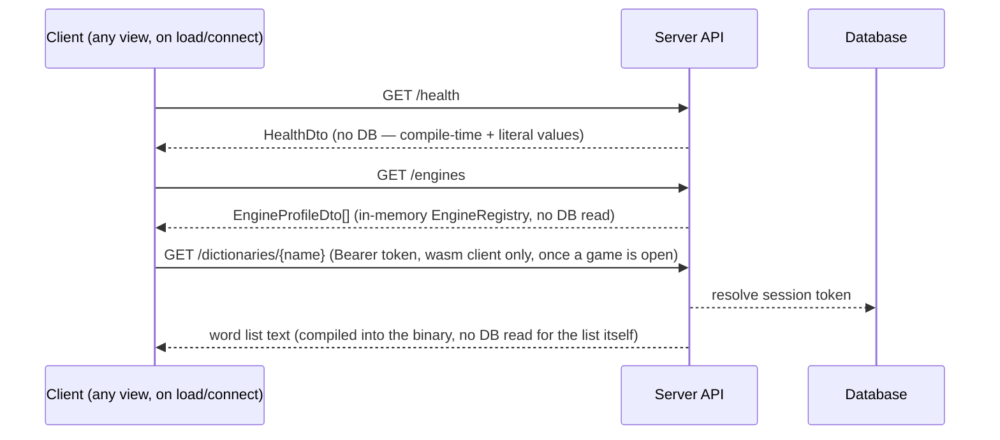
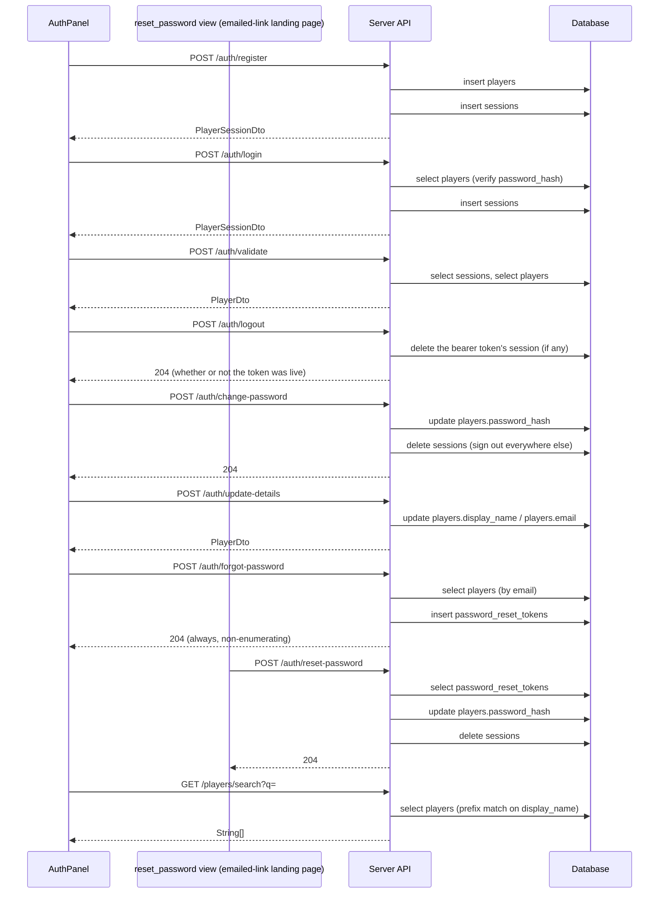
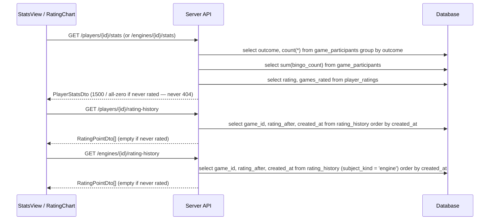
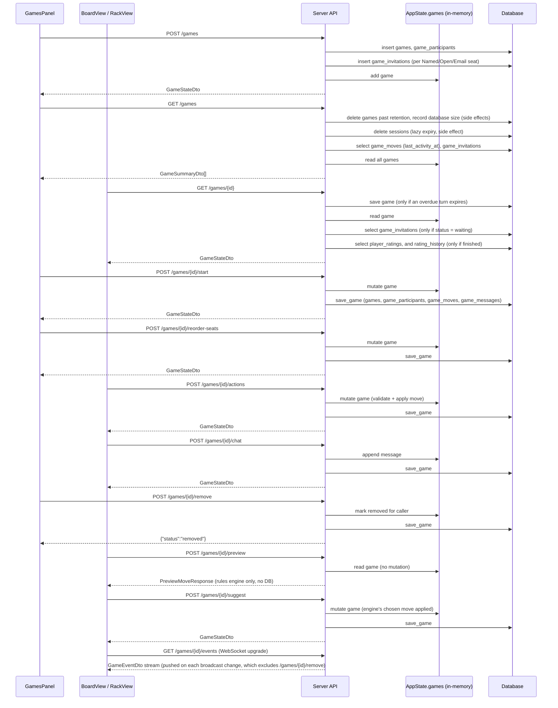
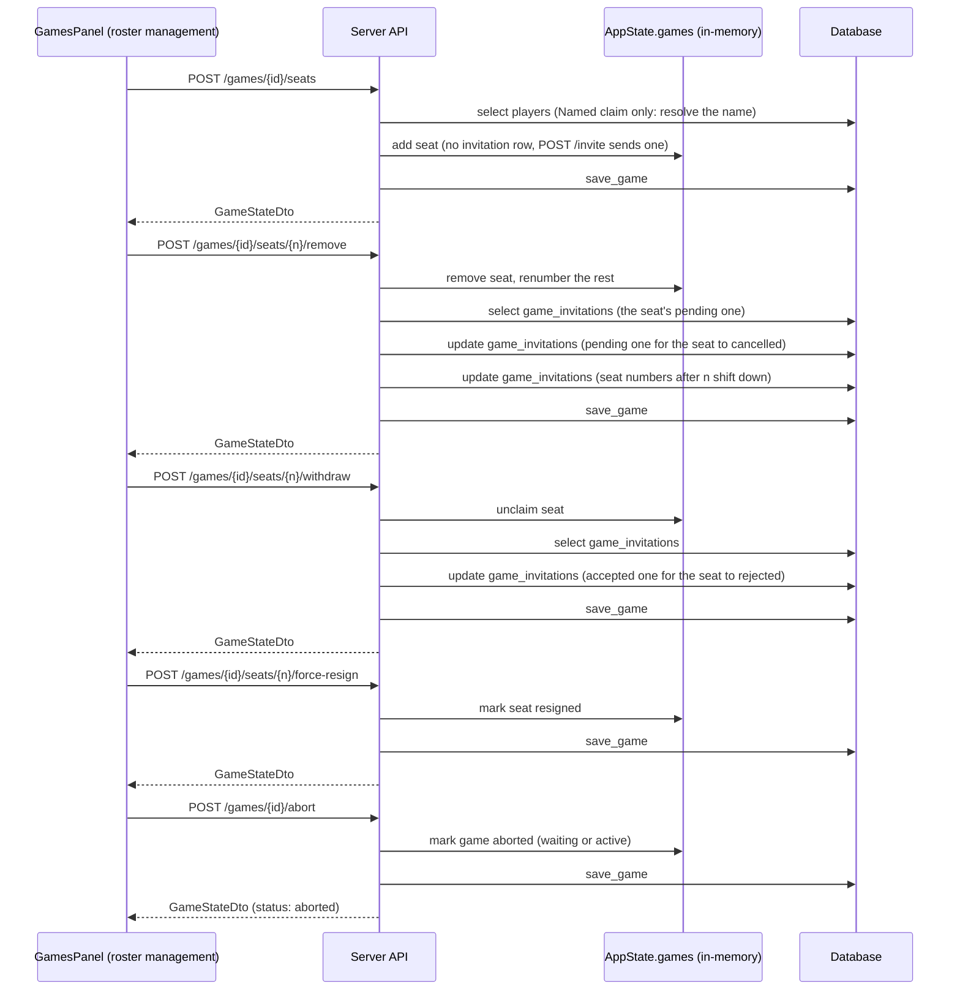
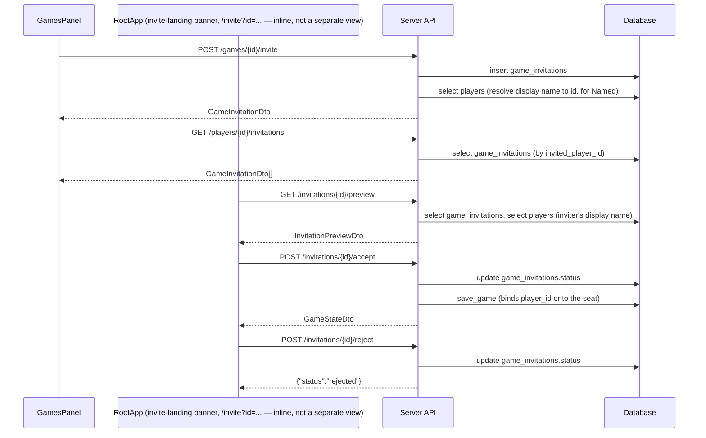
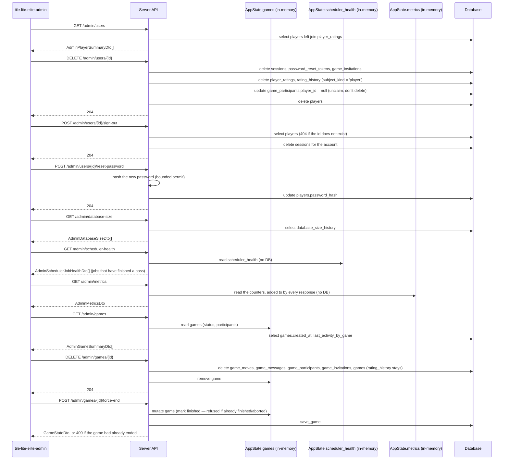

# API Schema

*Verified against the code at `b5f582e` (app 0.10.1, 2026-10-24): every route and method compared with the router, the Auth column re-derived from the handlers, the DTO field lists compared with the `api` crate, and the error messages by `check-api-errors.py`. To see what has changed since, `git log b5f582e..HEAD -- crates/`; for this document's own history, `git log --follow -- <this file>`.*

Every HTTP endpoint and wire type `server-game` exposes, as of `api::API_VERSION` `2.18` — generated by reading `crates/api/src/lib.rs` (every DTO) and `crates/server-game/src/app.rs`'s route table directly, not maintained by hand from memory. If this ever drifts from the code, the code wins — re-derive this doc from those two files rather than trusting stale prose here.

This is the flat, structural reference (every route, every field). For narrative walkthroughs of specific flows (register → login → play, the forgot-password round trip), see [4.2.6 Authentication and Invitations - Quick Start Examples](4.2.6-authentication-examples.md) — that doc and this one deliberately overlap on the auth endpoints at different altitudes: this one is "what's the shape," that one is "here's a worked example."

## Protocol Overview

Two protocols, one origin: ordinary REST (JSON over HTTP) for everything except live game updates, which use one WebSocket endpoint. In production/preview both are served by Caddy from the same origin as the static web client — see [4.3.4 Production Environment & Operations](4.3.4-production-environment.md#container-topology).

**Authentication**: a bearer token (`PlayerSessionDto.session_token`, issued by
`/auth/register` or `/auth/login`) sent as `Authorization: Bearer <token>` on
REST calls. Every route has an access level, in the Auth column of
[Endpoints](#endpoints) with what each level answers; see also
[4.2.5 Authentication](4.2.5-authentication.md). The WebSocket endpoint takes
the token only from a `?token=` query parameter.

**Errors**: every failure returns an RFC 9457 Problem Details body,
`Content-Type: application/problem+json`, whatever refused it: a handler, the
framework before a handler runs, a panic, or the WebSocket endpoint before its
upgrade. The body is `ApiError`: `status`, `title`, `detail` (the sentence for
the person), `error_type` (`business`, `technical` or `unexpected`, the error
scheme's *type*), `blip`, `reason` (the code from the [Reasons](#reasons)
table), `domain` (`tile-lite-elite`), `outcome` (`fatal`) and `correlation_id`.
`message` carries the same sentence as `detail`, kept for a client that
predates them; a client reads `detail` and falls back to `message`. A client
decides what to do from `reason`, then `error_type` and `blip`, then `status`,
and never pattern-matches the sentence. Two answers add members:
`blocking_games` on the admin delete-user refusal, and `violations` (`field`,
`value`, `limit`, `reason`) on a chat message that is too long and a move time
limit out of range. See `ApiError` in
[Meta / versioning DTOs](#meta--versioning-dtos).

**`x-request-id`** is on every response, and is the body's `correlation_id`
where there is a body: twelve Crockford base32 characters from 60 random bits,
made by the server for each request. A caller's own `x-request-id` is dropped,
never echoed, so a request cannot choose the identifier in the log. The web
client says `It has been logged; quote reference <id> if you report it.` on a
`500` only, which is the one answer a person reports.

A request the framework rejects before the handler runs answers one of
`MALFORMED_REQUEST`, `UNSUPPORTED_MEDIA_TYPE`, `INVALID_BODY`, `BODY_TOO_LARGE`,
`NO_SUCH_ROUTE` or `METHOD_NOT_ALLOWED`, in the body above and with a sentence of
ours: the framework's own words, which can echo what the caller sent, go to the
log up to the first quoted value and no further. That check runs before the
handler's sign-in check, so a caller with no session and a bad body gets one of
these, not `401`. A panic in a handler answers `INTERNAL`, and the panic's words
are logged and never sent.

In the refusal tables later in this document, a field that is *empty* was
sent as `""`, and one that is *blank* was sent as whitespace only. A required
field left out of the body gets the `422` in the status table.

### Status codes: what each one means and what a caller does

Both ends are written against this table and the [Reasons](#reasons) below it. The
server picks the status from the reason; the client decides what to do from the
reason, and never from the message. The *Type* is the error scheme's
(docs/1.10 *Errors*): a *blip* is a technical failure a later retry may clear.

| Code | HTTP text | Type | Meaning | What the caller does |
| --- | --- | --- | --- | --- |
| `400` | Bad Request | business | The request was malformed or broke a rule | Fix it. Retrying unchanged fails again |
| `401` | Unauthorized | technical, fundamental | Not signed in, or the session has expired | Sign in |
| `403` | Forbidden | business | Signed in, but not allowed to do this: someone else's game, a seat that is not yours, starting a game you did not create | Nothing. Not retryable |
| `404` | Not Found | business | No such game, player, invitation or address | Nothing. Not retryable |
| `405` | Method Not Allowed | business | The address exists and does not take this method | Fix it. Not retryable |
| `413` | Content Too Large | business | The body is over the size limit | Fix it. Not retryable |
| `415` | Unsupported Media Type | business | A body sent without `Content-Type: application/json` | Fix it. Not retryable |
| `422` | Unprocessable Entity | business | A JSON body with a required field left out, or any field of the wrong type | Fix it. Not retryable |
| `429` | Too Many Requests | technical, a blip | **You are asking too often** | Wait `Retry-After`, then retry |
| `500` | Internal Server Error | unexpected | This one request failed; the service is up | Report it with the reference. Do not loop |
| `502` | Bad Gateway | technical, a blip | Nothing is listening: mid-deploy, or the server is down | Back off and retry |
| `503` | Service Unavailable | technical, a blip | **The service is busy**: at capacity, not your fault | Wait `Retry-After`, then retry |
| `504` | Gateway Timeout | technical, a blip | Upstream took too long | Back off and retry |
| *(none)* | n/a | technical, a blip | No response at all: DNS, connection refused, timeout | Treat as `502` |

The HTTP text is the registered reason phrase for each code (RFC 9110, and RFC
6585 for `429`). It is here to make the table searchable against anything else
that talks about status codes — Caddy's logs, a browser's network tab, the
`http` crate's own constants — not because clients see it: `401` is
"Unauthorized" in the registry and means *unauthenticated*, which is the sort
of mismatch that makes the official name worth writing down beside what we
actually mean by it.

**The two that carry `Retry-After` are the two worth distinguishing.** `429`
is the caller's own doing and is fixed by slowing down. `503` is not their
fault at all — everybody together is asking for more than there is room for —
and is fixed by waiting. Answering the second with the first tells somebody to
change their behaviour when there was nothing wrong with it, and hides a
capacity problem in a log full of what look like abusive callers.

### Reasons

Every refusal has one `reason`, a variant of `api::Reason`; its status, type and
blip are one `match` in `crates/api` (`Reason::class`), so no handler picks a
status. `check-api-errors.py` fails when this table and the enum differ. A
`reason` a client does not know is read by its status.

**The layer counts, not the handler.** *Counted in* names what `GET
/admin/metrics` ([the admin DTOs](#admin-dtos-loopback-only)) adds one to for a
response with this reason: the `responses` class its status gives, the `errors`
type, and `too_many_requests` or `service_unavailable` where the status is 429
or 503. `ApiProblem::render` puts the reason in the response, so the counting
layer reads the classification and never derives it from the status; an error
with no reason is counted in `errors.unclassified`, which is zero while every
error leaves through `render`. A caught panic is also counted in
`panics_caught`, and a refused request to the events route in
`websocket_handshake_failures`. `check-api-errors.py` fails when a row's
*Counted in* is not what its status and type give.

| Reason | Status | Type | Blip | What the caller does | What is logged | Counted in |
| --- | --- | --- | --- | --- | --- | --- |
| `SIGN_IN_REQUIRED` | **401** | technical | no | Sign in | `request refused` at `warn`, with the `request_id` | `client_error`, `technical` |
| `SESSION_EXPIRED` | **401** | technical | no | Sign in again | `request refused` at `warn`, with the `request_id` | `client_error`, `technical` |
| `SIGN_IN_FAILED` | **400** | business | no | Fix it. Retrying unchanged fails again | `request refused` at `info`, with the `request_id` | `client_error`, `business` |
| `REGISTRATION_INCOMPLETE` | **400** | business | no | Fix it. Retrying unchanged fails again | `request refused` at `info`, with the `request_id` | `client_error`, `business` |
| `DISPLAY_NAME_TAKEN` | **400** | business | no | Fix it. Retrying unchanged fails again | `request refused` at `info`, with the `request_id` | `client_error`, `business` |
| `DISPLAY_NAME_BLANK` | **400** | business | no | Fix it. Retrying unchanged fails again | `request refused` at `info`, with the `request_id` | `client_error`, `business` |
| `EMAIL_BLANK` | **400** | business | no | Fix it. Retrying unchanged fails again | `request refused` at `info`, with the `request_id` | `client_error`, `business` |
| `EMAIL_REQUIRED` | **400** | business | no | Fix it. Retrying unchanged fails again | `request refused` at `info`, with the `request_id` | `client_error`, `business` |
| `NEW_PASSWORD_REQUIRED` | **400** | business | no | Fix it. Retrying unchanged fails again | `request refused` at `info`, with the `request_id` | `client_error`, `business` |
| `CURRENT_PASSWORD_WRONG` | **400** | business | no | Fix it. Retrying unchanged fails again | `request refused` at `info`, with the `request_id` | `client_error`, `business` |
| `NOTHING_TO_UPDATE` | **400** | business | no | Fix it. Retrying unchanged fails again | `request refused` at `info`, with the `request_id` | `client_error`, `business` |
| `RESET_LINK_INVALID` | **400** | business | no | Fix it. Retrying unchanged fails again | `request refused` at `info`, with the `request_id` | `client_error`, `business` |
| `NOT_GAME_CREATOR` | **403** | business | no | Nothing. Not retryable | `request refused` at `info`, with the `request_id` | `client_error`, `business` |
| `NOT_YOUR_SEAT` | **403** | business | no | Nothing. Not retryable | `request refused` at `info`, with the `request_id` | `client_error`, `business` |
| `NOT_SEATED` | **403** | business | no | Nothing. Not retryable | `request refused` at `info`, with the `request_id` | `client_error`, `business` |
| `NOT_IN_GAME` | **403** | business | no | Nothing. Not retryable | `request refused` at `info`, with the `request_id` | `client_error`, `business` |
| `NOT_YOUR_INVITATION` | **403** | business | no | Nothing. Not retryable | `request refused` at `info`, with the `request_id` | `client_error`, `business` |
| `NOT_YOUR_INVITATIONS` | **403** | business | no | Nothing. Not retryable | `request refused` at `info`, with the `request_id` | `client_error`, `business` |
| `ADMIN_LOOPBACK_ONLY` | **403** | business | no | Run the admin CLI on the server itself | `request refused` at `info`, with the `request_id` | `client_error`, `business` |
| `GAME_NOT_FOUND` | **404** | business | no | Nothing. Not retryable | `request refused` at `info`, with the `request_id` | `client_error`, `business` |
| `PLAYER_NOT_FOUND` | **404** | business | no | Nothing. Not retryable | `request refused` at `info`, with the `request_id` | `client_error`, `business` |
| `INVITATION_NOT_FOUND` | **404** | business | no | Nothing. Not retryable | `request refused` at `info`, with the `request_id` | `client_error`, `business` |
| `DICTIONARY_NOT_FOUND` | **404** | business | no | Nothing. Not retryable | `request refused` at `info`, with the `request_id` | `client_error`, `business` |
| `UNKNOWN_VARIANT` | **400** | business | no | Fix it. Retrying unchanged fails again | `request refused` at `info`, with the `request_id` | `client_error`, `business` |
| `TOO_FEW_SEATS` | **400** | business | no | Fix it. Retrying unchanged fails again | `request refused` at `info`, with the `request_id` | `client_error`, `business` |
| `SEAT_CLAIM_MISSING` | **400** | business | no | Fix it. Retrying unchanged fails again | `request refused` at `info`, with the `request_id` | `client_error`, `business` |
| `CREATOR_CLAIM_MISUSED` | **400** | business | no | Fix it. Retrying unchanged fails again | `request refused` at `info`, with the `request_id` | `client_error`, `business` |
| `MOVE_TIME_LIMIT_OUT_OF_RANGE` | **400** | business | no | Fix it. Retrying unchanged fails again | `request refused` at `info`, with the `request_id` | `client_error`, `business` |
| `SEATS_NOT_FILLED` | **400** | business | no | Fix it. Retrying unchanged fails again | `request refused` at `info`, with the `request_id` | `client_error`, `business` |
| `GAME_NOT_WAITING` | **400** | business | no | Fix it. Retrying unchanged fails again | `request refused` at `info`, with the `request_id` | `client_error`, `business` |
| `GAME_NOT_ACTIVE` | **400** | business | no | Fix it. Retrying unchanged fails again | `request refused` at `info`, with the `request_id` | `client_error`, `business` |
| `GAME_ALREADY_ENDED` | **400** | business | no | Fix it. Retrying unchanged fails again | `request refused` at `info`, with the `request_id` | `client_error`, `business` |
| `GAME_NOT_OVER` | **400** | business | no | Fix it. Retrying unchanged fails again | `request refused` at `info`, with the `request_id` | `client_error`, `business` |
| `NOT_PARTICIPANT` | **400** | business | no | Fix it. Retrying unchanged fails again | `request refused` at `info`, with the `request_id` | `client_error`, `business` |
| `UNKNOWN_SEAT` | **400** | business | no | Fix it. Retrying unchanged fails again | `request refused` at `info`, with the `request_id` | `client_error`, `business` |
| `SEAT_NOT_CLAIMED` | **400** | business | no | Fix it. Retrying unchanged fails again | `request refused` at `info`, with the `request_id` | `client_error`, `business` |
| `CREATOR_SEAT_PROTECTED` | **400** | business | no | Fix it. Retrying unchanged fails again | `request refused` at `info`, with the `request_id` | `client_error`, `business` |
| `SEAT_ALREADY_RESIGNED` | **400** | business | no | Fix it. Retrying unchanged fails again | `request refused` at `info`, with the `request_id` | `client_error`, `business` |
| `NOT_YOUR_TURN` | **400** | business | no | Fix it. Retrying unchanged fails again | `request refused` at `info`, with the `request_id` | `client_error`, `business` |
| `MOVE_REFUSED` | **400** | business | no | Fix it. Retrying unchanged fails again | `request refused` at `info`, with the `request_id` | `client_error`, `business` |
| `CHAT_EMPTY` | **400** | business | no | Fix it. Retrying unchanged fails again | `request refused` at `info`, with the `request_id` | `client_error`, `business` |
| `CHAT_TOO_LONG` | **400** | business | no | Fix it. Retrying unchanged fails again | `request refused` at `info`, with the `request_id` | `client_error`, `business` |
| `ENGINE_FAILED` | **500** | unexpected | no | Report it with the reference. Do not loop | `request refused` at `error`, with the `request_id` | `server_error`, `unexpected` |
| `NO_SEAT_TO_SUGGEST_FOR` | **400** | business | no | Fix it. Retrying unchanged fails again | `request refused` at `info`, with the `request_id` | `client_error`, `business` |
| `INVITATION_TARGET_AMBIGUOUS` | **400** | business | no | Fix it. Retrying unchanged fails again | `request refused` at `info`, with the `request_id` | `client_error`, `business` |
| `SEAT_NOT_INVITABLE` | **400** | business | no | Fix it. Retrying unchanged fails again | `request refused` at `info`, with the `request_id` | `client_error`, `business` |
| `SEAT_INVITATION_PENDING` | **400** | business | no | Fix it. Retrying unchanged fails again | `request refused` at `info`, with the `request_id` | `client_error`, `business` |
| `INVITATION_UNAVAILABLE` | **400** | business | no | Fix it. Retrying unchanged fails again | `request refused` at `info`, with the `request_id` | `client_error`, `business` |
| `INVITATION_ALREADY_ANSWERED` | **400** | business | no | Fix it. Retrying unchanged fails again | `request refused` at `info`, with the `request_id` | `client_error`, `business` |
| `ACCOUNT_HAS_GAMES` | **400** | business | no | Fix it. Retrying unchanged fails again | `request refused` at `info`, with the `request_id` | `client_error`, `business` |
| `ACCOUNT_SIGNED_IN` | **400** | business | no | Fix it. Retrying unchanged fails again | `request refused` at `info`, with the `request_id` | `client_error`, `business` |
| `UNKNOWN_STATUS_FILTER` | **400** | business | no | Fix it. Retrying unchanged fails again | `request refused` at `info`, with the `request_id` | `client_error`, `business` |
| `MALFORMED_REQUEST` | **400** | business | no | Fix it. Retrying unchanged fails again | `request refused` at `info`, with the `request_id` | `client_error`, `business` |
| `NO_SUCH_ROUTE` | **404** | business | no | Nothing. Not retryable | `request refused` at `info`, with the `request_id` | `client_error`, `business` |
| `METHOD_NOT_ALLOWED` | **405** | business | no | Fix it. Retrying unchanged fails again | `request refused` at `info`, with the `request_id` | `client_error`, `business` |
| `BODY_TOO_LARGE` | **413** | business | no | Fix it. Retrying unchanged fails again | `request refused` at `info`, with the `request_id` | `client_error`, `business` |
| `UNSUPPORTED_MEDIA_TYPE` | **415** | business | no | Fix it. Retrying unchanged fails again | `request refused` at `info`, with the `request_id` | `client_error`, `business` |
| `INVALID_BODY` | **422** | business | no | Fix it. Retrying unchanged fails again | `request refused` at `info`, with the `request_id` | `client_error`, `business` |
| `TOO_MANY_REQUESTS` | **429** | technical | yes | Wait `Retry-After`, then retry | `request refused` at `warn`, with the `request_id` | `client_error`, `technical`, `too_many_requests` |
| `SERVICE_BUSY` | **503** | technical | yes | Wait `Retry-After`, then retry | `request refused` at `warn`, with the `request_id` | `server_error`, `technical`, `service_unavailable` |
| `INTERNAL` | **500** | unexpected | no | Report it with the reference. Do not loop | `request refused` at `error`, with the `request_id` | `server_error`, `unexpected` |
| `UNKNOWN` | **500** | unexpected | no | Never sent: a client's name for a reason it does not know, read by its status | nothing: a client's word only | `server_error`, `unexpected` |

**What the framework's refusals say**, each with our sentence and never its own:

| | |
| --- | --- |
| `The request could not be read. Check it and try again.` | `MALFORMED_REQUEST` **400**. Malformed JSON, or a required query parameter left out |
| `There is nothing at that address.` | `NO_SUCH_ROUTE` **404** |
| `That address does not accept this kind of request.` | `METHOD_NOT_ALLOWED` **405** |
| `The request body is too large.` | `BODY_TOO_LARGE` **413** |
| `The request body must be sent as application/json.` | `UNSUPPORTED_MEDIA_TYPE` **415** |
| `The request body is missing a field or has a field of the wrong type.` | `INVALID_BODY` **422** |
| `Something went wrong on the server. It has been logged.` | `INTERNAL` **500**. Also what a panic answers |

An `INTERNAL` body says exactly `Something went wrong on the server. It has been logged.`
and nothing else: the cause is in the log under the `request_id`. A `business`
refusal logs at `info`, a `technical` one at `warn` and an `unexpected` one at
`error`, as the error scheme sets the levels.

### `x-build-id`

On **every** response, carrying the build the server was compiled from — the
same id `/health`'s `app_version` appends after the `+`.

A header rather than a field on one endpoint, because it belongs to any
response rather than to a question anybody asks. That is the point: a client
learns the server has moved from traffic it was sending anyway, instead of
polling something on a timer for an event that happens a few times a week.

**Absent on a build with no id** — a local `cargo run`. Silence is the honest
answer where a constant would be indistinguishable from "the server is running
your build".

**It is a trigger, not an authority.** It describes the *server*, while the
client bundle is served by a different container. Inside a deploy window the
server is already new while the old bundle is still being served, so a client
that reloaded on this header alone would fetch the old bundle, see the header
again, and loop. The web client uses it only to start a check against
`/version.txt`, which is served alongside the bundle and so knows what is
actually being served, and reloads only when *that* differs.

### `Retry-After`

Sent on **`429`** and on the **`503`** the service generates itself — a rate
limit, the hashing pool being full or a busy database. Not on `502` or `504`,
which come from Caddy when the server is not answering and carry nothing.

**Always an integer number of seconds**, never the HTTP-date form the standard
also permits. It is the earliest point worth trying again, not a promise that
trying then will succeed.

A client should:

- **wait at least that long**, and say so — "try again in 30 seconds" is the
  one thing a refused caller can act on
- **agree the plural with the number** — 1 second, 2 seconds. "In 1 seconds"
  reads as unfinished, and `0` is said as "now" rather than "in 0 seconds",
  a wait of none not being a wait
- **ignore a value it cannot parse**, and fall back to its own backoff. A proxy
  may rewrite the header, and a future server may send a date. **A wrong wait is
  worse than none**, because somebody will believe it

`refusal_message` in the web client implements exactly that, with tests for the
date form and the empty value.

**Where the number comes from.** It is not configured. For a rate limit it is
the time until one permit replenishes — derived from the limit itself, so
changing a limit changes the hint with it — **rounded up**, then given a random
**0 to 2 seconds** on top.

| refused by | permit every | `Retry-After` |
| --- | --- | --- |
| registration, 2/min | 30s | up to **33** |
| logins and resets, 10/min | 6s | up to **9** |
| authenticated, 240/min | 250ms | **1 to 3** |
| global floor, 1200/min | 50ms | **1 to 3** |
| the hashing pool being full | — | **1 to 3** |
| a busy or locked database, a pool timeout or a closed pool | — | **2**, fixed |

**Rounded up, because obeying it exactly has to work.** The underlying wait is
a countdown from the moment of refusal, so it is almost never a whole number of
seconds, and truncating it produced a value that was always slightly too early
— a client that waited precisely as long as it was told was refused again,
every time. Both adjustments here are upward for the same reason: waiting a
little too long costs a moment, waiting a little too short costs a round trip.

**Jittered, so a crowd does not return as a crowd.** The three keyed limits
stagger themselves, each caller's allowance refreshing from its own last
request. The global floor does not — it is one allowance for the whole service,
so every caller it refuses computes the same wait and would otherwise come back
at the same instant, into a service already short of room. Rounding up without
jitter would sharpen that, by turning a spread of truncated values into a
uniform one.

**So the number is not repeatable**, and nothing should treat it as a constant
of the limit. It is the earliest sensible retry for this refusal, not a
property of the tier.

**The two fast tiers say a small number** because their true wait is under a
second, and whole seconds is the unit the header has. That is not a loss: a
caller refused by those has to wait a moment, and a moment is what they are
told. The hint carries real information exactly where waiting is worth doing —
a registration refusal genuinely means half a minute.

**`502`, `503`, `504` and no-response are one family to a client**: the
service is not there just now, so back off and retry. The client's
`backend_is_unreachable` is exactly this test, and it is what drives the
offline state and the reconnect loop. A `500` is deliberately outside it — the
service answered, this one request failed, and dropping a working session into
a reconnect loop over that would be worse than the bug.

Which codes come from where: `429` from the three keyed rate-limit tiers,
`503` from the global floor, from the hashing semaphore and from a database
failure (see
[What a database failure returns](#what-a-database-failure-returns-from-any-endpoint)),
`502` and `504` from Caddy when the server is not answering.
[4.4.1 Rate Limits](4.4.1-configuration.md#rate-limits) has the limits
themselves.

**`/admin/*`**: loopback-only (rejected for any peer outside `127.0.0.0/8` and `::1`, regardless of `Authorization`), outside the player-facing auth model. See [4.3.4 Production Environment & Operations](4.3.4-production-environment.md#admin-cli).

### What a database failure returns, from any endpoint

A database failure answers in one of two ways, separate from the refusals
documented per endpoint, except in four cases. A failure while looking up the
session token answers as if there were no session; a failure while claiming the
invitation in `POST /invitations/{id}/accept` answers `404` or `400`;
`POST /auth/logout` answers `204`; and a call whose side effect fails, such as a
sweep or a `last_seen_at` update, logs or discards the failure and answers as it
would have without it.
**The driver's own text never reaches the caller**: `sqlx` renders table names,
column names, constraint kinds and fragments of SQL.

| | |
| --- | --- |
| `The service is busy just now. Please try again in a moment.` | `SERVICE_BUSY` **503**. The connection pool timed out or is closed, or the database is busy or locked. Load rather than fault, and it carries `Retry-After` |
| `Something went wrong on the server. It has been logged.` | `INTERNAL` **500**. Anything else, which is a bug or corruption. The same sentence answers a panic in a handler and every other unexpected failure |

**The detail is logged, not returned.** A 503 logs at `warn` and a 500 at
`error`, each with the underlying `sqlx` error and the request's
`request_id`, which is also the body's `correlation_id`. A caller who reports a
500 quotes that reference, and the report is matched to its log line by it.

**A uniqueness collision answers `400 That User ID is already taken`.**
`POST /auth/register` and `POST /auth/update-details` check the name before
writing it, and a write that loses a race with another gets the same answer as
if the check had caught it.

## Endpoints

**The Auth column is the route's access level**, declared where the route is
registered (`crates/server-game/src/app/routes.rs`) and checked by the server's
tests against this table, so a route and its row cannot differ. The checks
themselves are made in the handlers.

| Level | Who may call | Otherwise |
|---|---|---|
| `Public` | anyone; no session is required | never `401` |
| `Session` | any signed-in player | `401` |
| `Owner` | the player the path's `{player_id}` names | `401` without a session, `403` for another player |
| `Game` | a player seated in the game, or its creator; a call may narrow it, such as to the seat or the turn | `401` without a session, `403` for anyone else |
| `Creator` | the game's creator only; a game with no recorded creator lets any seated player through, and any signed-in player while no seat is claimed (`caller_may_manage_game`) | `401` without a session, `403` for anyone else, a seated player included |
| `Loopback` | the operator, on the host: `/admin/*`, not bearer-based | `403` from anywhere else |

`POST /auth/logout` is `Public`: it deletes the session of the token it is
given, if there is one, and answers `204` either way. `POST /auth/validate` is
`Session`, and takes its token from the body rather than a header.

### Meta endpoints

| Method | Path | Auth | Request | Response |
|---|---|---|---|---|
| GET | `/health` | Public | — | `HealthDto` |
| GET | `/engines` | Public | — | `Vec<EngineProfileDto>` |
| GET | `/dictionaries/{name}` | Session | — | `text/plain` word list (`sowpods`/`enable2k`/`german`/`spanish`) |

**The limiter answers before the handler**, so it can be returned by any endpoint rather than by a particular one.

| | |
| --- | --- |
| `You are asking too often — please slow down.` | `TOO_MANY_REQUESTS` **429**, with `Retry-After`. The limit for this route's tier; [4.4.1 Rate Limits](4.4.1-configuration.md#rate-limits) says what each tier is keyed by |
| `The server is busy — please try again.` | `SERVICE_BUSY` **503**, with `Retry-After`. The global floor |
| `rate limiting failed: …` | **500**. The limiter itself failed rather than refusing, and the text after the colon is its own error |

`Retry-After` is always present on a 429: see [Retry-After](#retry-after) for
why a caller should read it rather than guess.

**`/health` and `/admin/*` sit outside every limiter**, so `/health` refuses
nothing and answers while everything else is refusing. **`/engines`** takes no
input and needs no account, but sits behind the session and global limiters, so
it can return the limiter's 429 and 503.

**`GET /dictionaries/{name}`**

| | |
| --- | --- |
| `Sign in to fetch a dictionary` | `SIGN_IN_REQUIRED` **401**. No bearer token |

An unknown `{name}` is `DICTIONARY_NOT_FOUND` **404** from the handler, `Unknown dictionary '<name>'` — the four names are a closed set and a fifth is not a request the service understands. It is checked after sign-in, so a caller with no session meets the `401` first.

`/dictionaries/{name}` is the only Meta endpoint requiring sign-in, and not
because a word list is sensitive. It is the one place the server *redistributes*
its word lists rather than merely using them, and SOWPODS is Collins-derived
with no recoverable provenance (see [ATTRIBUTIONS.md](../ATTRIBUTIONS.md)). Only
the wasm client ever calls it; native builds compile every dictionary in.

### Auth endpoints

**`display_name` is both a label and the unique key**, and the UI calls it
something else on purpose (D48, #333). A player logs in with it, is found by it
when somebody invites them by name, and is shown by it in the roster and chat —
three roles, two of which are identifier work.

| where | what it is called |
| --- | --- |
| login and registration | **`User ID`** — a credential, and the word carries *unique* and *type it exactly* |
| the invitation flow | **`Player`** — you are naming somebody to play against, and within the game a person is a player |
| roster, chat, participants | nothing. The value is shown on its own |
| the API, the DTOs, the `players` column | **`display_name`**, unchanged |

**Every message a player reads follows the same split**: `Incorrect User ID or password` and `That User ID is
already taken` on the credential side; `Player to invite`, `a player or an
email` and `No player named '<x>'` on the person side.

**The mismatch with the data's name is deliberate.** Renaming the column means a migration and renaming the field is a breaking API
change, both paid for clarity that only the *form* delivers. The moment to
rename the data is when there are genuinely two things to name — if a display
name is ever split from the handle, which is what RFC 8266 assumes and this
schema does not have.

| Method | Path | Auth | Request | Response |
|---|---|---|---|---|
| POST | `/auth/register` | Public | `RegisterPlayerRequest` | `PlayerSessionDto` |
| POST | `/auth/login` | Public | `LoginPlayerRequest` | `PlayerSessionDto` |
| POST | `/auth/validate` | Session | `ValidateSessionRequest` | `PlayerDto` |
| POST | `/auth/logout` | Public | — | `204 No Content` (deletes the bearer token's session) |
| POST | `/auth/change-password` | Session | `ChangePasswordRequest` | `204 No Content` |
| POST | `/auth/update-details` | Session | `UpdatePlayerDetailsRequest` | `PlayerDto` |
| POST | `/auth/forgot-password` | Public | `RequestPasswordResetRequest` | `204 No Content` (always, non-enumerating) |
| POST | `/auth/reset-password` | Public | `ResetPasswordRequest` | `204 No Content` |
| GET | `/players/search?q=` | Session | — | `Vec<String>` (at most 8 display names, prefix match, sorted by name) |

#### What each Auth call refuses, and why

*Every message in these tables is the exact string the caller receives. The web client renders it verbatim, so these are on a player's screen — which is why they are part of the interface rather than an implementation detail.*

**`POST /auth/register`** — creates an account and returns a session, so the caller is signed in on success.

| | |
| --- | --- |
| `User ID, email, and password are all required` | `REGISTRATION_INCOMPLETE` **400**. Any of the three empty, or the User ID or email blank |
| `That User ID is already taken` | `DISPLAY_NAME_TAKEN` **400**. The folded name already exists. Folding is NFC + lowercase today, so `José` and `JOSÉ` are one name |

**`POST /auth/login`** — and it is the reason this document needs behaviour and not only shapes.

| | |
| --- | --- |
| `Incorrect User ID or password` | `SIGN_IN_FAILED` **400**. **both** a wrong password and an account that does not exist |

**One message for two conditions**, and the same time for both: [4.2.5](4.2.5-authentication.md#players-and-sessions) has how and why.

**`POST /auth/validate`** — exchanges a session token for the player it belongs to.

| | |
| --- | --- |
| `Session is invalid or has expired` | `SESSION_EXPIRED` **401**. No such token, or it has aged out |

**`POST /auth/logout`** — deletes the bearer token's session. Refuses nothing: `204` whether or not the token was live, so signing out twice is not an error.

**`POST /auth/change-password`**

| | |
| --- | --- |
| `Sign in to change your password` | `SIGN_IN_REQUIRED` **401**. No bearer token. A token that names no session answers `Session is invalid or has expired` |
| `Session is invalid or has expired` | `SESSION_EXPIRED` **401**. A session whose player has been deleted |
| `A new password is required` | `NEW_PASSWORD_REQUIRED` **400**. The new password is empty |
| `Current password is incorrect` | `CURRENT_PASSWORD_WRONG` **400**. The current password does not verify |

**`POST /auth/update-details`** — changes display name, email, or both.

| | |
| --- | --- |
| `Sign in to update your details` | `SIGN_IN_REQUIRED` **401**. No bearer token. A token that names no session answers `Session is invalid or has expired` |
| `Session is invalid or has expired` | `SESSION_EXPIRED` **401**. A session whose player has been deleted |
| `Nothing to update` | `NOTHING_TO_UPDATE` **400**. Both fields left out or null (each is optional; one left out or null keeps its value) |
| `User ID cannot be blank` · `Email cannot be blank` | `DISPLAY_NAME_BLANK` · `EMAIL_BLANK` **400**. Empty or blank |
| `That User ID is already taken` | `DISPLAY_NAME_TAKEN` **400**. The new name collides, folded |

**`POST /auth/forgot-password`**

| | |
| --- | --- |
| `An email address is required` | `EMAIL_REQUIRED` **400**. The field is empty or blank |

**It answers `204` whether or not the address is known.** That is the point: a different answer for a known address makes this an oracle for which emails have accounts. `An email address is required` fires only on a malformed request, never on an unknown address.

**`POST /auth/reset-password`**

| | |
| --- | --- |
| `A new password is required` | `NEW_PASSWORD_REQUIRED` **400**. Empty |
| `This reset link is invalid or has expired` | `RESET_LINK_INVALID` **400**. No such token, already used or aged out. One message for all three |

**`GET /players/search?q=`**

| | |
| --- | --- |
| `Sign in to search players` | `SIGN_IN_REQUIRED` **401**. No bearer token |

**An unknown prefix returns an empty list.** *Nobody matched* and *you may not ask* are different answers, which is what lets the invite field say `No player named '<x>'` without guessing.

#### Two failures any password call can return

`register`, `login`, `change-password`, `reset-password` and the admin
`reset-password` all hash or verify through a bounded permit, because Argon2 is
deliberately expensive and unbounded concurrency is a denial-of-service
surface.

| | |
| --- | --- |
| `The server is busy — please try again.` | `SERVICE_BUSY` **503**, with `Retry-After`. Every permit is in use. A caller should retry after the header says |
| `Something went wrong on the server. It has been logged.` | `INTERNAL` **500**. The permit could not be acquired at all, or the hashing task failed, or the hash could not be computed. The cause is logged, with the `request_id`, and none of the library's own text is returned |

The 503 is answered by waiting; the 500 is reported and not retried. The
caller's action differs, which is the test
[Status codes](#status-codes-what-each-one-means-and-what-a-caller-does)
applies.

### Rating & stats endpoints

A *rating subject* is a player *or* an engine. Both are rated and tracked
identically, so each route in the table exists in a `/players/{id}/…` and an
`/engines/{id}/…` form over the same handler shape. These are `Session`
routes, as are `GET /games`, `GET /players/search`,
`GET /dictionaries/{name}` and `GET /players/{id}/invitations`.

A subject that has never been rated, and an id that does not exist, give the
same answer: stats with rating `1500` and every counter `0`, history as an empty
list. A client can render a brand-new player's stats page without special-casing
"no rows yet". These routes read across accounts, so distinguishing the two
would say which ids exist.

| Method | Path | Auth | Request | Response |
|---|---|---|---|---|
| GET | `/players/{player_id}/stats` | Session | — | `PlayerStatsDto` |
| GET | `/players/{player_id}/rating-history` | Session | — | `Vec<RatingPointDto>` (oldest first) |
| GET | `/engines/{engine_id}/stats` | Session | — | `PlayerStatsDto` (with `subject_kind: engine`) |
| GET | `/engines/{engine_id}/rating-history` | Session | — | `Vec<RatingPointDto>` (oldest first) |

**All four refuse only a missing bearer token.**

| | |
| --- | --- |
| `Sign in to view stats` | `SIGN_IN_REQUIRED` **401**. The two `/stats` calls, without a bearer token |
| `Sign in to view rating history` | `SIGN_IN_REQUIRED` **401**. The two `/rating-history` calls, without one |

### Games endpoints

| Method | Path | Auth | Request | Response |
|---|---|---|---|---|
| POST | `/games` | Session | `CreateGameRequest` | `GameStateDto` |
| GET | `/games` | Session | — | `Vec<GameSummaryDto>` |
| GET | `/games/{id}` | Game | — | `GameStateDto` |
| POST | `/games/{id}/start` | Creator | `StartGameRequest` (empty) | `GameStateDto` |
| POST | `/games/{id}/reorder-seats` | Creator | `SwapSeatsRequest` | `GameStateDto` |
| POST | `/games/{id}/actions` | Game | `GameActionRequest` | `GameStateDto` |
| POST | `/games/{id}/chat` | Game | `PostChatMessageRequest` | `GameStateDto` |
| POST | `/games/{id}/remove` | Game | — | `{"status":"removed"}` |
| POST | `/games/{id}/preview` | Game | `PreviewMoveRequest` | `PreviewMoveResponse` |
| POST | `/games/{id}/suggest` | Game | — | `GameStateDto` (engine's suggested move applied) |
| GET | `/games/{id}/events` | Game (query `?token=`) | — | WebSocket upgrade → `GameEventDto` stream |

#### What each Games call refuses, and why

**Three refusals recur across the group:**

| | |
| --- | --- |
| `Game not found` | `GAME_NOT_FOUND` **404**. No game has that id. A game the caller removed from their own list is still found: removal only filters `GET /games` |
| `Sign in to <do the thing>` | `SIGN_IN_REQUIRED` **401**. No bearer token; the verb differs per call. A token that names no session, whether unknown, expired or idle, answers `SESSION_EXPIRED` **401** with `Session is invalid or has expired` |
| `You are not part of this game` | `NOT_IN_GAME` **403** on `GET /games/{id}`, `suggest` and `remove`. The caller is signed in but neither holds a seat nor created the game. A creator without a seat of their own is allowed |

**`POST /games`** — creates a game and its seats in one call.

| | |
| --- | --- |
| `Sign in to create a game` | `SIGN_IN_REQUIRED` **401**. No bearer token |
| `A game needs at least two seats` | `TOO_FEW_SEATS` **400**. Fewer than two supplied |
| `Every human seat needs a claim: creator, named, or open` | `SEAT_CLAIM_MISSING` **400**. A human seat with no claim |
| `Only one seat can be claimed by the creator` | `CREATOR_CLAIM_MISUSED` **400**. Two seats both claimed `creator` |
| `No player named '<x>'` | `PLAYER_NOT_FOUND` **404**. A `named` claim whose player does not exist, checked for every seat before anything is created |
| `Unknown game variant '<x>'` | `UNKNOWN_VARIANT` **400**. Not a bundled edition name. An edition that has been retired is refused too |
| `move_time_limit_seconds must be between 3600 and 3456000 seconds (got <n>)` | `MOVE_TIME_LIMIT_OUT_OF_RANGE` **400**. Rejected rather than clamped |

The game's `creator_player_id` is the caller, whatever claims the seats carry; the `creator` claim only decides which seat the creator sits in.

**`GET /games`** — the caller's own list.

| | |
| --- | --- |
| `Sign in to see your games` | `SIGN_IN_REQUIRED` **401**. No bearer token |

**`GET /games/{id}`** — `Game` level. Only the game's participants and its creator
may read it.

| | |
| --- | --- |
| `Sign in to view this game` | `SIGN_IN_REQUIRED` **401**. The caller has no session |
| `You are not part of this game` | `NOT_IN_GAME` **403**, as in [What each Games call refuses](#what-each-games-call-refuses-and-why) |

**`POST /games/{id}/start`**

| | |
| --- | --- |
| `Sign in to start a game` | `SIGN_IN_REQUIRED` **401**. No bearer token |
| `Only the game's creator can start it` | `NOT_GAME_CREATOR` **403**. Checked before the state of the game |
| `A game needs at least two seats` | `TOO_FEW_SEATS` **400**. Seats were removed after creation |
| `Every seat must be filled before the game can start` | `SEATS_NOT_FILLED` **400**. An open or invited seat is still unclaimed |
| `Something went wrong on the server. It has been logged.` | `ENGINE_FAILED` **500**. An engine seat's turn failed: no engine id, an engine the registry does not know, one that does not support the variant, or one that panicked. These are defects, so the caller is told only the one 500 sentence and the cause (the engine's id, the join error) goes to the log under the `request_id`. The call that ran the turn answers it: `start` when an engine moves first, and `actions` and `suggest` when one moves after the caller. A seat created with no `engine_id`, or one the registry does not know, is accepted at creation and fails here |

**`POST /games/{id}/actions`** — submit a move. The caller is signed in and holds the seat named; a seat nobody holds — an engine's, or a number the game has no seat for — is nobody's to act for.

| | |
| --- | --- |
| `Sign in to play this game` | `SIGN_IN_REQUIRED` **401**. No bearer token |
| `This seat belongs to a different player` | `NOT_YOUR_SEAT` **403**. The move names a seat this caller does not hold, or a seat that is not a player's |
| `It is not seat N's turn` | `NOT_YOUR_TURN` **400**. A play, pass or exchange for a seat that is not the one to move |
| `Game is not active` | `GAME_NOT_ACTIVE` **400**. A play, pass or exchange in a waiting, finished or aborted game |
| `<words> is/are not in the dictionary.` · `The first word must use at least two tiles.` · `Incorrect tile placement.` | `MOVE_REFUSED` **400**. A play the rules refuse, worded by the shared `format_move_error`: `is` for one word and `are` for several, joined with commas and `and`. `Incorrect tile placement.` covers every other refusal, among them tiles that are not in the rack. A play that `suggest` applies is refused the same way |
| `Not enough tiles left in bag to exchange` · `Rack does not contain exchange tiles` | `MOVE_REFUSED` **400**. An exchange the bag cannot cover, or one naming tiles the seat does not hold |
| `The game must be active to resign` | `GAME_NOT_ACTIVE` **400**. A resignation in a waiting, finished or aborted game; a resignation needs no turn |
| `Start square (x, y) is outside the WxH board` · `Offset N from (x, y) runs off the board` · `'X' is not a letter in this game's alphabet` · `A blank must say which letter it stands for` · `A move must place at least one tile` · `A move places at most N tiles, not M` | `MOVE_REFUSED` **400**. The request was not a move the board or the alphabet can address. Checked where the move enters, before any rule is applied. Each names the value that was out of range |

**`POST /games/{id}/preview`** and **`POST /games/{id}/suggest`**

| | |
| --- | --- |
| `Sign in to play this game` | `SIGN_IN_REQUIRED` **401**. Preview: no bearer token |
| `This seat belongs to a different player` | `NOT_YOUR_SEAT` **403**, as on `actions` |
| the six **400** refusals listed under `actions` | preview: the same check, made before the move is tried |
| `Sign in to ask for a suggestion` | `SIGN_IN_REQUIRED` **401**, suggest: no bearer token |
| `You are not part of this game` | `NOT_IN_GAME` **403**, suggest: as in [What each Games call refuses](#what-each-games-call-refuses-and-why), checked before the game's state |
| `Game is not active` | `GAME_NOT_ACTIVE` **400**. Suggest: the game is waiting, finished or aborted. `actions` answers it as well |
| `Current seat is not human-controlled` | `NO_SEAT_TO_SUGGEST_FOR` **400**. Suggest only. The seat to move is an engine's. A game whose current seat is not in it is a defect and answers `INTERNAL` **500**, the one 500 sentence |

**`POST /games/{id}/chat`**

| | |
| --- | --- |
| `Sign in to chat` | `SIGN_IN_REQUIRED` **401**. No bearer token |
| `Only seated players can chat in this game` | `NOT_SEATED` **403**. Watching is not taking part |
| `Chat message cannot be empty` | `CHAT_EMPTY` **400**. Nothing is left once the message is trimmed |
| `Chat message cannot exceed 1000 characters` | `CHAT_TOO_LONG` **400**. Counted in characters, after trimming |

**`POST /games/{id}/remove`** — takes the game off this caller's list; it does not delete it for anybody else.

| | |
| --- | --- |
| `Sign in to remove this game from your list` | `SIGN_IN_REQUIRED` **401**. No bearer token |
| `You are not part of this game` | `NOT_IN_GAME` **403**, as in [What each Games call refuses](#what-each-games-call-refuses-and-why) |
| `You are not a participant in this game` | `NOT_PARTICIPANT` **400**. Not reached through the API, since the `403` above answers first |

**`POST /games/{id}/reorder-seats`**

| | |
| --- | --- |
| `Sign in to reorder seats` | `SIGN_IN_REQUIRED` **401**. No bearer token |
| `Only the game's creator can reorder seats` | `NOT_GAME_CREATOR` **403** |
| `Seats can only be reordered before the game starts` | `GAME_NOT_WAITING` **400** |
| `Every seat must be filled before seats can be reordered` | `SEATS_NOT_FILLED` **400**. An unclaimed human seat is still outstanding |
| `Unknown seat` | `UNKNOWN_SEAT` **400**. Either seat number is not in this game |

**`GET /games/{id}/events`** — the WebSocket. It refuses **before the upgrade**, as an ordinary `ApiError`, with a reason for each case:

| | |
| --- | --- |
| `Game not found` | `GAME_NOT_FOUND` **404**. No game has that id |
| `Sign in and be part of this game to watch it live` | `SIGN_IN_REQUIRED` **401**. No `?token=` |
| `Session is invalid or has expired` | `SESSION_EXPIRED` **401**. A `?token=` that names no session |
| `Only a player in this game can watch it live` | `NOT_IN_GAME` **403**. Signed in, but neither seated nor the creator |

The token arrives as `?token=` because a browser cannot set a header on a WebSocket handshake. After the upgrade the server can still end the connection: see [WebSocket](#websocket-gamesidevents).

`/games/{id}/remove` hides a game from the caller's own list only — it is not broadcast, and no other player's view changes. It accepts a game whose status is `Finished` **or** `Aborted` (anything else is `GAME_NOT_OVER` **400**, "Only games that are over can be removed"); `Aborted` was added at API 2.8, having previously been offered by the games panel but rejected by the server.

### Seats & Roster endpoints (pre-start only, except force-resign and abort)

| Method | Path | Auth | Request | Response |
|---|---|---|---|---|
| POST | `/games/{id}/seats` | Creator | `CreateSeatRequest` | `GameStateDto` |
| POST | `/games/{id}/seats/{n}/remove` | Creator | — | `GameStateDto` |
| POST | `/games/{id}/seats/{n}/withdraw` | Game | — | `GameStateDto` |
| POST | `/games/{id}/seats/{n}/force-resign` | Creator | — | `GameStateDto` (mid-game only, unresponsive opponent) |
| POST | `/games/{id}/abort` | Creator | — | `GameStateDto` (creator cancels the whole game, waiting or active → `status: aborted`) |

#### What each Seats & Roster call refuses, and why

Every call here also returns `Game not found` for an unknown game, and a **401** without a bearer token whose wording names the verb rather than merely saying no:

| | |
| --- | --- |
| `Sign in to add a seat` | `SIGN_IN_REQUIRED` **401**. `POST /games/{id}/seats` |
| `Sign in to remove a seat` | `SIGN_IN_REQUIRED` **401**. `POST /games/{id}/seats/{n}/remove` |
| `Sign in to withdraw from a seat` | `SIGN_IN_REQUIRED` **401**. `POST /games/{id}/seats/{n}/withdraw` |
| `Sign in to force-resign a seat` | `SIGN_IN_REQUIRED` **401**. `POST /games/{id}/seats/{n}/force-resign` |
| `Sign in to abort a game` | `SIGN_IN_REQUIRED` **401**. `POST /games/{id}/abort` |

**`POST /games/{id}/seats`**

| | |
| --- | --- |
| `Only the game's creator can add a seat` | `NOT_GAME_CREATOR` **403** |
| `A human seat needs a claim: named, open, or email` | `SEAT_CLAIM_MISSING` **400**. A human seat with no claim, as `POST /games` refuses one |
| `Only the original creator seat may use the Creator claim` | `CREATOR_CLAIM_MISUSED` **400**. The `creator` claim is not a spare label. It belongs to the seat made when the game was |
| `No player named '<x>'` | `PLAYER_NOT_FOUND` **404**. A `named` claim whose player does not exist, as `POST /games` refuses one |
| `Seats can only be added before the game starts` | `GAME_NOT_WAITING` **400** |

A new seat sends no invitation and writes no `game_invitations` row;
`POST /games/{id}/invite` does that.

**`POST /games/{id}/seats/{n}/remove`** and **`/withdraw`** — and the pair is the point.

| | |
| --- | --- |
| `Only the game's creator can remove a seat` | `NOT_GAME_CREATOR` **403** on `remove`. The creator manages the roster |
| `Only the player holding this seat can withdraw from it` | `NOT_YOUR_SEAT` **403** on `withdraw`. You leave your own seat; you do not remove somebody else's |
| `Seats can only be removed before the game starts` | `GAME_NOT_WAITING` **400** on `remove` |
| `Unknown seat` | `UNKNOWN_SEAT` **400** on `remove`. The seat number is not in this game |
| `The creator's own seat can't be removed` | `CREATOR_SEAT_PROTECTED` **400** on `remove` |
| `A seat can only be withdrawn before the game starts` | `GAME_NOT_WAITING` **400** on `withdraw` |
| `The creator's own seat can't be withdrawn` | `CREATOR_SEAT_PROTECTED` **400** on `withdraw` |

`remove` cancels the seat's pending invitation and renumbers the invitations of the seats after it, to match the seats. `withdraw` keeps the seat and unclaims it, and sets the accepted invitation to rejected, so the creator can resend or remove it.

**`POST /games/{id}/seats/{n}/force-resign`** — the one call in this group that works mid-game.

| | |
| --- | --- |
| `Only the game's creator can force-resign a seat` | `NOT_GAME_CREATOR` **403** |
| `The game must be active to force-resign a seat` | `GAME_NOT_ACTIVE` **400**. Waiting, finished and aborted games have nobody to resign |
| `Unknown seat <n>` | `UNKNOWN_SEAT` **400** |
| `The creator's own seat can't be force-resigned` | `CREATOR_SEAT_PROTECTED` **400** |
| `That seat has already resigned` | `SEAT_ALREADY_RESIGNED` **400**. `actions` answers it too, for a seat that resigns twice |

**`POST /games/{id}/abort`**

| | |
| --- | --- |
| `Only the game's creator can abort a game` | `NOT_GAME_CREATOR` **403** |
| `The game has already ended` | `GAME_ALREADY_ENDED` **400**. Finished or aborted, so an abort cannot overwrite a real result. A waiting or an active game can be aborted |

### Invitations endpoints

| Method | Path | Auth | Request | Response |
|---|---|---|---|---|
| POST | `/games/{id}/invite` | Creator | `InvitePlayerRequest` | `GameInvitationDto` |
| GET | `/players/{player_id}/invitations` | Owner | — | `Vec<GameInvitationDto>` |
| GET | `/invitations/{id}/preview` | Public | — | `InvitationPreviewDto` (unauthenticated — the emailed join link's landing page) |
| POST | `/invitations/{id}/accept` | Session | — | `GameStateDto` |
| POST | `/invitations/{id}/reject` | Session | — | `{"status":"rejected"}` |

#### What each Invitations call refuses, and why

**`POST /games/{id}/invite`** — the richest set in the API, because a seat can be wrong in several distinct ways.

| | |
| --- | --- |
| `Sign in to invite players` | `SIGN_IN_REQUIRED` **401**. No bearer token. A token that names no session answers `Session is invalid or has expired` |
| `Session is invalid or has expired` | `SESSION_EXPIRED` **401**. A session whose player has been deleted |
| `Only the game's creator can invite players` | `NOT_GAME_CREATOR` **403**. Checked before the game's state, so a non-creator never learns it |
| `An invitation can target a player or an email, not both` | `INVITATION_TARGET_AMBIGUOUS` **400**. Both `invited_display_name` and `invited_email` were given |
| `No player named '<x>'` | `PLAYER_NOT_FOUND` **404**. The invited display name matches no account |
| `Game must be in waiting state to invite players` | `GAME_NOT_WAITING` **400**. The game has started, finished or been aborted |
| `No such seat` | `UNKNOWN_SEAT` **400**. The seat number is not in this game |
| `That seat is not open to be invited to` | `SEAT_NOT_INVITABLE` **400**. The seat exists and is already claimed, or is an engine's |
| `This seat already has a pending invitation` | `SEAT_INVITATION_PENDING` **400**. One is outstanding. Refused rather than replaced |

**`GET /players/{player_id}/invitations`** — a player's own list, so the caller is signed in and is that player. It can also answer the two database failures of
[What a database failure returns](#what-a-database-failure-returns-from-any-endpoint).

| | |
| --- | --- |
| `Sign in to see your invitations` | `SIGN_IN_REQUIRED` **401**. No bearer token |
| `You can only see your own invitations` | `NOT_YOUR_INVITATIONS` **403**. The path names a different player |

**`GET /invitations/{id}/preview`** — unauthenticated on purpose: it is the landing page an emailed join link opens, before the recipient has an account.

| | |
| --- | --- |
| `Invitation not found` | `INVITATION_NOT_FOUND` **404**, for an unknown invitation id, and the only refusal. An invitation that exists answers with its inviter's display name and its status, whether pending, accepted, rejected or cancelled |

**`POST /invitations/{id}/accept`**

| | |
| --- | --- |
| `Sign in to accept an invitation` | `SIGN_IN_REQUIRED` **401**. No bearer token. A token that names no session answers `Session is invalid or has expired` |
| `Session is invalid or has expired` | `SESSION_EXPIRED` **401**. A session whose player has been deleted |
| `Invitation not found` · `Game not found` | `GAME_NOT_FOUND` · `INVITATION_NOT_FOUND` **404**. The second means the invitation outlived its game |
| `This invitation was not sent to you` | `NOT_YOUR_INVITATION` **403**. A valid invitation, addressed to somebody else |
| `This invitation is no longer available — it may already have been claimed` | `INVITATION_UNAVAILABLE` **400**. Somebody took the seat first, or it was withdrawn. The server does not say which |

**`POST /invitations/{id}/reject`**

| | |
| --- | --- |
| `Sign in to reject an invitation` | `SIGN_IN_REQUIRED` **401**. No bearer token |
| `Invitation not found` | `INVITATION_NOT_FOUND` **404** |
| `This invitation has already been responded to` | `INVITATION_ALREADY_ANSWERED` **400**. Accepted or rejected already. Rejecting twice is refused rather than idempotent |

See [4.2.7 Seats and Invitations](4.2.7-authentication-and-invitations.md) for the Named/Open/Email seat-claim model these back.

### Admin endpoints (loopback only)

**What each refusal offers.** A refusal that names only a wait is not a remedy —
`sign-out` exists because the delete refusal had none (#295). The errors are
against the endpoints rather than in a list of their own, because what a
call refuses is part of what it does.

| Method | Path | Auth | Request | Response |
|---|---|---|---|---|
| GET | `/admin/users` | Loopback | — | `Vec<AdminPlayerSummaryDto>` (newest first) |
| DELETE | `/admin/users/{player_id}` | Loopback | — | `204 No Content`. **Refused `400`** while a game still refers to the account, or while it has a live session — the two refusals are separate and each names its own remedy |
| POST | `/admin/users/{player_id}/sign-out` | Loopback | — | `204 No Content`. Ends every session the account has, and nothing else. **`404`** for an id that does not exist — a mistyped id must not read as a successful sign-out. An account with no sessions is `204`: already signed out is the state being asked for |
| POST | `/admin/users/{player_id}/reset-password` | Loopback | `AdminResetPasswordRequest` | `204 No Content` |
| GET | `/admin/database-size` | Loopback | — | `Vec<AdminDatabaseSizeDto>`, newest day first, up to 90 days. A missing day means the service was quiet: the row is written by a sweep that only runs when somebody uses the service |
| GET | `/admin/scheduler-health` | Loopback | — | `Vec<AdminSchedulerJobHealthDto>`, one row per scheduled job that has finished a pass, sorted by job name. A job appears once its first pass finishes, so `last_completed_at` is always set |
| GET | `/admin/metrics` | Loopback | — | `AdminMetricsDto`: what the server has counted of its own symptoms, cumulative from the process's start (`started_at`, epoch seconds UTC). Reads memory, never the database, and no limiter counts it. The public address does not serve it: Caddy does not proxy `/admin/*` |
| GET | `/admin/games` | Loopback | — (query: `status` = `waiting`\|`active`\|`finished`\|`aborted`, `older_than_days`) | `Vec<AdminGameSummaryDto>` (newest first) |
| DELETE | `/admin/games/{game_id}` | Loopback | — | `204 No Content` |
| POST | `/admin/games/{game_id}/force-end` | Loopback | — | `GameStateDto`, or `400` if the game has already finished or been aborted |

#### What each Admin call refuses, and why

**`/admin/*` is guarded before any handler runs.**

| | |
| --- | --- |
| `Admin endpoints are only reachable from the server itself` | `ADMIN_LOOPBACK_ONLY` **403**. The guard is the connection's own address, not a bearer token — `docs/4.3.4`. So there is no admin credential to leak, and `tile-lite-elite-admin` reaches these by running inside the container |

**`DELETE /admin/users/{player_id}`** — two refusals, each naming its own remedy, which is why they are separate rather than one *cannot delete*. `Player not found` is **404**; the two refusals that follow are **400**.

| | |
| --- | --- |
| `That account cannot be deleted yet. The games below still refer to it. Please wait until they are gone, then delete the account. A finished or aborted game is removed automatically <period> after it ended, and an invitation goes with the game holding it. A game that has not ended stays until it does.` | `ACCOUNT_HAS_GAMES` **400**. The games are in the error's `blocking_games` field, so the operator can see what is holding the account |
| `` That account is signed in somewhere. Deleting it now would take an account that is in use, and one that is about to create the very games this command refuses to orphan. Sessions end on their own: 48 hours after they were last used, and 10 days at the outside. To act now rather than wait, sign the account out first: `tile-lite-elite-admin users sign-out <name>`. `` | `ACCOUNT_SIGNED_IN` **400**. Names the command that clears it, which is the whole of #295 |

**`POST /admin/users/{player_id}/sign-out`** and **`/reset-password`**

| | |
| --- | --- |
| `Player not found` | `PLAYER_NOT_FOUND` **404**. A mistyped id must not read as a successful sign-out |
| `A new password is required` | `NEW_PASSWORD_REQUIRED` **400**. Reset only: empty |

`reset-password` hashes the new password through the same bounded permit as the
player calls, so it can return [the two password-call failures](#two-failures-any-password-call-can-return).

**`GET /admin/games`**

| | |
| --- | --- |
| `Unknown status '<x>', expected waiting/active/finished/aborted` | `UNKNOWN_STATUS_FILTER` **400**. The `status` query value is not one of the four |

**The game calls** — `DELETE /admin/games/{id}` and `POST /admin/games/{id}/force-end` — return `Game not found` for an unknown id, and `force-end` returns **400** for a game that has already finished or been aborted.

## WebSocket: `/games/{id}/events`

One event type, three tags (`#[serde(tag = "type")]`), all three carrying the full current `GameStateDto` rather than a diff — the client always replaces its local state wholesale, never patches it. Every state-changing REST call broadcasts to every connection watching that game, so any client with the socket open sees other players' moves without polling.

**The server can end the connection after the upgrade**, with a close code from
the same scheme (`4000` plus the status where there is one):

| Code | When | What the client does |
| --- | --- | --- |
| `4404` | The game was deleted while watched | Stop. The game is gone |
| `4500` | The server failed: a receiver that fell behind the broadcast, or an event that did not serialise | Reconnect, then fetch the state |
| `1001` | The server is shutting down (it waits `SHUTDOWN_GRACE`, 500 ms, for the sockets to write this before it drains), or the broadcast closed | Reconnect with backoff |

## DTO Reference

See `crates/api/src/lib.rs` for the doc comments explaining *why* a field exists; that source is the canonical explanation, not duplicated here. `Option<T>` fields are nullable; enums use `#[serde(rename_all = "snake_case")]` unless noted.

**Source** column convention: for a *response* field, where the value comes
from at read time — a `table.column`, or "calculated" with a one-line note. For
a *request* field, what the server does with it (which table it ends up
persisted into, or how it is consumed). A recurring, load-bearing fact
throughout the game-domain tables in this section:
`GameSession`/`GameStateDto`/`GameSummaryDto`/`MoveRecordDto`/`ChatMessageDto`
are built from `games.snapshot_json`, deserialized once into memory.
`game_participants`, `game_moves` and `game_messages` are mirrors rewritten on
every save, and a response reads them back in three places only:

- `last_activity_at`, from `game_moves`;
- `PlayerStatsDto`, from `game_participants.outcome` and `bingo_count`;
- admin delete-user's `blocking_games`, from `game_messages`.

See [4.4.2 Database Schema](4.4.2-database-schema.md) for the columns those
mirror tables hold.

### Core game domain DTOs

**`GameStateDto`** — built by `GameSession::to_dto` (`game_state.rs`), then `redact_game_state` zeroes/empties a few fields per-viewer before the response leaves the server: other seats' racks, the chat, and each seat's `invited_email`, which only the game's creator sees.

| Field | Type | Source |
|---|---|---|
| `id` | `String` | `games.snapshot_json` (`PersistedGame.id`) |
| `version` | `i64` | `games.snapshot_json`: bumped on every state change, so a client discards a snapshot older than the one it shows |
| `status` | `GameStatus` | `games.snapshot_json` |
| `creator_player_id` | `Option<String>` | `games.snapshot_json` |
| `variant` | `String` | `games.snapshot_json` — a bundled edition name from `rules-shared`'s registry: `official`, `north_american`, `german`, `spanish`, `spicy`. A game created under a since-retired edition keeps its name (`wordfeud`), which no new game can use. Additive: a new edition is a new accepted value for an existing field, which is a minor API bump (`spicy` arrived at 2.6) |
| `language` | `String` | `games.snapshot_json` |
| `board_layout` | `String` | `games.snapshot_json` |
| `turn_number` | `i64` | `games.snapshot_json` |
| `current_seat` | `u8` | `games.snapshot_json` |
| `winner_seat` | `Option<u8>` | `games.snapshot_json` |
| `final_bonus_seat` | `Option<u8>` | `games.snapshot_json` |
| `final_bonus_points` | `Option<i32>` | `games.snapshot_json` |
| `bag_count` | `usize` | calculated — `bag.len()`, where `bag` is itself from `games.snapshot_json` |
| `move_time_limit_seconds` | `u64` | `games.snapshot_json` |
| `turn_started_at` | `i64` | `games.snapshot_json` |
| `participants` | `Vec<ParticipantDto>` | `games.snapshot_json` (see `ParticipantDto` for its calculated fields), **redacted** |
| `board` | `Vec<BoardCellDto>` | calculated — `board_to_dto`, from `games.snapshot_json`'s board plus the compile-time premium-square layout for `board_layout` |
| `racks` | `Vec<RackDto>` | `games.snapshot_json`, **redacted**: `redact_game_state` zeroes every seat's rack except the caller's own |
| `moves` | `Vec<MoveRecordDto>` | `games.snapshot_json` (`game_moves` table is never read for this, despite existing) |
| `messages` | `Vec<ChatMessageDto>` | `games.snapshot_json`, **redacted**: emptied entirely unless the caller holds a seat in this game |

**`GameSummaryDto`** — built by `GameSession::to_summary_dto`, called per-game from the `list_games` handler, which then overwrites `relationship`/`invitation_id` per caller.

| Field | Type | Source |
|---|---|---|
| `id`, `status`, `variant`, `current_seat` | — | `games.snapshot_json` |
| `participants` | `Vec<ParticipantDto>` | `games.snapshot_json`, with `invitation_status` forced to `None` (not meaningful in a list view), and `invited_email` redacted in `list_games` as for `GameStateDto` |
| `last_activity_at` | `i64` | calculated — `persistence::last_activity_by_game`: `max(game_moves.created_at)` for the game, falling back to `games.created_at` if no moves yet (a real read of those two tables, unlike the rest of this DTO). Once the game has a move, the time of its last save of any kind ([`game_moves.created_at`](4.4.2-database-schema.md#game_moves) is a save time) |
| `move_time_limit_seconds`, `turn_started_at` | — | `games.snapshot_json` |
| `last_message_received_at` | `Option<i64>` | calculated in `list_games`: the newest message in `games.snapshot_json` **not sent by the caller**, so a player's own message never marks a game unread |
| `relationship` | `GameRelationship` | calculated in the `list_games` handler, comparing the caller's player id against `games.snapshot_json`'s participants and `game_invitations` |
| `invitation_id` | `Option<String>` | calculated in `list_games`, from `game_invitations`, set only when `relationship` is `InvitedByName`/`InvitedOpen` |

**`ParticipantDto`**

| Field | Type | Source |
|---|---|---|
| `seat_number`, `kind`, `display_name`, `player_id`, `engine_id`, `score`, `invited_email`, `resigned` | — | `games.snapshot_json`. `invited_email` is redacted as for `GameStateDto` |
| `rating_before`, `rating_after` | `Option<f64>` | `rating_history`, for a finished and rated game |
| `current_rating` | `Option<f64>` | `player_ratings` |
| `invitation_status` | `Option<SeatInvitationStatus>` | calculated — `attach_invitation_status`, the most recent `game_invitations` row for that seat; always `None` in `GameSummaryDto`'s context, only populated for `GameStateDto` responses where a seat is unclaimed |

`GameStatus`/`SeatKind`/`GameRelationship`/`SeatInvitationStatus`/`PremiumDto` are plain enums carried inline in the DTOs, not separately sourced.

| DTO | Fields | Source |
|---|---|---|
| `BoardCellDto` | `premium: PremiumDto`, `letter: Option<String>`, `is_blank: bool` | calculated — `board_to_dto`; `premium` from the compile-time board layout, `letter`/`is_blank` from `games.snapshot_json` |
| `RackDto` | `counts: Vec<u8>`, `blanks: u8` | `games.snapshot_json`, redacted (see `GameStateDto.racks`) |
| `MoveRecordDto` | `move_number`, `seat_number`, `move_type`, `main_word`, `score_delta`, `positions`, `description`, `elapsed_us` (move time in µs, `null` if not captured) | `games.snapshot_json` (`game_moves.payload_json` holds the same shape on disk, but is never read back — see the note at the top of this section) |
| `PositionDto` | `x: u8`, `y: u8` | part of `MoveRecordDto`/`MoveCandidateDto`, same source as its parent |

### Move & preview DTOs

No database involvement at all — legality/scoring is computed live by the rules engine against the in-memory `GameSession`, and a preview is never persisted.

| DTO | Fields | Source |
|---|---|---|
| `GameActionRequest` | `seat_number`, `action: PlayerActionDto` | request only — `action` is applied to the in-memory `GameSession`, then persisted into `games.snapshot_json` (and its mirror tables) by the `save_game` call at the end of the request |
| `PlayerActionDto` | `Place`\|`Pass`\|`Exchange`\|`Resign` | request only |
| `MoveCandidateDto` / `TilePlacementDto` / `TileDto` / `DirectionDto` | — | request only |
| `PreviewMoveRequest` | `seat_number`, `candidate: MoveCandidateDto` | request only, never persisted |
| `PreviewMoveResponse` | `is_legal`, `headline`, `detail`, `score` | calculated — live rules-engine evaluation against current in-memory state; not read from or written to the database |

### Game/seat creation DTOs

| DTO | Fields | Source |
|---|---|---|
| `CreateGameRequest` | `seats`, `seed`, `variant`, `language`, `board_layout`, `move_time_limit_seconds` | request only — becomes the initial `games.snapshot_json` on creation |
| `CreateSeatRequest` | `kind`, `display_name`, `engine_id`, `claim: Option<SeatClaim>` | request only — `claim` is consumed immediately. On `POST /games`, `Creator` binds the creator's `player_id` onto that seat (`creator_player_id` itself is set from the caller whatever the claims), and `Named`/`Open`/`Email` each create a `game_invitations` row. On `POST /games/{id}/seats`, `Creator` is refused, `Named` takes the player's own spelling of the name, `Email` is kept on the seat as `invited_email`, and no `game_invitations` row is written |
| `SeatClaim` | `Creator`\|`Named`\|`Open`\|`Email` | request only, see `CreateSeatRequest` |
| `StartGameRequest` | *(empty)* | request only, no fields |
| `SwapSeatsRequest` | `seat_a: u8`, `seat_b: u8` | request only — reorders `games.snapshot_json`'s participant list |

### Chat DTOs

| DTO | Fields | Source |
|---|---|---|
| `PostChatMessageRequest` | `body: String` | request only — appended into `games.snapshot_json`'s `messages` list, mirrored into `game_messages` on save |
| `ChatMessageDto` | `id`, `player_id`, `display_name`, `body`, `created_at` | `games.snapshot_json` (the `game_messages` mirror is read back only as the [Source convention](#dto-reference) says) |

### Authentication DTOs

| DTO | Fields | Source |
|---|---|---|
| `RegisterPlayerRequest` | `display_name`, `email`, `password`, `stay_logged_in` | request only — `display_name`/`email` inserted into `players`, `password` argon2-hashed into `players.password_hash`, `stay_logged_in` stored on the new session as `sessions.stay_logged_in`, a record of the client's choice; it does not affect expiry, which is the same for every session (see [4.4.2](4.4.2-database-schema.md)'s `sessions`) |
| `LoginPlayerRequest` | `display_name`, `password`, `stay_logged_in` | request only — `display_name`/`password` checked against `players`, `stay_logged_in` same as in `RegisterPlayerRequest` |
| `PlayerSessionDto` | `player_id` | `players.id` |
| | `session_token` | calculated — a fresh UUID v4, returned once; only its sha256 (`sessions.token_hash`) is ever persisted |
| | `display_name`, `email` | `players.display_name`, `players.email` |
| `ValidateSessionRequest` | `session_token` | request only — hashed and looked up against `sessions.token_hash` |
| `ChangePasswordRequest` | `current_password`, `new_password` | request only — `current_password` checked, `new_password` argon2-hashed into `players.password_hash` |
| `UpdatePlayerDetailsRequest` | `display_name`, `email` | request only — persisted into `players.display_name`/`players.email` (only the `Some` one(s)) |
| `RequestPasswordResetRequest` | `email` | request only — looked up against `players.email`; always `204` regardless of match (non-enumerating) |
| `ResetPasswordRequest` | `token`, `new_password` | request only — `token` hashed and matched against `password_reset_tokens.token_hash`, `new_password` hashed into `players.password_hash` |
| `PlayerDto` | `id`, `display_name`, `email`, `created_at` | `players.id`/`players.display_name`/`players.email`/`players.created_at` |
| | `last_seen_at` | `players.last_seen_at` — when the account was last used, in unix seconds; see [4.4.2 Database Schema](4.4.2-database-schema.md)'s note on that column |

### Invitation DTOs

| DTO | Fields | Source |
|---|---|---|
| `InvitePlayerRequest` | `invited_display_name`, `invited_email`, `seat_number` | request only — creates a `game_invitations` row |
| `GameInvitationDto` | `id`, `game_id`, `invited_player_id`, `inviting_player_id`, `seat_number`, `status`, `created_at`, `responded_at` | `game_invitations`, 1:1 by column name |
| | `inviting_player_display_name` | calculated — looked up from `players.display_name` for `inviting_player_id` at request time, not stored on `game_invitations` itself |
| `InvitationStatus` | `Pending`\|`Accepted`\|`Rejected`\|`Cancelled` | `game_invitations.status` |
| `InvitationPreviewDto` | `inviting_player_display_name`, `status` | same as `GameInvitationDto` — this is the unauthenticated subset shown on the emailed join link's landing page |

### Meta / versioning DTOs

| DTO | Fields | Source |
|---|---|---|
| `HealthDto` | `status` | calculated — the literal string `"ok"` |
| | `api_version` | compile-time constant, `api::API_VERSION` |
| | `app_version` | compile-time — `Cargo.toml`'s `version` plus `TILE_LITE_ELITE_BUILD_ID` if set at build time (see [4.4.1 Configuration](4.4.1-configuration.md#versioning)) |
| | `schema_version` | `_sqlx_migrations` — the highest migration applied to this server's database, read once at startup. `Option<i64>`, `#[serde(default)]`, so a client that predates API 2.7 simply ignores it. Exists for `scripts/deliver/deploy.sh`, which compares it against the target commit's migrations and refuses to ship an image the database has already moved past |
| `ApiVersion` | `major`, `minor` | compile-time constant, part of `HealthDto`/version-check responses |
| `ApiError` | `detail`, `message` | calculated: the sentence for whatever failed, never sourced from the database, the framework or a panic. `message` is the same sentence, kept for a client from before 2.17 |
| | `status`, `title`, `outcome`, `domain` | the status and its reason phrase, always `fatal`, always `tile-lite-elite` |
| | `error_type`, `blip`, `reason` | from the one `Reason::class` match in `crates/api`: [Reasons](#reasons) |
| | `violations` | `field`, `value`, `limit`, `reason` for a chat message too long and a move time limit out of range; omitted when empty |
| | `correlation_id` | the request's `x-request-id`, omitted outside a request |
| | `blocking_games` | `Vec<AdminGameSummaryDto>`, omitted when empty — the games standing in the way of an admin delete-user, built from in-memory `state.games` |
| `EngineProfileDto` | `id`, `name`, `version`, `author`, `description` | **in-memory `EngineRegistry`**, not the database — `GET /engines` reads `state.engines.metadata()` directly. `engine_profiles` is written to (upserted once per server startup) but never read back; it exists for potential future querying, not current use |
| | `supports_timed_play`, `supports_analysis`, `supports_ranking` | same — in-memory `EngineRegistry` (mirrored into `engine_profiles.capabilities_json` on write, but that mirror is never read) |

### Admin DTOs (loopback only)

| DTO | Fields | Source |
|---|---|---|
| `AdminGameSummaryDto` | `id`, `status`, `participants` | in-memory `state.games` (itself from `games.snapshot_json`) |
| | `created_at` | calculated — `persistence::created_at_by_game`, a real `select id, created_at from games` (unlike the player-facing DTOs, admin listing does read this column back) |
| | `last_activity_at` | calculated — `persistence::last_activity_by_game`, same query as `GameSummaryDto.last_activity_at` |
| `AdminDatabaseSizeDto` | `recorded_on`, `recorded_at`, `players`, `sessions`, `games`, `invitations`, `chat_messages`, `database_bytes`, `games_in_memory` | `database_size_history`, read back by `persistence::list_database_size_history` |
| `AdminSchedulerJobHealthDto` | `job`, `last_completed_at: Option<i64>`, `errored_last_pass: u64` | in-memory `state.scheduler_health`, written by each pass of a scheduled job |
| `AdminMetricsDto` | `started_at`, `too_many_requests`, `service_unavailable`, `panics_caught`, `websocket_handshake_failures`, `responses`, `errors`, `latency` | in-memory `state.metrics`, atomics the counting layer adds to on every response; read by `admin_metrics`, never the database |
| | `started_at: i64` | calculated: epoch seconds UTC when `AppState` was made |
| | `too_many_requests`, `service_unavailable` | read from the response's status, so every 503 is counted whatever built it |
| | `panics_caught` | the `PanicCaught` marker `panic_response` puts on the 500 it builds |
| | `websocket_handshake_failures` | a 4xx or 5xx whose matched path is `EVENTS_PATH` |
| `AdminResponseCountsDto` | `informational`, `success`, `redirection`, `client_error`, `server_error` | the class of each response's status (`informational` is a WebSocket's 101); a request is in exactly one |
| `AdminErrorTypeCountsDto` | `business`, `technical`, `unexpected` | the `error_type` of the `Reason` that `ApiProblem::render` puts in the response; an error is in exactly one, so `client_error + server_error` equals their sum |
| | `unclassified` | an error response that carried no reason: a defect in the layering, zero while every error leaves through `render` |
| `AdminLatencyDto` | `bounds_ms` | `LATENCY_BOUNDS_MS` ([4.4.1](4.4.1-configuration.md#server-timings-held-in-code)): upper bounds in milliseconds, inclusive and ascending |
| | `counts` | time to each response's head, one bucket per bound and one longer for requests slower than every bound; the counts sum to the `responses` |
| `AdminPlayerSummaryDto` | `id`, `display_name`, `email`, `created_at`, `last_seen_at` | `players` — the same columns `PlayerDto` carries |
| | `rating`, `games_rated` | `player_ratings`, **left**-joined in `persistence::list_player_summaries`. `rating` is `null` for a subject with no row (never finished a rated game), deliberately *not* the `1500` that `PlayerStatsDto` reports — an operator listing needs "has this account ever played" to be visible, and the left join is what keeps those accounts in the list at all |
| `AdminResetPasswordRequest` | `new_password` | request only — argon2-hashed into `players.password_hash`, bypassing the normal `current_password` check (loopback-only access is the authorization instead) |

### Rating & stats DTOs

| DTO | Fields | Source |
|---|---|---|
| `RatingSubjectKind` | `player`\|`engine` | calculated — which of the two `/…/stats` routes was called |
| `PlayerStatsDto` | `subject_kind`, `subject_id` | echoed back from the route's path parameter |
| | `rating`, `games_rated` | `player_ratings`, falling back to `1500`/`0` when there's no row — this DTO never 404s for an unrated subject |
| | `wins`, `losses`, `ties`, `timeouts`, `resignations` | calculated — `select outcome, count(*) … group by outcome` over `game_participants.outcome`, which `persistence::compute_participant_outcomes` sets once a game finishes |
| | `bingo_count` | calculated — `sum(game_participants.bingo_count)` across every game this subject has played |
| `RatingPointDto` | `game_id`, `rating_after`, `created_at` | `rating_history`, ordered by `created_at` — one row per game that actually moved this subject's rating, so a skipped-for-rating ending (timeout, force-resign, abort, admin force-end) contributes no point |

See [4.4.1 Configuration](4.4.1-configuration.md#versioning) for how `ApiVersion` is checked client-side and when to bump it.

## Sequence Diagrams: Every Endpoint, With Context

One diagram per group from [Endpoints](#endpoints), each showing the UI side that actually calls it (`crates/ui/src/components/`/`views/`), the server handler, and which table(s) it reads from or writes to — matching the **Source** columns in [DTO Reference](#dto-reference). Where a call is served entirely from the in-memory `AppState.games` map rather than a real query, the diagram says so explicitly rather than drawing an arrow to a table that is not touched.

### Meta sequences

### Authentication sequences

### Rating & stats sequences

`StatsView` (`crates/ui/src/views/stats.rs`) fetches both halves for whichever subject is being viewed; `RatingChart` (`crates/ui/src/components/rating_chart.rs`) plots the history series. Neither endpoint reads the in-memory games map — a rated result is settled into these tables once, when the game finishes, and every later read is pure SQL.

### Games sequences

### Seats & Roster sequences

### Invitations sequences

### Admin sequences (loopback only — no UI, `tile-lite-elite-admin` CLI)

